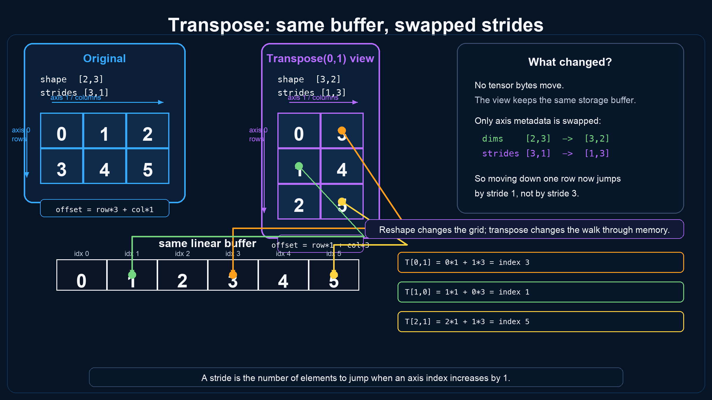

# Model Formats and Tensor Storage

These notes adapt material imported from DotDiffusion to Marmotte's F# codebase.
The format documents describe existing behavior or explicitly identify proposed
work. Illustrations are conceptual aids, not executable format specifications.

## Reading Guide

| Document | Purpose | Marmotte status |
| --- | --- | --- |
| [GGUF](gguf.md) | Binary layout and current parser contracts | Metadata and tensor index implemented |
| [Safetensors](safetensors.md) | JSON header, packed data, and next implementation steps | Planned; no reader yet |
| Storage and strides below | Concepts for future tensor access and execution | No tensor storage or view API yet |

`Marmotte.Core` currently contains shared helpers. `Marmotte.Cli` exposes the
[`info` command](../README.md#command-line) for inspecting a local GGUF file.
The GGUF library returns an index; it does not expose mapped tensors or run
inference. Future storage types should follow actual consumers rather than being
inferred from these pictures.

## Keep the Format Conventions Separate

| Concern | GGUF in Marmotte | Safetensors |
| --- | --- | --- |
| Prefix | 24-byte fixed header, including magic and version | 8-byte little-endian JSON length |
| Metadata | Typed binary values, including arrays | String-to-string `__metadata__` map |
| Tensor descriptions | Binary descriptors after metadata | Objects within the JSON header |
| Numeric payload order | Little-endian; big-endian supported for v3 | Little-endian |
| Dimension order | Contiguous dimension first | Contiguous dimension last (C order) |
| Tensor positions | Relative to the aligned data section | `[BEGIN, END)` relative to the data buffer |
| Spacing between payloads | Alignment padding allowed | Complete buffer coverage; no holes |
| Encoding identifiers | Numeric tensor tags and separate file profiles | Dtype strings |

Neither format stores arbitrary runtime strides. Preserve the original shape
convention in each reader. Make any conversion to a future common runtime
representation explicit and tested; do not mistake axis reordering for moving
the underlying bytes.

## Storage, Ownership, and Views

The [storage illustration](tensor-storage-modes.png) introduces useful concepts,
but its four columns are not mutually exclusive storage kinds:

- **Owned / borrowed** describe who controls a resource's lifetime.
- **Memory-mapped** describes how bytes are backed; a mapping can be owned or borrowed.
- **Sliced view** describes access to shared storage, which may itself be owned,
  borrowed, or mapped.
- **Read-only / writable** describes access permissions. It is independent of
  ownership: borrowed storage is not necessarily writable, and mappings are not
  inherently read-only. Read-only mappings are the intended choice for model inspection.

The diagram's allocation and copy columns are simplifications. A mapping avoids
an eager copy of all weights into a managed array, but still uses virtual memory,
resident pages, and bookkeeping. A view may allocate its descriptor without
copying its payload. An owner may adopt or copy a buffer, and managed arrays do
not require manual disposal in the way a file mapping does.

A future API must keep a view's underlying resource alive for the view's entire
lifetime, define who disposes mappings, and prevent access after disposal. The
current `GgufFile` owns metadata and descriptors only, not the original file.

## Strides, Reshape, and Transpose

The following examples use **element strides**, C-order shapes, and ordinary
fixed-width scalar elements. These are runtime concepts; they do not add stride
fields to either serialized format.

For the linear buffer `[0; 1; 2; 3; 4; 5]`:

| View | Shape | Element strides | Logical rows |
| --- | --- | --- | --- |
| Original matrix | `[2; 3]` | `[3; 1]` | `[0; 1; 2]`, `[3; 4; 5]` |
| Contiguous reshape | `[3; 2]` | `[2; 1]` | `[0; 1]`, `[2; 3]`, `[4; 5]` |
| Transposed view | `[3; 2]` | `[1; 3]` | `[0; 3]`, `[1; 4]`, `[2; 5]` |

```text
element_index = storage_element_offset + sum(index[i] * element_stride[i])
byte_position = storage_byte_start + element_index * bytes_per_element
```

For the transpose, `T[0,1]` addresses element 3, `T[1,0]` addresses element 1,
and `T[2,1]` addresses element 5. A transpose can therefore be a view over the
same bytes. A backend requiring contiguous data may still need a copy.



The reshape shown here works without copying because its source is contiguous.
Do not generalize that to every strided reshape. Serializing a transposed view
to Safetensors requires its logical values to be packed in C order.

For the original matrix above, a GGUF descriptor uses dimensions `[3; 2]`.
That describes the same contiguous matrix; it does not mean the matrix has
been transposed. Also, GGUF quantization blocks contain packed values and block
metadata, so the scalar byte-address formula is not sufficient to decode them.

## Imported Illustration Review

The original PNGs are preserved. Read them with these corrections:

| Illustration | Review |
| --- | --- |
| [GGUF parser map](gguf-format.png) | The layout is useful. Its little-endian note omits v3 big-endian support; its bitwise alignment requires powers of two. Lazy slices are future work, and unknown tensor tags are preserved with limited validation. |
| [Safetensors overview](safetensors-format.png) | The top overview omits the separate length prefix and mislabels sizes. Field names in the pseudocode contain typos; the sample header length and hex dump disagree with its JSON. Use the checked example in [safetensors.md](safetensors.md#worked-example). The dtype list is only a subset. |
| [Storage modes](tensor-storage-modes.png) | Useful vocabulary, but ownership, backing storage, views, and writability are independent concerns. “No allocation” and “no copy” are not unconditional guarantees. |
| [Tensor strides](tensor-strides.png) | Shapes and stride values in the three examples are correct. The axis-2 legend is inappropriate for these rank-2 examples, and several colored arrows do not map to the claimed buffer elements. Use the table above and the transpose illustration instead. |
| [Transpose strides](tensor-transpose-strides.png) | Its three index calculations are correct when strides and storage offsets are measured in elements. The example illustrates a possible runtime view, not an implemented Marmotte operation. |

## Sources and Local Contracts

- [Marmotte GGUF types](../src/Marmotte.Gguf/Types.fs)
- [Marmotte GGUF reader](../src/Marmotte.Gguf/Gguf.fs)
- [GGUF specification](https://github.com/ggml-org/ggml/blob/master/docs/gguf.md)
- [Safetensors format](https://github.com/huggingface/safetensors#format)
