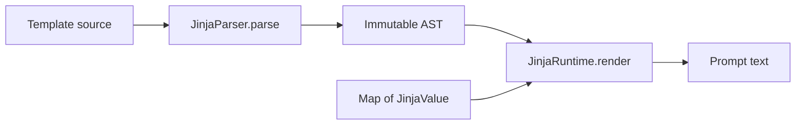

# D.4: render a conversation into prompt text

Learn to render the supported Jinja subset with explicit data, then use the
`tokenizer.chat_template` stored in a GGUF file. You need the .NET 10 SDK. The
runnable example uses invented messages and markers, so it needs no model:

```sh
dotnet fsi examples/ParserCombinatorSample.fsx
```

It prints the syntax tree, a rendered conversation, another rendering with a
changed context, and this compact prompt:

```text
<bos>[user]Hello!<eos>[assistant]
```

## 1. Keep raw prompts unchanged

A raw prompt bypasses template parsing and rendering:

```fsharp
open Marmotte.Core

let raw = ChatPrompt.render None Map.empty (ChatPrompt.Raw "Complete this sentence: ")
// Ok "Complete this sentence: "
```

No template, separators or boundary tokens are required for this path. Even a
raw string containing `{{ ... }}` remains ordinary text. The raw path also
bypasses runtime output limits because it returns the original string.

## 2. Supply data to a parsed template

`JinjaValue` represents strings, signed 64-bit integers, booleans, `None`, lists
and objects. An object is an immutable `Map<string, JinjaValue>`, not a reflected
.NET object. Context values never execute or become new template source.

```fsharp
let context = Map.ofList [ "name", JinjaValue.String "Ada" ]

let rendered =
    JinjaParser.parse "Hello {{ name }}!"
    |> Result.map (JinjaRuntime.render context)
// Ok (Ok "Hello Ada!")
```

Parsing and rendering have separate error types; keeping both results visible
here shows the two stages. Parse once and retain the AST when rendering the
same template repeatedly. Each render owns its buffers and budgets, so an AST
and immutable context can be reused concurrently.



## 3. Format messages and an optional assistant prefix

For conversations, the helper constructs `messages` and
`add_generation_prompt`, overriding any context entries with those names:

```fsharp
let template =
    "[{{ message.role }}]{{ message.content }};[assistant]"

let messages = [ { Role = "user"; Content = "Hello!" } ]
let prompt = ChatPrompt.Conversation (messages, true)
let rendered = ChatPrompt.render (Some template) Map.empty prompt
// Ok "[user]Hello!;[assistant]"
```

The role is a string to allow template-specific roles. This API supports
text-only content, with no tool schemas, attachments or multimodal data. The
helper does not enforce role alternation, invent a default template or append
an assistant marker itself. Only the template decides how the flag affects text.

To supply additional values, pass them in the context. Missing variables or
members produce `JinjaRuntimeError.MissingVariable`, including in conditions.
This strict policy makes incomplete configuration visible. An unselected branch
or a short-circuited operand does not access its missing variables.

## 4. Render the template from GGUF metadata

With a model already indexed by `Gguf.readFile`:

```fsharp
open Marmotte.Gguf

let loaded = GgufTokenizer.read model.Metadata
let rendered = loaded.RenderPrompt(ChatPrompt.Conversation (messages, true))
let raw = loaded.RenderPrompt(ChatPrompt.Raw "A raw prompt")
```

`GgufTokenizer.read` stores the exact optional `tokenizer.chat_template` string
as `ChatTemplate`. A present non-string or null string raises
`InvalidDataException`. Template parsing is deferred until conversation rendering,
so unsupported template syntax does not prevent raw-text use of the tokenizer.
Named template collections are not selected or inferred.

`RenderPrompt` adds `bos_token` and `eos_token` only when their configured IDs
exist, using the vocabulary spellings verbatim. The BOS/EOS insertion flags do
not insert text or duplicate markers. Missing IDs stay absent; a template that
requires them fails explicitly. No weights are read.

The result distinguishes `MissingTemplate`, `Syntax` (with the parser position)
and `Runtime` errors. Runtime errors do not have source spans because the AST
does not store them. Failures never publish partial rendered text. Null public
arguments and message fields are programming errors and raise
`ArgumentNullException`; nested .NET nulls are not valid runtime data.

## 5. Keep rendering separate from tokenization

D.4 produces **text**, not token IDs. `EncodeText` continues to treat every
special-token spelling as ordinary text. Passing a rendered prompt containing
`<bos>` to it does not insert a BOS ID. The caller must assemble explicit
`TokenizerSegment.SpecialToken` entries and pre-tokenized `TextPiece` entries
when producing model input, choosing one owner for boundary insertion.
Automatic conversion of rendered markers to special IDs is not implemented.
This distinction also prevents silently treating marker-like message content
as control tokens. There is no inference pipeline or CLI chat command yet.

## Runtime contract and limits

The [parser tutorial](jinja-parser-sample.md) lists the accepted grammar.
Runtime rules for that grammar are:

| Operation | Behavior |
| --- | --- |
| Truthiness | False for `None`, false, zero, and empty string/list/object; true otherwise |
| `and`, `or` | Short-circuit and return an operand value; `not` returns a boolean |
| Equality | Structural lists/objects; ordinal strings; booleans equal numeric 0/1; unlike types unequal |
| Ordering | Numbers/booleans with one another, or ordinal UTF-16 strings; other pairs fail |
| Membership | List value equality, object string keys, or ordinal string substring |
| Chained comparisons | Evaluate each operand once and stop at the first false comparison |
| Output | Strings verbatim, invariant decimal integers, `True`, `False`, `None`; containers fail |
| Loops | Lists only; a fresh local scope per iteration, restored after the loop |
| `loop` | `index`, `index0`, `length`, `first`, `last`; the innermost loop shadows the outer one |

The loop variable name `loop` is reserved and rejected by evaluation. Contexts
are immutable. No assignments, method calls, HTML escaping or automatic
whitespace trimming occur. Literal whitespace, including the final newline,
is preserved. UTF-16 string ordering is deliberate and differs from Unicode
code-point ordering for some supplementary characters.

`JinjaRuntime.renderWithLimits` accepts positive `JinjaRenderLimits`. Defaults
are 1,048,576 output UTF-16 code units, 100,000 evaluation steps and depth 128.
Depth cannot be raised above 128. Steps account for nodes, expressions, lookups,
comparisons and iterations, including loops with empty bodies. They are not a
wall-clock timeout or a bound on the size of caller-owned strings. Output is
checked before appending. The same limits guard caller-constructed ASTs and
nested structural comparisons. Conversations use the default runtime limits;
raw prompts return unchanged without these limits.

The grammar remains a supported subset: no filters, indexing, string
concatenation, arithmetic, `is defined`, macros, assignments, includes, loop
`else` or whitespace-control tags. Many real model templates use such features
and will be rejected; no target-model compatibility is claimed by this step.

## Verification and references

Core tests cover exact output, strict errors, short-circuiting, truthiness,
comparison chains, scopes, loop metadata, repeated/concurrent renders and resource
limits. GGUF tests use small typed metadata fixtures for template presence/type,
BOS/EOS spellings, raw fallback and unsupported syntax. No model is required.

References checked on 2026-11-08:

- [GGUF tokenizer metadata](https://github.com/ggml-org/ggml/blob/master/docs/gguf.md#other): the `tokenizer.chat_template` string key.
- [Jinja template documentation](https://jinja.palletsprojects.com/en/stable/templates/): expression, conditional and loop behavior used to define the supported subset.
- [Chat templates](https://huggingface.co/docs/transformers/chat_templating): message conventions and the distinction between formatting and special-token insertion.

Implementation and fixtures are original. The explicit restrictions above are
part of Marmotte's contract, rather than a claim of complete Jinja compatibility.
