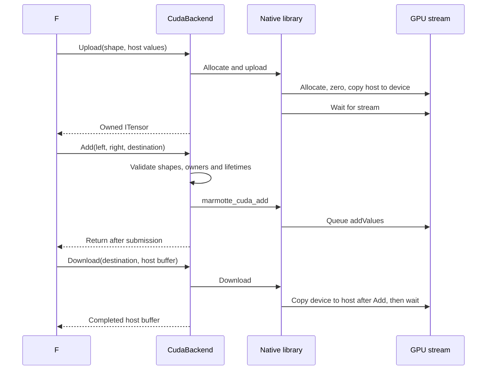

# CUDA: from the first build to an Add on the GPU

Marmotte's CUDA backend implements contiguous F32 tensors, zero-initialized
allocation, uploads, downloads, synchronization and element-wise Add. It uses
native CUDA C++ through P/Invoke, with no additional NuGet dependency. Other
kernels, weight upload and the key-value cache still throw
`NotImplementedException`.

This guide assumes familiarity with building the .NET solution, but no CUDA
experience. Commands run from the repository root. The native build is optional:
`dotnet build Marmotte.slnx` and the default tests work without CUDA installed.

## What the different tools do

| Component | Purpose |
| --- | --- |
| NVIDIA GPU | Executes the parallel arithmetic and holds tensors in device memory (VRAM). |
| NVIDIA driver | Lets the operating system and CUDA runtime communicate with the GPU. |
| CUDA Toolkit | Development tools, headers and libraries; includes the `nvcc` compiler. |
| Host C++ compiler | Compiles the CPU portion of a CUDA source file: MSVC on Windows, a supported GCC toolchain on Linux. |
| CMake | Generates a native build for the selected toolchain, then invokes it. |
| .NET SDK | Compiles the F# backend and applications. With `MarmotteBuildCuda=true`, MSBuild also invokes CMake to compile the `.cu` files with `nvcc`. |

A `.cu` file can contain CPU functions and GPU functions. `nvcc` compiles both
parts, delegating CPU compilation to the host compiler. Our result is a shared
library: `marmotte_cuda.dll` on Windows or `libmarmotte_cuda.so` on Linux. The
F# assembly remains a separate `Marmotte.Cuda.dll` on both platforms.

`nvidia-smi` reports the driver and GPU. Its displayed CUDA version describes
driver support, not the Toolkit installed for compilation. Use `nvcc --version`
to inspect the compiler. See NVIDIA's [installation guide](https://docs.nvidia.com/cuda/archive/12.8.1/cuda-installation-guide-microsoft-windows/index.html)
and [driver compatibility explanation](https://docs.nvidia.com/deploy/cuda-compatibility/).

## Install and check prerequisites

Use a 64-bit Windows or Linux process and an NVIDIA GPU supported by your
Toolkit and driver. The managed solution targets .NET 10. The CMake project
requires CMake 3.24 or later and CUDA C++17 support.

On Windows, install these components:

1. An NVIDIA driver compatible with the chosen Toolkit.
2. Visual Studio or Build Tools with **Desktop development with C++** and a
   Windows SDK. The .NET workload alone does not provide a native compiler.
3. The CUDA Toolkit, including its Visual Studio build integration.
4. CMake and the .NET 10 SDK.

Choose the host compiler from the compatibility table for your Toolkit version;
installing the newest Visual Studio does not automatically make it compatible.
The commands below select Visual Studio 2022 explicitly. They were exercised
with CUDA 12.8, MSVC 19.42, CMake 4.1.2 and an RTX 4070 Ti SUPER (compute
capability 8.9), with driver 610.88 on Windows. This records a working setup,
not a requirement to use those exact versions.

Check from PowerShell:

```powershell
dotnet --version
cmake --version
nvcc --version
nvidia-smi
```

The Visual Studio CMake generator finds MSVC without requiring `cl.exe` on
your ordinary shell's PATH. Ninja instead needs a developer shell with the
compiler environment configured. For Linux, follow NVIDIA's
[Linux installation guide](https://docs.nvidia.com/cuda/cuda-installation-guide-linux/index.html)
for the supported distribution, driver, Toolkit and host compiler combination.

## Build on Windows

Enable native compilation directly in the managed build:

```powershell
dotnet build Marmotte.slnx -p:MarmotteBuildCuda=true
dotnet fsi examples/CudaAdd.fsx
```

Expected example output:

```text
CUDA Add, then in-place Add: [|12.0f; 24.0f; 36.0f; 48.0f; 60.0f; 72.0f|]
```

The `BuildCudaNative` target in
[`Marmotte.Cuda.fsproj`](../src/Marmotte.Cuda/Marmotte.Cuda.fsproj) configures and
builds CMake before the F# project is compiled. It also runs before collecting
files to copy to consumers. The resulting library is copied beside the managed
assembly and propagated through project references to applications/tests and
publish output. A failed native build stops the managed build.

The target runs CMake on each real build so edits to `.cu`, `.h` and CMake files
are considered even when the F# sources are unchanged. CMake's generated build
system handles incremental compilation. Visual Studio's fast up-to-date shortcut
is disabled when CUDA compilation is enabled; design-time builds used by the
editor never invoke CMake. These hooks use MSBuild's
[`BeforeTargets`](https://learn.microsoft.com/en-us/visualstudio/msbuild/how-to-extend-the-visual-studio-build-process)
and [`Exec`](https://learn.microsoft.com/en-us/visualstudio/msbuild/exec-task).

| MSBuild property | Default and purpose |
| --- | --- |
| `MarmotteBuildCuda` | `false`; set to `true` to configure/build CUDA before the managed project. |
| `MarmotteCudaArchitectures` | `native`, targeting GPU(s) on the build machine. Set a numeric target to build without a GPU. |
| `MarmotteCudaGenerator` | `Visual Studio 17 2022` on Windows, CMake's default on Linux. Visual Studio generators use `-A x64`. |
| `MarmotteCudaBuildDirectory` | `artifacts/cuda/msbuild/<Configuration>` under the repository; an override should be an absolute directory path. |
| `MarmotteCudaNativePath` | An existing native library to deploy instead of building it. Do not combine with `MarmotteBuildCuda=true`. |

For example, target compute capability 8.9 explicitly:

```powershell
dotnet build Marmotte.slnx -p:MarmotteBuildCuda=true -p:MarmotteCudaArchitectures=89
```

`89` means compute capability 8.9, not CUDA version 8.9. The Toolkit must
recognize the requested target. Unsuffixed numeric architectures request both
device machine code and PTX, the intermediate GPU code that a compatible driver
can compile when loading. See the [CMake architecture options](https://cmake.org/cmake/help/latest/prop_tgt/CUDA_ARCHITECTURES.html).
For a list in an MSBuild command, escape its semicolons, for example
`"-p:MarmotteCudaArchitectures=86%3B89"`.

The native configuration follows the managed configuration: Debug by default,
Release with `-c Release`. Separate build directories prevent those configurations
from sharing a native output file. The example references managed **Debug**
assemblies; adjust its `#r` paths when using Release. Pass `MarmotteBuildCuda=true`
to `dotnet publish` as well when building an application for deployment.

Keep the property on subsequent builds: a build without it can remove a previously
copied native library as an obsolete output. To enable CUDA for all builds from
one PowerShell session, set `$env:MarmotteBuildCuda = 'true'`; MSBuild reads this
environment variable too. Remove it with `Remove-Item Env:MarmotteBuildCuda` to
return to managed-only builds.

## Build on Linux

The same source and C ABI support a Linux shared library. This path has not
been exercised by the Windows validation described below.

```sh
dotnet build Marmotte.slnx -p:MarmotteBuildCuda=true
dotnet fsi examples/CudaAdd.fsx
```

MSBuild passes the configuration as `--config`, and also as `CMAKE_BUILD_TYPE`
for generators other than Visual Studio and Ninja Multi-Config.
If `nvcc` is not on PATH, set the `CUDACXX` environment variable to its absolute
path before the first configuration. Use a new `MarmotteCudaBuildDirectory` when
changing compilers or generators; CMake caches the selected toolchain.

## Build native code separately or use a prebuilt library

The separate CMake workflow remains available, for example to build an optimized
native library while debugging managed code:

```powershell
cmake -S src/Marmotte.Cuda/native -B artifacts/cuda -G "Visual Studio 17 2022" -A x64 -DCMAKE_CUDA_ARCHITECTURES=89
cmake --build artifacts/cuda --config Release
$cudaLibrary = (Resolve-Path artifacts/cuda/native/marmotte_cuda.dll).Path
dotnet build Marmotte.slnx "-p:MarmotteCudaNativePath=$cudaLibrary"
```

`-S` identifies sources; `-B` keeps generated files in a separate directory;
`-G` selects the build system. `--config Release` selects the optimized native
configuration. For Linux, omit the Visual Studio generator and `-A x64`, add
`-DCMAKE_BUILD_TYPE=Release`, and use `libmarmotte_cuda.so` as the output filename.

`MarmotteCudaNativePath` takes an **absolute file path**, not a directory. In this
mode the project only copies the supplied binary; it does not invoke CMake.
Rebuild native code separately after editing it, then run the managed build
with the property again. Use this property on `dotnet publish` to package a
prebuilt native library. No files need to be copied to a system directory.

The native target links the CUDA runtime statically, using CMake's
[`CUDA_RUNTIME_LIBRARY`](https://cmake.org/cmake/help/latest/prop_tgt/CUDA_RUNTIME_LIBRARY.html)
property. The NVIDIA driver is still required at execution time. On Windows,
the C/C++ runtime is also linked statically. Linux still requires compatible
system C/C++ libraries. We do not package a driver or prebuilt native binaries.

## Follow one call through the code

| File | Responsibility |
| --- | --- |
| [`CudaBackend.fs`](../src/Marmotte.Cuda/CudaBackend.fs) | Tensor shapes, instance ownership, disposal and the public Core interfaces. |
| [`CudaNative.fs`](../src/Marmotte.Cuda/CudaNative.fs) | P/Invoke declarations, native error translation and the context `SafeHandle`. |
| [`native/CudaContext.h`](../src/Marmotte.Cuda/native/CudaContext.h) | Private shared state: selected device, stream and owned allocations with their lengths. |
| [`native/CudaRuntime.cu`](../src/Marmotte.Cuda/native/CudaRuntime.cu) | Device initialization, allocation, copies, synchronization and cleanup. |
| [`native/kernels/Add.cu`](../src/Marmotte.Cuda/native/kernels/Add.cu) | GPU addition and its CPU-side launch function, `marmotte_cuda_add`. |
| [`native/CMakeLists.txt`](../src/Marmotte.Cuda/native/CMakeLists.txt) | Native sources, compiler settings and output location. |



For `[2; 3]`, storage is six consecutive F32 values in row-major order. Shape
validation stays in F#; the native addition only needs the element count.
`extern "C"` gives exported functions stable names without C++ name mangling.
P/Invoke calls those CPU functions; the CPU function launches GPU code.

There are two functions in `Add.cu`: `marmotte_cuda_add` runs on the CPU,
while `addValues`, marked `__global__`, runs on the GPU. The launch uses
`<<<blocks, threads, 0, stream>>>`: a grid of blocks, 256 threads per block,
zero bytes of dynamic shared memory, and this backend's stream. A thread's
element index is `blockIdx.x * blockDim.x + threadIdx.x`. For 257 values, two
blocks launch 512 threads; the bounds check lets only indices 0 through 256
write. No threads communicate, and each output reads only the same index of
each input. That also makes exact in-place Add valid. NVIDIA's
[programming guide](https://docs.nvidia.com/cuda/archive/12.8.1/cuda-c-programming-guide/index.html#programming-model)
explains the underlying thread hierarchy and launch syntax.

The block size is a straightforward starting point, not a benchmark-derived
optimum. No fast-math flags are enabled. Tests cover NaN, infinities, signed zero
and subnormal values as well as ordinary additions; NaN payload bits are not a
portable contract.

## Memory, ordering and lifetime

`new CudaBackend(deviceIndex = 0)` selects a zero-based CUDA device ordinal.
Construction does not load the library. The first non-empty allocation creates
one native context with one nonblocking stream; each native operation selects
the device on its calling thread. An unused `Synchronize`, and operations using
only empty tensors, work without CUDA. An empty download still waits if earlier
work exists on the backend.

Our stream orders zero-initialization, transfers and kernels. Add checks the
launch status and returns without waiting for GPU execution. Download and
Synchronize wait for all earlier work on that stream. Separate backend
instances own separate streams and tensors, even on the same GPU; the backend
does not synchronize the whole device. CUDA's [stream API](https://docs.nvidia.com/cuda/cuda-runtime-api/group__CUDART__STREAM.html)
documents this ordering and synchronization model.

The current transfer path deliberately uses managed staging arrays:

- Upload copies the supplied `ReadOnlyMemory<single>` to an array, marshals it
  into the native call, and waits until the GPU copy finishes. Callers may reuse
  their original buffer immediately after return.
- Download allocates an array, copies device data into it, waits, then copies
  into the caller's `Memory<single>`. This supports memory slices and keeps the
  caller's buffer unchanged if validation or the device transfer fails.

Each transfer therefore needs an extra host array of `elementCount * 4` bytes,
in addition to the caller's buffer and device allocation. This is a simple safe
interop baseline, not a zero-copy path. It uses no F# unsafe pointers or manual
pinning. Although the native API uses `cudaMemcpyAsync`, the enclosing transfer
waits before returning so the marshalled host pointer cannot outlive its call.
See the CUDA [memory API](https://docs.nvidia.com/cuda/cuda-runtime-api/group__CUDART__MEMORY.html)
for allocation and copy semantics.

Use `use`/`Dispose` for backends and tensors. Tensor disposal waits before
freeing its allocation; backend disposal waits and releases every remaining
allocation and its stream. Metadata remains readable after disposal. A
`SafeHandle` also owns the native context as a finalization safety net, but
deterministic disposal avoids retaining VRAM until garbage collection.
Cleanup makes a best effort after device failure, and finalization cannot
report failures to the caller. There is no `cudaDeviceReset`: disposing one
backend must not invalidate another backend's resources.

The native allocation registry provides an additional length and ownership
check at the C ABI boundary. It is not a thread-safety mechanism. As specified
by Core, concurrent calls on one backend, including disposal, are unsupported.
Shapes must match exactly: no broadcasting or strided views. Tensors belong to
their creating instance and cannot be passed to another CUDA or CPU backend.

## Run the tests

Normal tests require neither CUDA nor a native library:

```powershell
dotnet build Marmotte.slnx
dotnet test Marmotte.slnx --no-build
```

They cover driver-free construction, empty tensors, argument validation,
ownership, disposal and the explicitly unfinished operations. The four GPU
tests are reported as skipped by default. After building and deploying the
native library with `MarmotteBuildCuda=true` or `MarmotteCudaNativePath`, opt in explicitly:

```powershell
$env:MARMOTTE_TEST_CUDA = '1'
dotnet test tests/Marmotte.Backends.Tests/Marmotte.Backends.Tests.fsproj --no-build --filter Category=CUDA
Remove-Item Env:MARMOTTE_TEST_CUDA
```

On Linux, prefix the test command with `MARMOTTE_TEST_CUDA=1`. Opting in makes
missing libraries, incompatible drivers and missing GPUs fail the tests;
they are not silently treated as successful or skipped.

[`CudaTests.fs`](../tests/Marmotte.Backends.Tests/CudaTests.fs) checks CPU agreement,
scalars, matrices, empty tensors, 255/256/257 elements, 65,537 elements, special
F32 values, zero initialization, all exact aliasing cases, queued dependencies,
memory slices, validation before writes, foreign/disposed storage, and disposal
while work is pending. The example and GPU tests were exercised on the Windows
setup above. No model files are required. These are correctness checks, not
performance measurements; no speedup is claimed.

## Diagnose common failures

| Symptom | What to check |
| --- | --- |
| `nvcc` is not found | Toolkit installation and PATH; a working `nvidia-smi` alone is insufficient. |
| CMake cannot find CUDA or a host compiler | CUDA Visual Studio integration, C++ workload, selected generator and Toolkit/compiler compatibility. Use a new build directory after changing toolchains. |
| Unsupported host compiler | Select a supported compiler for the installed Toolkit instead of bypassing the compiler check. |
| `DllNotFoundException` | Build with `MarmotteBuildCuda=true`, or supply a prebuilt library via `MarmotteCudaNativePath`; check native dependencies too. |
| `BadImageFormatException` | Match the native binary and .NET process architecture; this backend requires 64-bit execution. |
| `EntryPointNotFoundException` | A stale native library was deployed; rebuild it and copy it through the managed build again. |
| No device, insufficient driver, invalid device ordinal | Check `nvidia-smi`, driver compatibility and the chosen `deviceIndex`. |
| No kernel image for this device | Rebuild with an architecture supported by both the GPU and Toolkit. |
| `OutOfMemoryException` | Device allocation failed or the host staging array could not be allocated. Dispose unused tensors and reduce sizes. |
| An error appears at Download or Synchronize | An asynchronous kernel may have failed earlier. Add a temporary Synchronize after the suspected launch to locate it. |
| `NotImplementedException` from another kernel | Only Add is implemented on CUDA at this stage. |

CUDA runtime failures include the operation, numeric error code and native
message in `InvalidOperationException`; `cudaErrorMemoryAllocation` (status 2)
maps to `OutOfMemoryException`, as specified in the
[runtime error identifiers](https://docs.nvidia.com/cuda/cuda-runtime-api/group__CUDART__TYPES.html).
There is no automatic CPU fallback.

## Add another kernel

Create a separate `.cu` file under `native/kernels/`, containing the GPU
function and its host launch entry point, and list it in `CMakeLists.txt`.
Reuse the private context for device selection, allocation checks and stream
ordering. Add a private P/Invoke binding in `CudaNative.fs`, then replace the
corresponding placeholder in `CudaBackend.fs`, keeping public argument checks
there. Add CPU comparison and contract tests behind the explicit CUDA opt-in.
Keep transfers out of kernels so intermediate tensors can remain on the GPU.
