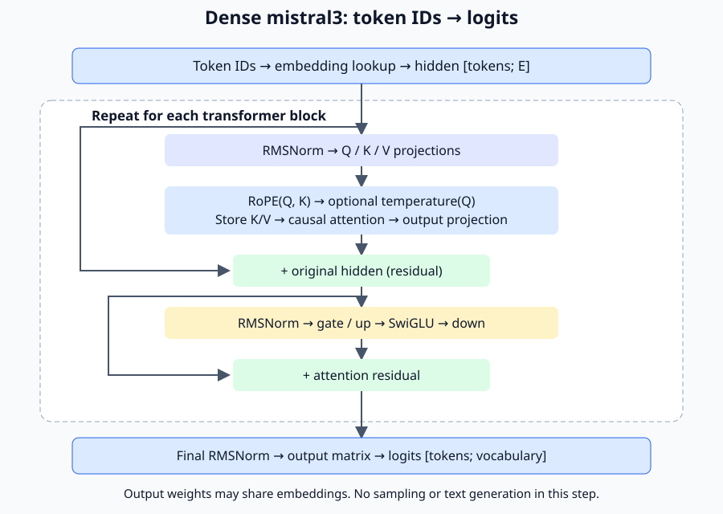

# Run a dense mistral3 forward pass

This walkthrough turns token IDs into logits using Marmotte's CPU backend.
You need .NET 10 and the repository; no downloaded model is required for the
first example. A logit is an unnormalized score for a vocabulary token. This
step computes scores; choosing a token and generating text remain later work.

## 1. Run a model small enough to understand

From the repository root:

```sh
dotnet build Marmotte.slnx
dotnet fsi examples/Forward.fsx
```

The script supplies an in-memory tensor source and a one-layer layout with four
vocabulary tokens and four embedding channels. Embeddings and output are the
same identity matrix. Block projections are zero, so the residual connections
preserve the selected embeddings. Final RMS normalization gives one nonzero
logit per input token. Expected output, rounded to four decimal places:

```text
Token 0 logits: [0.0000; 2.0000; 0.0000; 0.0000]
Token 1 logits: [0.0000; 0.0000; 2.0000; 0.0000]
Cached positions: 2
```

These are invented weights, not a trained language model. Their purpose is to
make the execution and resource ownership visible. Tests use nonzero weights
in two layers to exercise every branch of the actual arithmetic.

## 2. Load weights once

```fsharp
use model = TransformerModel.Load(backend, source, layout)
```

`layout` is a `ModelTensorLayout`, `source` an `ITensorSource`, and `backend` an
`ITensorBackend`. Core validates the publicly constructible configuration,
role shapes, encodings, counts and their agreement with source descriptors.
It loads matrices in their stored encoding, decoding only normalization vectors
to F32. Tied output reuses the uploaded embedding object. Loading failures
release storage already uploaded and preserve the borrowed source/backend.

The model owns its weights; the caller owns the backend, source, cache and
returned logits. Keep the source and backend alive through model use and any
pending operations. Dispose the model before its dependencies. The CPU backend
retains weight payloads, so loading from a mapped source avoids copying the
whole model into managed arrays. No model-wide F32 expansion takes place.

For a local GGUF, replace the invented layout/source with:

```fsharp
let index = Gguf.readFile path
let layout = GgufModelTensorLayout.read index
use source = GgufTensorSource.openMappedFile path
use backend = new CpuBackend() :> ITensorBackend
use model = TransformerModel.Load(backend, source, layout)
```

This fragment requires `Marmotte.Gguf`, `Marmotte.Core` and `Marmotte.Cpu`.
Construct `path` from `LM_STUDIO_MODELS_FOLDER` and relative path segments as
in the repository's inspection scripts. Keep the file unchanged while mapped.
The GGUF adapter rejects unsupported model tensors; the executor uses the
validated roles rather than interpreting format-specific names.

## 3. Allocate a cache for one sequence

Choose a capacity that fits both your memory budget and the model context.
The full configured context is not automatically allocated:

```fsharp
let c = model.Configuration
let capacity = min 4096 c.ContextLength
let cacheLayout =
    KeyValueCacheLayout.Create(c.BlockCount, capacity, c.KeyValueHeadCount,
                               c.KeyLength, TensorEncoding.F16, TensorEncoding.F16)
use cache = backend.AllocateKeyValueCache(cacheLayout)
```

Keys and values may use different supported cache encodings; quantized heads
must contain whole blocks. Use a different cache for each sequence/model. The
executor checks dimensions and backend ownership, but cannot detect a cache
filled with another model's weights or another sequence of the same shape.

## 4. Execute the transformer

```fsharp
use logits = model.Forward(cache, 0, ReadOnlyMemory<int>(tokenIds))
let scores = Array.zeroCreate<single> logits.Shape.ElementCount
backend.Download(logits, scores.AsMemory())
```

The output is row-major `[tokenIds.Length; VocabularySize]`: row `t` predicts
the token after input token `t`. All rows are returned, including during prompt
processing. No softmax, token selection, stopping policy or text decoding is
performed by `Forward`.



Each block first normalizes its input and projects separate Q, K and V. Q and
K receive full-head adjacent-pair RoPE (plain or YaRN); only Q receives any
position-dependent attention temperature factor. The rotated K and unrotated
V enter that layer's cache. Causal grouped-query attention reads the prefix,
then its output projection is added to the original block input.

The resulting residual is normalized again. Gate and up projections produce
`SwiGLU(gate, up)`, followed by the down projection and a second residual
addition. Final normalization and the output matrix produce logits. The query
projection width is independent of the embedding width: the target uses 4096
query channels and 3072 embedding channels.

The graph order was checked against the dense branch of
[llama.cpp's mistral3 graph](https://github.com/ggml-org/llama.cpp/blob/master/src/models/mistral3.cpp)
on 2026-11-08. Marmotte's orchestration is original F# using its own contracts.
Biases, mixture of experts, additional normalization, sliding windows, adapters
and multimodal inputs are outside this supported layout.

## 5. Continue or replace a prefix

To process another consecutive batch, pass its first absolute position. It
must be no greater than the stored count, and the batch must fit the capacity.
All layers must have equal stored counts before the call. On success, a
non-empty batch replaces that suffix in every layer. An empty batch returns
`[0; VocabularySize]` logits and preserves the cache even at an earlier position.

The kernel supports these calls so it can be tested independently; prompt
chunking, token-by-token generation and sampling orchestration remain roadmap
I.2–I.4. Callers decide the batch size. Scratch tensors are allocated per call
and reused across layers, approximately
`tokens × (3E + 2Q + 2K + 2F)` F32 values, plus `tokens × vocabulary` output,
where E is embedding width, Q/K projected head widths and F feed-forward width.
Weights and the separately allocated cache remain live between calls.
Attention adds a prefix-length score buffer and one decoded head at a time.

All ID and shape/range validation occurs before cache writes. Invalid inputs
raise argument exceptions; malformed loaded layouts/payloads raise
`InvalidDataException`. Source I/O and backend errors propagate. An allocation
or execution failure releases temporary/output storage, but an execution failure
may leave a partially updated cache: discard it rather than attempting to resume.
There is no rollback. Operations obey backend submission order; `Download` and
`Synchronize` wait for completion. CPU completes synchronously; GPU backends
still raise `NotImplementedException`. Concurrent calls are unsupported.

## Validation and current limits

`TransformerTests` compares logits with an independent scalar double-precision
implementation, using two nonzero dense blocks, unequal embedding/query widths,
tied and separate output, F32/F16 weights and independently packed Q8_0 blocks.
It also checks chunk equivalence, prefix replacement, YaRN and temperature
integration, F32/F16/BF16 caches, malformed inputs, borrowed resource lifetime
and cleanup after injected loading/execution failures.
Individual kernel suites cover additional weight and cache encodings.

This validates the synthetic forward computation, not end-to-end tokenizer/model
compatibility, generated text quality or performance on the target model.
A real-model comparison remains roadmap K.3. Core has no dependency on a format
or backend. Architecture-specific preparation is isolated from weight loading
and the dense block execution; another architecture must explicitly define its
supported configuration and graph differences rather than silently reusing them.
