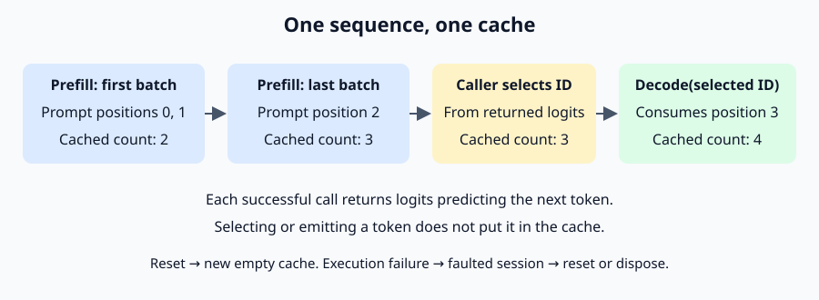

# Process a prompt and decode one token at a time

The forward pass computes logits. `GenerationSession` adds sequence state:
chunked prompt processing (*prefill*), incremental decoding and ownership of a
KV cache. This tutorial requires .NET 10 and the repository, without a local
model installation. Read [the forward walkthrough](forward-pass.md) first if
logits and the cache are unfamiliar.

## 1. Run the synthetic generation example

```sh
dotnet build Marmotte.slnx
dotnet fsi examples/Generation.fsx
```

The script shares `SyntheticModel.fsx` with the forward example. Its invented
identity embeddings and zero transformer projections favor repeating the last
input ID. It demonstrates execution, not trained language generation:

```text
Prompt: 3 tokens (batch size 2)
Generated token 1: 2 (cached: 3)
Generated token 2: 2 (cached: 4)
Generated token 3: 2 (cached: 5)
Stopped: TokenLimit; returned: 3; cached: 5
```

The script uses Core's `TokenSampling.greedy` for the largest-logit choice; the
three-token budget is passed to `TokenGenerator`. Pass `--sample` to use the seeded `TokenSampler` instead; see
[probabilistic sampling](sampling.md). `TokenGenerator` now handles EOS and length stopping; see
[the stopping walkthrough](token-generation.md). The session itself still accepts
the caller's selected token.

## 2. Create an independent sequence

Given a loaded `TransformerModel`:

```fsharp
use sequence =
    GenerationSession.Create(model, capacity = 4096, batchSize = 32,
                             keyEncoding = TensorEncoding.F16,
                             valueEncoding = TensorEncoding.F16)
```

Capacity must be positive and no greater than the model's context length;
choose a smaller number for a smaller model. `batchSize` is the maximum number
of prompt tokens passed to each forward call. It must be positive, and may be
larger than capacity: actual batches are bounded by the prompt length.

Each session owns a separately allocated cache. Multiple sessions can borrow the
same model, but calls on a shared backend must remain sequential. Dispose the
sessions before their model, backend and tensor source. Disposing a session
releases its cache without disposing those borrowed dependencies.

## 3. Prefill a tokenized prompt

```fsharp
let logits = sequence.Prefill(ReadOnlyMemory<int>(tokenIds))
```

The prompt must contain at least one ID. The session validates every ID and the
whole prompt's capacity before any forward call, so an invalid last ID cannot
leave earlier chunks cached. It then processes consecutive batches from
position zero, including the final short batch. Only the last prompt position's
logits are returned, as a caller-owned F32 array of `model.VocabularySize` values.
These scores predict the first continuation token.



`Prefill` requires a new or reset session. It does not tokenize text, insert BOS,
render a chat template or treat EOS specially. With a supported GGUF tokenizer,
raw text can be encoded with `loadedTokenizer.EncodeText(prompt, true)` before
prefill; chat formatting and explicit special-token segmentation remain the
caller's responsibility, as described in [chat prompts](chat-prompts.md).

The session requests `LogitSelection.NoTokens` for intermediate batches and
`LastToken` for the final batch. Every prompt token still enters every layer's
KV cache, but intermediate batches skip the final block's unused query/attention,
feed-forward and vocabulary projection. The final batch computes the last block's
feed-forward and output projection only for its last token. The host download
is exactly `vocabularySize` F32 elements, directly returned to the caller; there
is no full-batch download or second host copy. Every cache-only batch still
synchronizes before its processed count advances. See [selected logits](forward-pass.md#request-only-the-logits-you-need)
for the standalone API and measurements.

## 4. Consume each selected token

```fsharp
let selectedToken = chooseToken logits
let followingLogits = sequence.Decode(selectedToken)
```

For deterministic greedy selection, define the application helper as follows:

```fsharp
let chooseToken (logits: single array) =
    match TokenSampling.greedy (ReadOnlySpan<single>(logits)) with
    | Ok tokenId -> tokenId
    | Error error -> invalidOp $"Token selection failed: {error}."
```

The helper chooses how to report a failure; the library returns a typed `Result`.
Greedy selects the largest finite logit without softmax, sorting or a random
seed. For `[1.0f; 3.0f; 3.0f]`, it returns `Ok 1`: equal maxima select the
smallest token ID, including signed-zero ties. Selection scans the vocabulary
in linear time with constant auxiliary space and leaves logits unchanged.

Negative infinity excludes an entry, allowing callers to mask tokens. An empty
span returns `EmptyLogits`; all entries excluded returns `NoEligibleTokens`.
NaN or positive infinity anywhere returns `InvalidLogit(tokenId, value)` for
the first invalid entry, rather than hiding an invalid model output. IDs are
relative to the supplied span, so pass the full vocabulary row. EOS is an
ordinary candidate here; stopping belongs to the caller.

`Decode` appends exactly one
selected token at `ProcessedTokenCount` and returns scores for the following
token. The input ID is validated before cache updates. A full cache raises
`ArgumentOutOfRangeException`; there is no eviction or automatic context sliding.

The selected token is available for display before `Decode` runs. Selecting or
emitting it does not itself add it to the cache: only a forward call does that.
If the application decides to stop after selecting a token, no final decode is
needed. The example's last emitted token consequently leaves the cached count
at five rather than six. For text, feed selected IDs to `TokenTextDecoder` and
complete the decoder when generation ends; see [streaming decoding](token-decoding.md).

The session returns only logits and retains no host token history or old logit
arrays. Callers own the returned arrays and may modify or retain them without
affecting future steps. Counts and logits are reported after backend completion:
intermediate prefill batches synchronize, and final prefill/decode outputs use
`Download`, which waits for submitted work.

## 5. Handle reset, cancellation and failures

`Reset()` discards the sequence and permits another prompt without reloading
weights. It allocates a replacement cache before releasing the old one, briefly
requiring memory for two caches. If allocation fails, the old state remains.
This approach also recovers from a partially written cache without exposing it
to callers.

Both `Prefill` and `Decode` accept an optional `CancellationToken`. Cancellation
is cooperative at batch boundaries: it does not interrupt a running CPU kernel.
Before execution, invalid input or cancellation leaves the session unchanged.
Once processing starts, an execution failure faults the session; cancellation
between prompt batches does too. `IsFaulted` then reports true and both execution
methods reject further work until reset. `ProcessedTokenCount` counts only
completed batches, not any partial cache changes from the failing batch.
Cancellation requested during the last batch may arrive too late to stop the
call; successful completion is returned.

Common errors are `ArgumentOutOfRangeException` for invalid IDs or limits,
`ArgumentException` for an empty prompt or incompatible cache block dimensions,
`InvalidOperationException` for prefill/decode in the wrong state, and
`ObjectDisposedException` after session/model disposal. Backend, allocation and
source errors propagate. Session disposal is idempotent; metadata remains
readable afterwards. Concurrent calls are not supported.

## Validation and next steps

Synthetic tests compare chunk sizes 1, 2, 3 and 8, incremental tokens and
attention temperature against the independent scalar forward reference. They
also cover interleaved sessions, full capacity, invalid prompts, reset, resource
ownership, injected execution failures and cancellation between batches.

This completes the sequence mechanics of I.2. I.3 now includes both greedy and
[seeded probabilistic sampling](sampling.md).
`TokenSamplingTests` covers finite scores, ties, excluded tokens, invalid values,
input slices and comparison with a sorted reference up to 131,072 entries.
I.4 is implemented by [`TokenGenerator`](token-generation.md); a generation CLI
is available through `generate`; see [Try a prompt](../README.md#try-a-prompt).
A real-model prompt/continuation comparison is not established by the synthetic
tests and remains a separate check.
