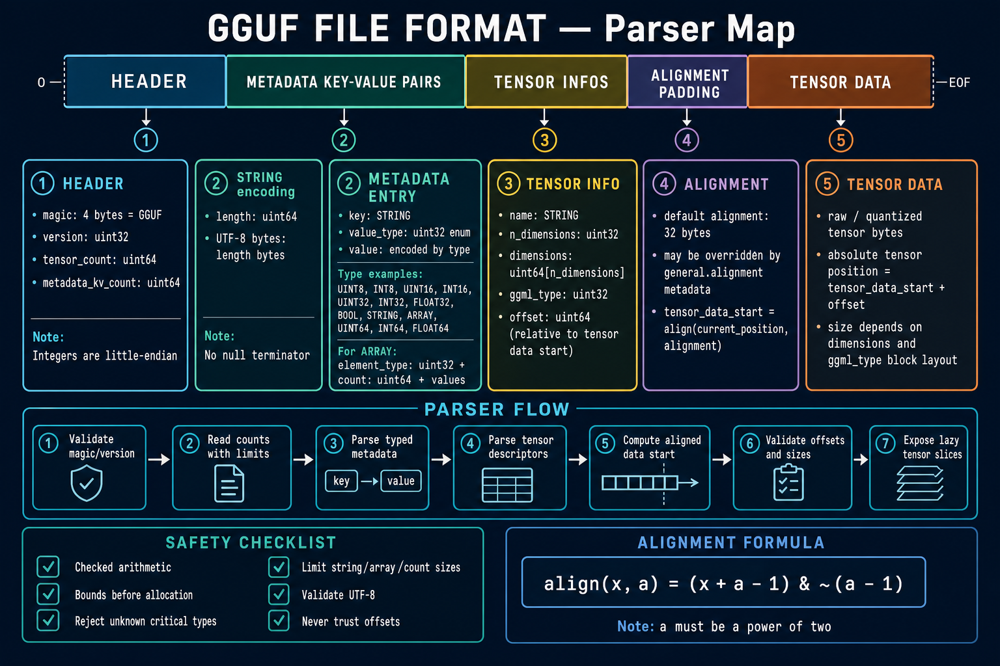

# GGUF Format

GGUF is a binary container format used to store model metadata, tensor
descriptors, and tensor data in a single file. Marmotte's `Marmotte.Gguf`
library reads the metadata and tensor index without loading the weights.

This document describes the format and the current F# implementation, including
native quantization from floating-point weights. General tensor views,
dequantization, and inference remain future work.

> The imported diagram is a conceptual overview. Its little-endian note omits
> GGUF v3 big-endian support, its bitwise alignment formula only applies to
> powers of two, and its lazy-slice step is not implemented in Marmotte. The
> details and implementation status below take precedence.



## File Layout

A GGUF file contains five consecutive regions:

1. Header
2. Metadata key-value pairs
3. Tensor descriptors
4. Alignment padding
5. Tensor data

Header, metadata, and descriptor fields are serialized consecutively without
implicit alignment. Padding aligns the data section and individual tensor
payloads within it.

```text
+---------+------------------+--------------+---------+-------------+
| Header  | Metadata entries | Tensor infos | Padding | Tensor data |
+---------+------------------+--------------+---------+-------------+
```

Numeric fields use the byte order detected from the version field. GGUF files are
normally little-endian, while GGUF v3 can also represent big-endian data.

## Header

For GGUF v2/v3, the fixed header occupies exactly 24 bytes. The offsets below
are relative to the beginning of the GGUF content in the source stream.

| Offset | Size | Type | Field |
| ---: | ---: | --- | --- |
| `0` | 4 | ASCII bytes | Magic: `GGUF` |
| `4` | 4 | `uint32` | Format version |
| `8` | 8 | `uint64` | Number of tensors |
| `16` | 8 | `uint64` | Number of metadata entries |

Marmotte supports GGUF v2 in little-endian and v3 in either byte order.

The reader initially interprets the version as little-endian. Values 2 and 3
select little-endian; `0x03000000` identifies a big-endian v3 file. Other values,
invalid magic, and truncated headers are rejected. The magic remains the four
literal ASCII bytes `GGUF` in both byte orders.

The public result is a `GgufFile`, rather than a separate header object:

```fsharp
open Marmotte.Gguf

let model = Gguf.readFile "model.gguf"
printfn "GGUF v%d, %A" model.Version model.Endianness
printfn "%d tensors, %d metadata entries" model.Tensors.Length model.Metadata.Count
```

See [Gguf.fs](../src/Marmotte.Gguf/Gguf.fs) for the reader and
[Types.fs](../src/Marmotte.Gguf/Types.fs) for its public types.

## Strings

GGUF strings are length-prefixed UTF-8 values:

```text
length: uint64
data:   byte[length]
```

There is no null terminator.

Marmotte validates lengths before allocating memory, checks that all bytes are
available, and rejects invalid UTF-8. Lengths count bytes, not .NET UTF-16 characters.
Metadata keys have a 65,535-byte limit and tensor names a 64-byte limit, in
addition to configurable string limits.

## Metadata

The header's metadata count determines how many key-value entries follow.

Each entry contains:

```text
key:        STRING
value_type: uint32
value:      encoded according to value_type
```

### Value Types

| Value | Name | Encoded value |
| ---: | --- | --- |
| `0` | `UINT8` | `uint8` |
| `1` | `INT8` | `int8` |
| `2` | `UINT16` | `uint16` |
| `3` | `INT16` | `int16` |
| `4` | `UINT32` | `uint32` |
| `5` | `INT32` | `int32` |
| `6` | `FLOAT32` | IEEE 754 binary32 |
| `7` | `BOOL` | One byte, zero or one |
| `8` | `STRING` | GGUF string |
| `9` | `ARRAY` | Element type, count, then elements |
| `10` | `UINT64` | `uint64` |
| `11` | `INT64` | `int64` |
| `12` | `FLOAT64` | IEEE 754 binary64 |

An array is encoded as:

```text
element_type: uint32
count:        uint64
elements:     value[count]
```

The element type determines the encoding of every element. The GGUF
specification permits nested arrays. Marmotte supports them with limits on
nesting depth, array length, and the total number of decoded metadata values.
Even an empty array retains its element type.

Common metadata keys include model architecture, model name, tokenizer data,
quantization information, and `general.alignment`.

Marmotte represents metadata with the `GgufValue` discriminated union. Pattern
matching preserves the exact wire type without an `obj` payload:

```fsharp
let architecture =
    match Map.tryFind "general.architecture" model.Metadata with
    | Some(GgufValue.String value) -> Some value
    | _ -> None
```

Examples include `GgufValue.UInt32`, `GgufValue.Float64`, and
`GgufValue.Array(elementType, values)`. Duplicate metadata keys and unknown
metadata tags are rejected because an unknown tag does not provide enough
information to decode or skip its payload.

### File Profiles and Tensor Encodings

`general.file_type` describes a file-level profile, exposed as `model.FileType`
through `GgufFileType`. Profiles such as `Q3_K_S`, `Q3_K_M`, and `Q4_K_M` can
mix several tensor encodings. `GgmlType` describes each tensor's actual encoding.

The numeric identifiers are not interchangeable: value 12 means
`GgufFileType.Q3_K_M` for a file profile and `GgmlType.Q4_K` for a tensor.
An absent or incorrectly typed profile produces `None`; it is not guessed
from the filename or from tensor encodings.

## Tensor Descriptors

The tensor count from the header determines how many tensor descriptors follow
the metadata entries.

Each descriptor contains:

```text
name:          STRING
n_dimensions:  uint32
dimensions:    uint64[n_dimensions]
ggml_type:     uint32
offset:        uint64
```

The offset is relative to the beginning of the tensor data region, not to the
beginning of the file:

```text
absolute_position = tensor_data_start + tensor.offset
```

Dimensions use GGML order: the contiguous dimension comes first. For example,
a contiguous 2-row, 3-column matrix has GGML dimensions `[3; 2]`; the same
matrix has shape `[2; 3]` in Safetensors. Do not silently swap their conventions.

The tensor's byte size also depends on its encoding. For known block layouts:

```text
element_count = product(dimensions)
byte_size = (element_count / elements_per_block) * bytes_per_block
```

The first dimension must contain complete quantization blocks. Marmotte checks
these calculations for overflow. It accepts up to four dimensions, rank-zero
scalars (one element), and tensors with a zero dimension (no elements).

Each `GgufTensorInfo` exposes:

| Member | Meaning |
| --- | --- |
| `Name` | Tensor name |
| `Dimensions` | GGML dimensions as `uint64 array` |
| `TensorType` | Tensor encoding (`GgmlType`) |
| `ElementCount` | Number of logical elements |
| `Offset` | Byte offset relative to the tensor data section |
| `AbsoluteOffset` | Byte position in the original stream |
| `ByteSize` | Validated encoded size, or `None` for an unknown encoding |

Unknown encodings retain their numeric identifier. The parser checks their
starting offset, but cannot validate their full size or overlap with a following
tensor. Consumers must not treat `ByteSize = None` as proof of a valid payload.

## Alignment

The tensor data region starts at an aligned position relative to the start of
the GGUF content. `Gguf.read` can start at a nonzero stream position.

The specification calls the bytes after the tensor descriptors `_padding[]`.
They bring the tensor data section to the required alignment.

The default alignment is 32 bytes. A `general.alignment` metadata entry can
override it. Marmotte requires a `uint32`, greater than zero and divisible by 8,
following the written specification. Some upstream readers impose the stricter
requirement of a power of two; acceptance by Marmotte is not a guarantee of
compatibility with every GGUF consumer.

```text
relative_position = position_after_tensor_infos - gguf_start
padding = (alignment - relative_position % alignment) % alignment
tensor_data_start = position_after_tensor_infos + padding
```

This works for every alignment accepted by Marmotte, including 24. The bitwise
shortcut in the diagram only works for powers of two and must not replace it.

Each tensor's relative offset must be a multiple of the selected alignment.
Marmotte requires the header padding to exist even when there are no tensors.
It seeks over that padding; it does not inspect whether each padding byte is zero.

## Tensor Data

The final region contains raw or quantized tensor bytes. The current parser
does not read these bytes; it validates known payload ranges using the stream
length and returns descriptors.

`Gguf.read` leaves its caller-owned stream open at `DataOffset` after success.
`Gguf.readFile` opens and closes its own stream. Neither returns live tensor
slices or retains a file handle. The result's records contain arrays, so they
should not be described as deeply immutable.

A future payload-loading layer could:

- Keep the file open or memory-map it.
- Reuse the parsed metadata and tensor descriptors.
- Require a known, validated range before exposing a tensor view.
- Represent tensor payloads as bounded slices of the underlying storage.
- Decode or dequantize values only when an execution backend needs them.

## Native Quantization

`GgufQuantizer.quantizeFile format inputPath outputPath` implements streaming
conversion, separately from the index-only reader. The CLI exposes it through
[`quantize`](../README.md#quantize-a-gguf-file). `GgufQuantizationFormat` deliberately
contains only `Q4_0` and `Q8_0`; the much larger `GgufFileType` enumeration describes
profiles the reader can identify, not conversions the writer can perform.

| Property | Current contract |
| --- | --- |
| Input | One complete little-endian v2/v3 file; every tensor must be F32, F16 or BF16 |
| Eligible tensors | Non-empty, rank at least 2, contiguous dimension divisible by 32 |
| Other floating-point tensors | Copied byte for byte, preserving their encoding |
| Output | GGUF v3 little-endian, Q4_0 or Q8_0 blocks, original alignment |
| Metadata | Preserve typed values; replace `general.file_type` and `general.quantization_version` (2) |
| Payload memory | Less than 128 KiB of reusable buffers, independent of tensor size |
| Index memory | Default reader limits; final validation also reads the output index |
| Publication | Temporary sibling file, validated before moving to a previously absent output path |

Selection is based on tensor shape, with no architecture-specific name exceptions
or mixed-precision heuristics. It does not reproduce llama.cpp's model-specific
selection policy. The summary reports how many tensors were converted or retained.
Inference compatibility and model quality must be evaluated separately; tests
cover the binary format and numerical conversion, not model execution.

Every block represents 32 contiguous values:

| Encoding | Stored bytes | Reconstruction |
| --- | --- | --- |
| Q4_0 | F16 scale + 16 packed bytes (18 bytes total) | `scale * (nibble - 8)`; low nibbles hold elements 0–15, high nibbles hold 16–31 |
| Q8_0 | F16 scale + 32 signed bytes (34 bytes total) | `scale * signed_byte` |

The implementation follows the reference block layouts and rounding conventions
in [GGML's block definitions](https://github.com/ggml-org/llama.cpp/blob/master/ggml/src/ggml-common.h)
and [reference quantizers](https://github.com/ggml-org/llama.cpp/blob/master/ggml/src/ggml-quants.c).
Q4_0 uses a signed scale from the first value with greatest absolute magnitude;
Q8_0 uses a positive scale and rounds halfway values away from zero. Integer codes
are calculated with the unrounded scale, then the scale is stored as F16.
Reconstruction therefore includes both integer rounding and F16 scale error.

Converted NaN/infinite weights and scales exceeding the finite F16 range are
rejected. Blocks whose scale underflows to F16 zero decode to zero; the encoder
handles these without an infinite reciprocal. Copied payloads are not numerically
validated. The output contains no new provenance inferred from its filename.

The input remains read-only. Existing files/directories at the output path are
rejected, and a concurrent creation of that path also prevents publication.
The output directory must exist. On failure or handled cancellation, the temporary
file is deleted; a forced process termination can leave that temporary file behind.
`quantizeFileWithCancellation` checks its cancellation token between payload chunks.
Unsupported data raises `InvalidDataException`; I/O and cancellation exceptions
propagate. A call with the same input and output path raises `ArgumentException`.

Requantization, integer inputs, unknown encodings, big-endian input, and files with
`split.*` metadata are rejected. No `Q3_K_S`, `Q4_K_M`, IQ or other mixed profile
is written. In particular, the already-quantized Ministral launch-profile model
can be inspected but cannot be converted by this initial quantizer.

## Safe Parsing Order

1. Read exactly 24 header bytes.
2. Validate the `GGUF` magic.
3. Detect byte order and validate the version.
4. Read tensor and metadata counts.
5. Validate counts against configured limits.
6. Parse each typed metadata entry.
7. Read `general.alignment`, or use 32.
8. Parse each tensor descriptor.
9. Compute the aligned tensor data start.
10. Validate tensor offsets and encoded sizes against the file length.
11. Return metadata and resolved descriptors, leaving weights unread.

## Security Requirements

GGUF files must be treated as untrusted input.

- Use checked arithmetic for additions, multiplications, and alignment.
- Set explicit limits for strings, arrays, dimensions, metadata, and tensors.
- Validate a length before allocating or slicing.
- Reject unknown metadata value types.
- Reject invalid dimensions, duplicate names, and incomplete quantization blocks.
- Verify known tensor ranges remain inside the file and do not overlap.
- Treat empty tensors as zero-length ranges, which may share an offset.
- Preserve unknown tensor types with explicit validation limitations.
- Never convert an untrusted `uint64` directly to `int` or `nativeint`.
- Do not trust offsets merely because the file has a valid header.

## Marmotte Implementation Status

Implemented:

- Fixed-size header reading
- Magic validation
- GGUF v2 and v3 validation
- Little-endian and big-endian detection
- Tensor and metadata counts
- Truncated-header detection
- Endian-aware primitive reading
- Bounded UTF-8 string reading
- Metadata scalar values
- Type-safe metadata discriminated union
- Empty and nested metadata arrays with allocation and nesting limits
- Tensor descriptors
- Alignment and relative/absolute tensor positions
- Known encoding sizes, payload bounds, and overlap checks
- File-level quantization profiles, separate from tensor encodings
- Streaming F32/F16/BF16 to Q4_0/Q8_0 conversion, metadata/index writing and safe
  publication through `GgufQuantizer` and the `quantize` CLI command
- Quantizer tests for exact blocks, numerical error, preservation and failed writes
- Tests for valid files, malformed input, partial reads, and stream ownership
- A Spectre.Console [`info` command](../README.md#command-line) that accepts a
  local GGUF path and displays a summary, encoding counts, and bounded tensor and
  metadata previews without reading weights
- A local inspection script: [GgufScript.fsx](../src/Marmotte.Gguf/GgufScript.fsx),
  using `LM_STUDIO_MODELS_FOLDER` as the models root directory and appending the
  model's relative path; see the [configuration instructions](../README.md#inspect-a-local-gguf-file)

Not implemented:

- Lazy tensor byte views or memory-mapped storage
- General tensor loading, quantized-weight decoding, or model execution
- Requantization, K-quant/IQ encoders and architecture-specific quantization policies
- Safetensors parsing; see the [next-format plan](safetensors.md)

## References

- [GGUF format documentation](https://github.com/ggml-org/ggml/blob/master/docs/gguf.md)
- [GGUF public definitions](https://github.com/ggml-org/ggml/blob/master/include/gguf.h)
- [Upstream reader and alignment validation](https://github.com/ggml-org/llama.cpp/blob/master/gguf-py/gguf/gguf_reader.py)
- [Tensor encodings and file profiles](https://github.com/ggml-org/llama.cpp/blob/master/gguf-py/gguf/constants.py)
- [Hugging Face Hub GGUF documentation](https://huggingface.co/docs/hub/gguf)
