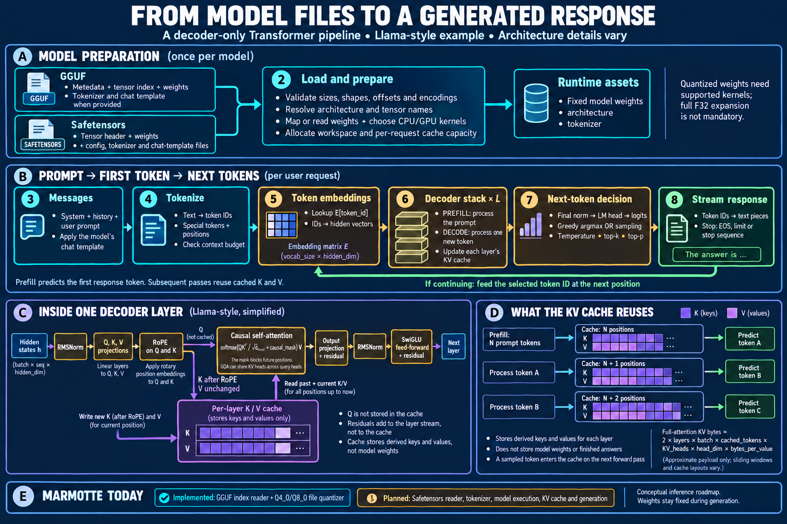

# From Model Files to a Generated Response

This illustration follows a text-only, decoder-only Transformer with a
Llama-style layer. It is a conceptual explanation of inference, not a claim that
Marmotte already executes these steps. Model-specific details still come from
the architecture and configuration; see the [Marmotte roadmap](../ROADMAP.md).



[Open the full-size illustration](inference-pipeline.png).

## A. Prepare the Model

GGUF and Safetensors are alternative storage formats. Neither is an execution
engine, and conversion between them is not a prerequisite for inference.

| Input | Information to resolve |
| --- | --- |
| GGUF | Typed metadata, tensor names/shapes/encodings/offsets, weight bytes, and tokenizer/chat-template metadata when supplied |
| Safetensors model package | Tensor names/shapes/dtypes/offsets and weight bytes; architecture configuration, tokenizer and chat template usually come from companion files; sharded packages also need their index |

The loader validates ranges, resolves architecture-specific tensor names and
shapes, then maps or reads the weights into the chosen runtime. File dimensions
must be interpreted using their format's convention. A readable index alone
does not establish that the runtime supports the model's operations.
See the [GGUF specification](https://github.com/ggml-org/ggml/blob/master/docs/gguf.md),
[Safetensors format](https://github.com/huggingface/safetensors#format), and
[model loading documentation](https://huggingface.co/docs/transformers/main/en/models).

Model weights remain fixed during ordinary generation. Quantized weights require
matching compute/decoding kernels, but the entire model need not be expanded to
F32 at once. Workspace and cache capacity can be reserved ahead of time; populated
cache entries belong to a request or a validated reusable prefix. Marmotte's
[planned weight-access and kernel work](../ROADMAP.md#milestone-1-run-a-model-on-the-cpu)
starts on CPU, followed by CUDA and Metal.

## B. Turn a Prompt into a Response

### Messages and token IDs

Apply the model's chat template to the system message, history and user message.
Tokenize that sequence with the matching tokenizer. Control tokens must follow
the template's rules; adding BOS/EOS a second time can change the input.
Tokens may represent word fragments, punctuation or bytes. The runtime also
prepares position indices and attention masks, and checks the context budget.
The diagram groups these preparation steps under tokenization.
[Chat-template reference](https://huggingface.co/docs/transformers/main/en/chat_templating).

### Token embeddings

Each token ID selects a learned row from the embedding matrix:

```text
E: [vocabulary_size, hidden_dimension]
h[i] = E[token_id[i]]
```

A prompt of N tokens becomes N hidden vectors. These are internal token
embeddings, rather than a separate sentence embedding for vector search.
The decoder layers transform them into contextual hidden states. This lookup and
the final vocabulary projection are visible in the
[Llama model implementation](https://github.com/huggingface/transformers/blob/main/src/transformers/models/llama/modeling_llama.py).

### Logits, selection and text

After the decoder stack, final normalization and the language-model head map the
last position's hidden state to one logit per vocabulary token. Logits are scores,
not probabilities. Greedy decoding selects the largest score. Sampling can apply
penalties, temperature and top-k/top-p filtering before choosing a token from
the resulting distribution. These controls are configurable, not mandatory
steps for every strategy.
[Generation strategies](https://huggingface.co/docs/transformers/main/en/generation_strategies).

The tokenizer decoder turns selected IDs into text pieces for streaming. A token
is not necessarily a complete word or Unicode character; the implementation must
handle partial byte sequences. Stop on the configured EOS/end-of-turn IDs, stop
strings, token/context limit, or cancellation. A matched stop string may require
buffering before it can be suppressed from the displayed output.
[Generation configuration](https://huggingface.co/docs/transformers/main/en/main_classes/text_generation).

## C. Inside a Decoder Layer

For the illustrated pre-normalized Llama-style block:

1. Normalize the incoming hidden states with RMSNorm.
2. Project them into queries Q, keys K and values V.
3. Apply RoPE using token positions to Q and K; V remains unchanged.
4. Attend to permitted positions using the current query and available keys/values.
5. Project the attention output and add the original residual stream.
6. Apply another RMSNorm, a SwiGLU feed-forward network, and a second residual addition.

Repeat for each layer. The diagram abbreviates the residual bypasses as
"+ residual". These are additions to hidden states, not writes to the KV cache.
Normalization, positional encoding and feed-forward structure vary by model.
[LLaMA architecture](https://arxiv.org/html/2302.13971v1#S2.SS2),
[RoPE paper](https://arxiv.org/abs/2104.09864).

For one attention head, the conceptual operation is:

```text
attention(Q, K, V) = softmax(Q K^T / sqrt(head_dimension) + mask) V
mask = 0 for allowed positions, -infinity for excluded positions
```

The causal mask prevents a position from reading future positions. Optimized
kernels can evaluate this without materializing the entire attention matrix.
[Transformer attention](https://arxiv.org/abs/1706.03762).

## D. Prefill, Decode and the KV Cache

**Prefill** processes the prompt, potentially in chunks, with causal attention.
It fills each layer's cache with keys and values and produces the logits used to
choose the first response token.

**Decode** processes the newly selected token at its next position. Each layer
computes its new Q/K/V, appends K after RoPE and the unchanged V, and uses the
cached prefix during attention. Queries are not retained in the KV cache.
[Caching reference](https://huggingface.co/docs/transformers/main/en/cache_explanation).

| Forward pass | Cache positions after processing | Next prediction |
| --- | --- | --- |
| N prompt tokens | N | Token A |
| Token A | N + 1 | Token B |
| Token B | N + 2 | Token C |

A sampled token enters the cache only when a subsequent forward pass processes
it. Feed its ID directly to the embedding lookup; do not re-tokenize the streamed
text. With a cache, previous tokens need not repeat their projections and
feed-forward computations, although full attention still reads their K/V.

For uniform full-attention layers, this approximate payload size follows from
counting both K and V elements:

```text
KV bytes = 2 × layers × batch × cached_tokens × KV_heads × head_dimension × bytes_per_value
```

For example, 26 layers, batch 1, 4,096 cached positions, 8 KV heads, head dimension
128 and two-byte values give **416 MiB**. This is an illustrative calculation,
not a measurement of Marmotte. Use KV-head count rather than query-head count:
grouped-query attention shares K/V across groups of query heads.
[GQA paper](https://arxiv.org/abs/2305.13245).

This estimate excludes allocation overhead, unused reserved capacity and
temporary attention buffers. Sliding windows, paging, offloading and quantized
caches change storage requirements. Cache dtype is a separate choice from weight
quantization. A cache contains derived attention state, not model parameters or
finished answers, and must match the exact processed prefix and positions.
[Cache strategies](https://huggingface.co/docs/transformers/main/en/kv_cache).

## E. Marmotte Today

| Area | Current status |
| --- | --- |
| GGUF metadata and tensor index | Implemented, including `info` |
| F32/F16/BF16 to Q4_0/Q8_0 file conversion | Implemented through `quantize`; an offline conversion operation |
| Safetensors tensor index | Implemented for single files, including `info`; shards and payload access planned |
| Tokenizer, embeddings and runtime tensor access | Planned |
| Transformer kernels, KV cache and response generation | Planned; CPU first, then CUDA/Metal |

The illustration simplifies a text-only generation path. It does not specify
multimodal encoders, MoE routing, speculative decoding or every architecture's
position/scaling rules. In particular, the target `mistral3` model requires the
additional details recorded in the [roadmap](../ROADMAP.md).

The PNG was created with the built-in `image_gen` tool and visually reviewed.
The [generation and correction prompts](inference-pipeline.prompt.txt) are saved
alongside it. These notes and primary references provide the readable technical
companion to the illustration.
