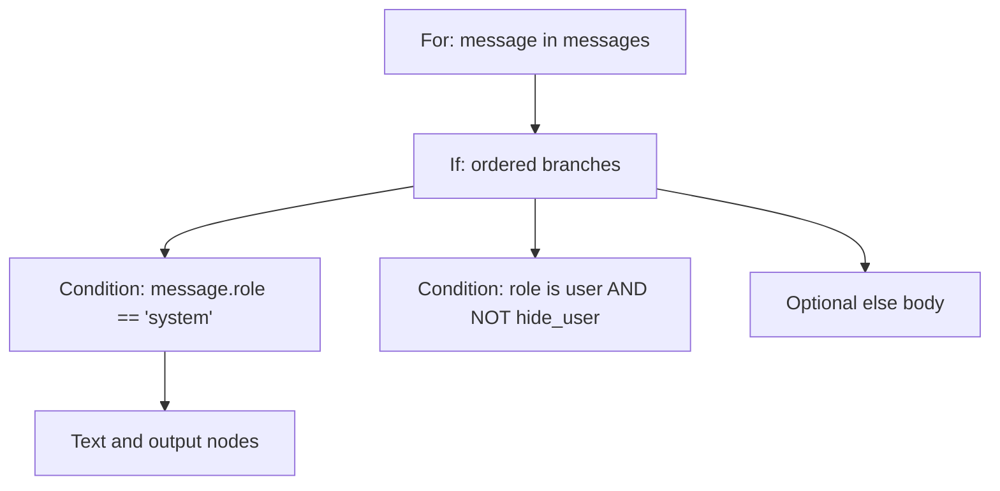

# Parse Jinja templates before evaluating them

Learn to turn template text into a typed syntax tree with Core's `JinjaParser`.
You need the .NET 10 SDK, but no model file or runtime context. From the repository
root, run:

```sh
dotnet fsi examples/ParserCombinatorSample.fsx
```

The example prints a chat template's AST containing a loop and three conditional
branches, then an error for a missing `endif`. Parsing does not render text,
resolve variables, choose branches or perform escaping.

## 1. Parse a variable expression

In an application referencing `Marmotte.Core`, start with:

```fsharp
open Marmotte.Core

let result = JinjaParser.parse "Hello {{ user.name }}!"
```

The result is:

```fsharp
Ok [ JinjaNode.Text "Hello "
     JinjaNode.Output (JinjaExpression.Variable ["user"; "name"])
     JinjaNode.Text "!" ]
```

The parser uses the existing `ParserCombinator` module. Character parsers compose
into identifiers; `.>>.` retains both values, `>>.` and `.>>` discard delimiters,
and `||>` maps results into syntax nodes. Private parser binding preserves the
failure position once a grammar construct has begun. Opening tag dispatch keeps
malformed tags from silently falling back to literal text.

## 2. Add conditions and loops

```jinja

System: {{ message.content }}
User: {{ message.content }}
{{ message.role }}: {{ message.content }}


```

`JinjaNode.For` stores the variable name, collection expression and body.
`JinjaNode.If` stores ordered `JinjaBranch` records and an optional else body.
An absent else is `None`; an explicitly empty else is `Some []`. Loops and
conditionals can contain each other. Each block consumes its own terminator;
an unmatched `endif`, duplicate `else` or `elif` following `else` is an error.



The AST carries syntax independently of runtime values. A future runtime can
accept a context, resolve variable paths and evaluate the selected body without
parsing again. No context or evaluation API is introduced yet.

## 3. Compose conditions with explicit precedence

Expressions are supported in output tags, conditions and loop collections.
From strongest to weakest binding:

| Syntax | AST |
| --- | --- |
| Literals, variable paths, `(expression)` | `Literal`, `Variable`, grouped expression |
| `==`, `!=`, `<`, `<=`, `>`, `>=`, `in`, `not in` | `Compare` |
| `not expression` | `Not` |
| `left and right` | `And` |
| `left or right` | `Or` |

For example, `a or not b == 2 and c` groups as
`a or ((not (b == 2)) and c)`. Logical chains associate to the left.
`0 < count <= 10` stores the first operand and an ordered list of comparison
steps. This preserves the middle operand once, allowing a future runtime to
implement chained comparisons rather than compare a boolean result to `10`.

Supported literals are signed decimal 64-bit integers, single- or double-quoted
strings, `true`, `false`, `none` and their title-case variants. String escapes
support backslash, either quote, `\n`, `\r` and `\t`. Other escapes are rejected.
Delimiters inside strings are string content, and comments are opaque.
Identifiers use ASCII letters or underscore followed by ASCII letters, digits
or underscore; dotted access allows whitespace around dots.

This is an original implementation of a documented Jinja subset. The syntax
reference is the official [Jinja template documentation](https://jinja.palletsprojects.com/en/stable/templates/),
including variables, literals, comparisons, logic, `if`, `for` and comments.
This module does not claim full Jinja compatibility.

## 4. Handle errors and limits

```fsharp
match JinjaParser.parse "unfinished" with
| Ok nodes -> printfn "%A" nodes
| Error error ->
    printfn "Line %d, column %d: %s"
        (error.Position.Line + 1) (error.Position.Column + 1) error.Message
```

`parse` consumes the complete input and returns `Result<JinjaNode list,
JinjaParseError>`. Errors contain zero-based UTF-16 offsets and columns. LF
advances the line (including in CRLF); a standalone CR advances the column.
`null` input raises `ArgumentNullException`.

Input is limited to 1,048,576 UTF-16 code units. Nested blocks are limited to 64;
expression recursion and logical chains share a 64-level budget. These fixed
limits reject excessive input before deep recursive parsing. The AST uses
immutable lists and records. It preserves literal whitespace, including the
final newline, and retains comment content for inspection.

Unsupported syntax is rejected: indexing, filters, calls, arithmetic, floating
point literals, tests such as `is defined`, inline conditional expressions,
loop `else`, assignments, macros, includes and inheritance. Expression/block
whitespace-control markers are unsupported. Comment content is retained verbatim,
including marker-like characters; no whitespace trimming is performed.

Run the focused tests with:

```sh
dotnet test tests/Marmotte.Core.Tests/Marmotte.Core.Tests.fsproj --filter FullyQualifiedName~JinjaParserTests
```
