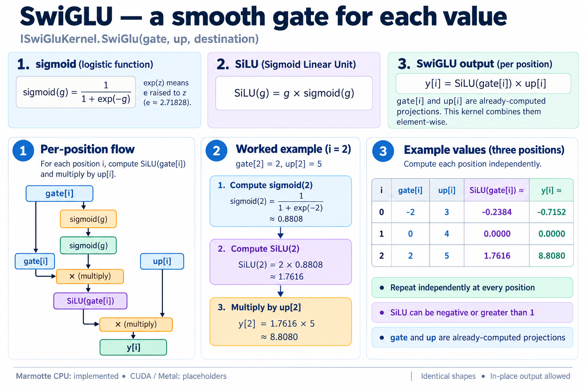
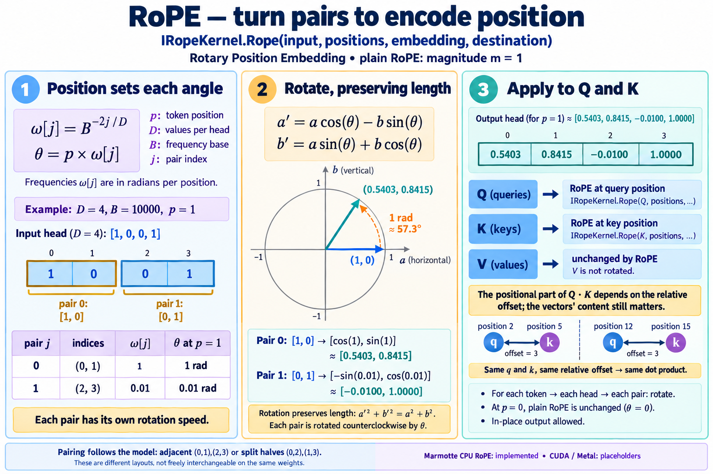
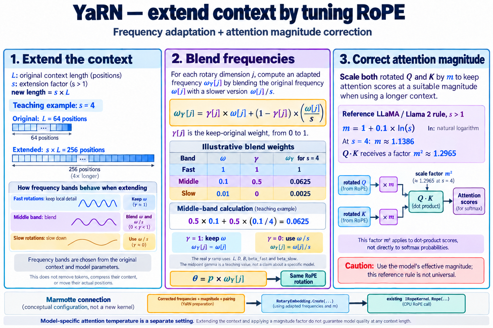

# Execution Tensors and Kernels

`Marmotte.Core` defines the compute contracts. `Marmotte.Cpu`, `Marmotte.Cuda`
and `Marmotte.Metal` each reference Core; Core references none of the backends.
The implemented operations are element-wise F32/F16 addition, the SwiGLU
activation of the feed-forward layer, RMS normalization, embedding lookup from
stored weights, matrix-vector and matrix-matrix products with stored weights,
rotary position embedding, and the attention temperature applied to queries. A
key-value cache keeps the keys and values of past positions in an encoding
chosen separately for each, from F32 down to Q4_0.

## Reading the Formulas

A **kernel** is a focused numerical operation on tensors. For these examples,
think of a tensor as an array with a shape: `[3]` holds three values, and
`[2; 3]` holds two rows of three values. F32 means a 32-bit floating-point value.
**Activations** are intermediate values computed for the current input;
**weights** are the model's learned parameters, reused across inputs.

Each kernel below has an illustrated walkthrough with small, invented inputs.
Read the input shapes first, follow one output value, then repeat the operation
over the remaining positions or rows. Indexes start at zero. Approximate values
in the pictures are rounded to four decimal places for display; calculations
use unrounded intermediates.

| Notation | Meaning |
| --- | --- |
| `x[i]` | Value at position `i` in a vector |
| `X[t, c]` | Feature `c` of token row `t` |
| `W[r, c]` | Weight in output row `r`, input column `c` |
| `X[t, *]` or `X[t, :]` | All columns of row `t` |
| `C`, `R`, `T` | Input feature count, output feature count, token count |
| `Σ_c` | Add the terms for every column `c`, from `0` to `C - 1` |
| `mean(...)` | Sum the values, then divide by their count |
| `sqrt(...)`, `exp(z)` | Square root, and the exponential `e` raised to `z` |
| `Wᵀ` | Transposed matrix in the mathematical expression: rows become columns |

| Kernel or technique | What one output represents | Walkthrough |
| --- | --- | --- |
| Add | Sum of two values at the same position | [Matching positions](#add-and-buffer-reuse) |
| SwiGLU | One value multiplied by a smooth gate | [Three scalar steps](#swiglu) |
| RMSNorm | One value rescaled using its row's magnitude and a learned weight | [Measure, normalize, scale](#rms-normalization) |
| EmbeddingLookup | A feature copied or decoded from the vocabulary row selected by an ID | [Select rows](#embedding-lookup) |
| MatVec | Sum of products between one weight row and one input vector | [One dot product](#matrix-vector-product) |
| MatMul | The same dot product for one token in a batch | [Reuse rows across tokens](#matrix-matrix-product) |
| Rope | One value of a pair turned by an angle that grows with the token's position | [Rotate pairs](#rotary-position-embedding) |
| YaRN (parameter preparation) | Adjusted RoPE frequencies and an attention magnitude factor | [Extend context](#yarn-context-extension) |
| AttentionTemperature | One query value multiplied by a factor of its position block | [Scale queries](#attention-temperature) |
| StoreKeyValues / ReadKeyValues | One cached key or value of a past position, encoded and decoded back to F32 | [Key-value cache](#key-value-cache) |

All eight kernels and the key-value cache have CPU implementations. CUDA also
implements Add and F32/F16 device storage/transfers; its remaining kernels and Metal
remain placeholders. See the [CUDA build and implementation guide](cuda.md).
Core implements YaRN parameter preparation. Attention temperature has a worked
example in text. The eight walkthrough images were
generated with the built-in `image_gen` tool, visually reviewed, and their
numerical examples checked independently. The prompts for the
[first six kernels](kernel-illustrations.prompt.txt) and for
[RoPE and YaRN](rope-yarn-illustrations.prompt.txt) are kept alongside the
images. The older overview below has its own status note.

## From GGUF to Add


[Open the full-size diagram](gguf-to-add-kernel.png).

The diagram predates embedding lookup and `MatVec`, so it still shows both as
planned. Solid teal paths are
implemented, dashed amber paths are planned, and gray panels identify GPU
placeholders at the time the diagram was drawn; CUDA Add is now implemented.
Opening a source reads the index; `WeightMatrix.Read` requests a
payload through that source. CPU `UploadWeights` then retains the encoded
matrix without another payload copy.

Embedding lookup provides the first connection from stored weights to F32
activations, and `MatVec` multiplies stored weights by an F32 activation vector.
`IAddKernel` adds those activations, not encoded weights. `examples/Embedding.fsx`
demonstrates the lookup, while `examples/Add.fsx` supplies F32 and F16 host values
directly through `Upload`. Kernel outputs can feed another kernel without a
download; `Download` is the explicit route back to host values. The diagram's
planned embedding and matrix-product labels are now outdated.

The image was generated with the built-in `image_gen` tool and visually reviewed.
Its [generation and correction prompts](gguf-to-add-kernel.prompt.txt) are saved
alongside it. The contracts below remain the authoritative description.

## Stored Weights and Execution Tensors

`ITensorSource` and `WeightMatrix` provide read-only access to encoded model
weights. Their payloads can contain quantization blocks, and they cannot be
passed directly to `Add`. `backend.UploadWeights(matrix)` places a matrix on a
backend as an `IWeightTensor`, keeping its encoding, rows and columns: the
weights are never decoded as a whole. The CPU backend retains the matrix payload
without copying it; a GPU backend is expected to copy it into device memory.
Because a backend may retain the payload, keep the tensor source that produced
the matrix alive while the weight tensor is in use. Embedding lookup consumes
an `IWeightTensor` and token IDs; `MatVec` consumes an `IWeightTensor` and F32
`ITensor` values.

`ITensor` represents an owned, writable, contiguous **F32 or F16 execution tensor**.
Its `TensorShape` uses row-major dimensions: `[2; 3]` means two rows of three
values. Shapes copy their dimension arrays and expose a read-only collection.
An empty shape is a scalar with one value; any zero dimension makes an empty
tensor. Negative dimensions and element counts beyond `Array.MaxLength` are
rejected before allocating storage. Allocation still depends on available memory.

The tensor interface exposes shape, encoding and backend family, but no array,
span or native pointer. Each implementation owns its storage. `Upload` accepts
host `ReadOnlyMemory<single>` or `ReadOnlyMemory<Half>` and copies it into new
storage of the matching encoding; `Download` copies into caller-provided
`Memory<single>` or `Memory<Half>` of that same encoding. Both require an exact
element count. A mismatched download is rejected before writing; transfers do
not convert precision. `Allocate(shape)` defaults to F32; the overload
`Allocate(shape, encoding)` accepts F32 or F16 and rejects other encodings.
This makes transfers explicit without requiring a GPU allocation to masquerade
as a managed array. Model weights use `UploadWeights` instead; kernels decode
them one row at a time.

## One Contract, Three Implementations

| Concern | CPU today | CUDA today | Metal placeholder |
| --- | --- | --- | --- |
| Factory | `CpuBackend()` | `CudaBackend(deviceIndex = 0)` | `MetalBackend()` |
| Owned tensor storage | Private `single array` or `Half array` | Private F32 or F16 device allocation | Future Metal buffer |
| `Allocate` | Zero-filled array | Device allocation, zeroed on the stream | `NotImplementedException` |
| `Upload` / `Download` | Explicit host copies | Explicit copies through managed staging arrays, complete on return | `NotImplementedException` |
| `UploadWeights` | Retains the payload without copying | `NotImplementedException` | `NotImplementedException` |
| `Synchronize` | Nothing to wait for | Waits for the instance's stream | `NotImplementedException` |
| `IAddKernel.Add` | F32: safe `Vector<T>` loop with a scalar tail; F16: scalar Half loop | Separate F32/F16 kernels, 256 threads per block | `NotImplementedException` |
| `ISwiGluKernel.SwiGlu` | Safe `Vector<T>` loop with `Vector.Exp`, scalar tail with `MathF.Exp` | `NotImplementedException` | `NotImplementedException` |
| `IRmsNormKernel.RmsNorm` | Safe `Vector<T>` loops, sum of squares in double precision | `NotImplementedException` | `NotImplementedException` |
| `IEmbeddingKernel.EmbeddingLookup` | Decodes selected rows with `RowDecoder` directly into F32 output | `NotImplementedException` | `NotImplementedException` |
| `IMatVecKernel.MatVec` | One decoded row at a time, `Vector<T>` dot product in double precision | `NotImplementedException` | `NotImplementedException` |
| `IMatMulKernel.MatMul` | Each decoded row shared by every token of the batch | `NotImplementedException` | `NotImplementedException` |
| `IRopeKernel.Rope` | Angles in double precision once per token, shared by every head | `NotImplementedException` | `NotImplementedException` |
| `IAttentionTemperatureKernel.ApplyAttentionTemperature` | One F32 factor per token, `Vector<T>` multiplication | `NotImplementedException` | `NotImplementedException` |
| `AllocateKeyValueCache` | Whole capacity up front: one byte array per layer for keys, one for values | `NotImplementedException` | `NotImplementedException` |
| `IKeyValueCacheKernel` | Encodes whole batches with `RowEncoder`, reads them back with `RowDecoder` | `NotImplementedException` | `NotImplementedException` |
| SDK/driver required today | None | Toolkit for native builds, driver/GPU for non-empty tensors | None |

`ITensorBackend` inherits `IAddKernel`, `ISwiGluKernel`, `IRmsNormKernel`,
`IEmbeddingKernel`, `IMatVecKernel`, `IMatMulKernel`, `IRopeKernel`,
`IAttentionTemperatureKernel` and `IKeyValueCacheKernel`, so orchestration can
call each kernel directly on the backend.
A consumer needing a single operation can accept its kernel interface directly.
CUDA uses a small native library through P/Invoke. Construction and empty tensors
need no CUDA installation; the first non-empty allocation initializes the device.
GPU tensors expose only Core's interfaces, not native pointers. Metal operations
and unfinished CUDA operations fail explicitly, without a CPU fallback.

## Add and Buffer Reuse

![Add: at each of three positions, add the two input values; [1, -2, 3] plus [4, 5, -1] gives [5, 3, 2]](kernel-add.png)

[Open the Add illustration](kernel-add.png).

Read `i` as the position being processed. At position `1`, read `-2` from
`left` and `5` from `right`, then write `3` to the destination. Every position
produces its own output; the output keeps the input shape. **In-place** means
reusing an input's storage for that destination once its values have been read.

```fsharp
open System
open Marmotte.Core
open Marmotte.Cpu

let addExample () =
    use backend = new CpuBackend() :> ITensorBackend
    let shape = TensorShape.Create [| 2; 3 |]
    use left = backend.Upload(shape, ReadOnlyMemory<single>([| 1.0f; 2.0f; 3.0f; 4.0f; 5.0f; 6.0f |]))
    use right = backend.Upload(shape, ReadOnlyMemory<single>([| 10.0f; 20.0f; 30.0f; 40.0f; 50.0f; 60.0f |]))
    use destination = backend.Allocate(shape)

    backend.Add(left, right, destination)

    let result = Array.zeroCreate<single> shape.ElementCount
    backend.Download(destination, result.AsMemory())
    result // [| 11.0f; 22.0f; 33.0f; 44.0f; 55.0f; 66.0f |]
```

`Add(left, right, destination)` writes `destination[i] = left[i] + right[i]`.
All three tensors must have exactly the same dimensions and encoding, not just
the same number of elements. There is no broadcasting, type promotion or strided view.
Empty tensors are valid no-ops; scalars add to scalars. NaN and infinities follow
ordinary F32 addition rather than being rejected as malformed model data.

For F32, the CPU backend processes `Vector<single>.Count` values at a time: four with
ARM64 NEON, eight with AVX2. It reinterprets its arrays as vectors with
`MemoryMarshal.Cast`, without unsafe code, and adds the remaining values one by
one. Each lane performs the same single-precision addition as a scalar loop, so
the results are identical. Kernels that reduce values, such as dot products,
will not have that property: vectorizing them changes the summation order, and
their tests will need tolerances.

The destination is explicit so a caller can reuse its buffer. Exact aliasing is
supported: `backend.Add(hidden, residual, hidden)` updates the hidden state in
place, and `backend.Add(hidden, hidden, hidden)` doubles it. Otherwise inputs are
unchanged. All arguments are validated before any destination write.

Every tensor must come from the **same backend instance** executing the kernel.
`BackendKind.Cpu` alone is insufficient: even another `CpuBackend` instance is a
different ownership domain. This leaves room for distinct devices and contexts
without treating their allocations as interchangeable. An explicit download and
upload is currently the only way to move values between instances.

## Half Add and memory use

F16 is IEEE binary16, represented by .NET's
[`System.Half`](https://learn.microsoft.com/dotnet/api/system.half) and CUDA's
`half`. CPU and CUDA implement Add for this format, including in-place Add.
The same code works with either backend:

```fsharp
let addHalf (backend: ITensorBackend) =
    let shape = TensorShape.Create [| 3 |]
    let leftValues = [| 1.0f; 2.0f; 3.0f |] |> Array.map Half.op_Explicit
    let rightValues = [| 10.0f; 20.0f; 30.0f |] |> Array.map Half.op_Explicit
    use left = backend.Upload(shape, ReadOnlyMemory<Half>(leftValues))
    use right = backend.Upload(shape, ReadOnlyMemory<Half>(rightValues))
    use destination = backend.Allocate(shape, TensorEncoding.F16)
    backend.Add(left, right, destination)
    let result = Array.zeroCreate<Half> shape.ElementCount
    backend.Download(destination, result.AsMemory())
    result // Half values: 11, 22, 33
```

The conversion of literals above is explicit application code. Internally, an
F16 tensor has **2 × element count bytes of payload**, compared with 4 × count
for F32; allocator and object overhead are additional. The CPU owns `Half[]`.
CUDA allocates `count * sizeof(half)` bytes and copies the raw bits through a
temporary `uint16[]` staging array, also two bytes per element. Neither backend
creates an F32 shadow tensor or F32 transfer buffer. Upload and Download preserve
all bits, including signed zero and NaN payloads.

Storage precision and arithmetic implementation are distinct. The safe CPU
loop uses `Half` addition; the runtime can promote individual operands to scalar
F32 and round back to Half. This does not expand the tensor into an F32 array.
CUDA uses [`__hadd`](https://docs.nvidia.com/cuda/archive/13.0.0/cuda-math-api/cuda_math_api/group__CUDA__MATH____HALF__ARITHMETIC.html)
in a kernel with `half*` inputs and output. Both paths round to nearest F16,
ties to even, retain subnormal results, and produce infinity on overflow.
Arithmetic NaN payloads are unspecified. This smaller format has less range
and precision; it is not an automatic performance improvement, and no speedup
is claimed for the scalar CPU implementation.

`HalfTests.fs` checks hand-specified binary16 results at rounding boundaries,
overflow, normal/subnormal transitions, signed zero, infinities and NaNs, as
well as transfer of all 65,536 bit patterns. It exercises the same cases on CPU
and, when explicitly enabled, CUDA. Other CPU kernels still require F32 and
reject F16 with `NotSupportedException` before writing; mixed-format Add and
incorrect Download overloads raise `ArgumentException`, including for empties.
The Metal backend remains a placeholder for both formats.

## SwiGLU



[Open the SwiGLU illustration](kernel-swiglu.png).

For each position, first compute `sigmoid(g) = 1 / (1 + exp(-g))`. Multiply
that by `g` to get `silu(g)`, then multiply by the corresponding `up` value.
For `gate = [-2; 0; 2]` and `up = [3; 4; 5]`, the output is approximately
`[-0.7152; 0; 8.8080]`. This smooth multiplier can be negative or greater than
one. The caller has already computed the `gate` and `up` projections before
invoking this kernel.

The feed-forward layer of LLaMA-family models, including `mistral3`, gates one
projection with another. `SwiGlu(gate, up, destination)` writes
`destination[i] = silu(gate[i]) × up[i]`, with `silu(x) = x / (1 + e^-x)`; see
[GLU Variants Improve Transformer](https://arxiv.org/abs/2002.05202). In the
target model, `gate` and `up` are the 9,216-value outputs of `ffn_gate` and
`ffn_up`, and the result feeds `ffn_down`. The tensor rules are those of `Add`:
identical shapes, the same backend instance, exact aliasing such as
`backend.SwiGlu(gate, up, up)`, and validation before any write.

Unlike addition, the result depends on how the exponential is approximated. The
CPU backend uses `Vector.Exp` in vector lanes and `MathF.Exp` for the remaining
values. Measured on ARM64 for gates from -87 to 90, both stay within 2.2e-7
relative error of a double-precision SiLU, and they differ from each other by
at most four units in the last place. Tests therefore compare with a relative
tolerance of 1e-6. Below about -88.7, `e^-x` overflows in F32 and the result is
a signed zero instead of a value smaller than 1e-36. NaN gates stay NaN, and
`silu(-∞)` is NaN, as the formula gives.

On an Apple M4 Max, single-threaded in Release, the vectorized kernel takes about
0.63 ns per value, against 1.43 ns for a scalar loop with the same formula. One
feed-forward layer of 9,216 values takes about 5.8 µs instead of 13.3 µs.

## RMS Normalization

![RMSNorm: square [3, 4], average to 12.5, divide the original row by sqrt(12.5 + 0.01), then multiply by [2, 0.5] to obtain approximately [1.6964, 0.5655]](kernel-rmsnorm.png)

[Open the RMSNorm illustration](kernel-rmsnorm.png).

For the example row `[3; 4]`, the mean square is `(9 + 16) / 2 = 12.5`.
With the teaching value `epsilon = 0.01`, divide both original values by
`sqrt(12.51)`, giving approximately `[0.8482; 1.1309]`. Multiply by the learned
column weights `[2; 0.5]` to obtain approximately `[1.6964; 0.5655]`.

**RMS** means *root mean square*. Each row gets its own magnitude, while the
learned weight vector is shared across rows. RMSNorm does not subtract the row
mean. The positive `epsilon`, inside the square root, prevents division by zero
for an all-zero row; the model supplies its actual value.

Each block normalizes the hidden state before attention and before the
feed-forward layer, and the model normalizes it once more before the LM head.
`RmsNorm(input, weight, epsilon, destination)` normalizes every row along the
last dimension, then multiplies each column by its weight:

```text
destination[r, c] = input[r, c] / sqrt(mean(input[r, *]²) + epsilon) × weight[c]
```

See [Root Mean Square Layer Normalization](https://arxiv.org/abs/1910.07467).
For the target model, rows have 3,072 values, `epsilon` is
`attention.layer_norm_rms_epsilon` (1e-5), and `weight` is one of the F32
`attn_norm`, `ffn_norm` or `output_norm` vectors. `input` and `destination` have
the same shape, of rank 1 or more, so one call can normalize every token of a
prompt. `weight` is an F32 `ITensor` of shape `[columns]`, not an
`IWeightTensor`: these vectors are small and already F32, so a caller can read
their payload and upload them once. `epsilon` must be finite and positive, so
that an all-zero row stays finite. Ownership, exact aliasing and validation
follow `Add`; empty tensors are valid no-ops.

The mean of the squares is a reduction, so its result depends on the summation
order. The CPU backend widens each vector to double precision and sums the
squares in two vector accumulators. This keeps rows of thousands of values
accurate, and squares beyond the F32 range, such as that of 1e30, do not
overflow. The scale `1 / sqrt(mean + epsilon)` is computed in double precision
and rounded once, then each value is multiplied by the scale and by its weight
in F32. Over 1,000 random rows of 3,072 values, the largest relative error
against a double-precision reference was 1.6e-7, and tests use a relative
tolerance of 1e-6. NaN or infinite values make their row's results NaN or zero,
as the formula gives; other rows are unaffected.

On an Apple M4 Max, single-threaded in Release, one row of 3,072 values takes
about 0.73 µs, against 3.3 µs for the same algorithm without vectors, which is
limited by its single chain of additions. The 53 normalizations of one token
take about 39 µs.

## Embedding Lookup

![Embedding lookup: IDs [2, 0, 2] select vocabulary rows 2, 0 and 2 in order, producing three rows of F32 activations](kernel-embedding.png)

[Open the embedding illustration](kernel-embedding.png).

Think of the vocabulary matrix as a table whose row number is a token ID.
With IDs `[2; 0; 2]`, copy or decode row `2`, then row `0`, then row `2` again.
The example produces rows `[2; 2; 2]`, `[1; 0; 2]`, `[2; 2; 2]`. The token's
**position** chooses the destination row; its **ID** chooses the weight row.
Repeated IDs therefore produce repeated embeddings, and no summation occurs.
The picture uses F32 weights so that every value is directly visible; quantized
weights require decoding the selected rows to recover their F32 values.

`EmbeddingLookup(weights, tokenIds, destination)` selects vocabulary rows:
`destination[i, column] = weights[tokenIds[i], column]`. It applies no scaling,
normalization or special handling for padding tokens. IDs are zero-based signed
integers in `[0, weights.Rows)` and can repeat or arrive in any order. The caller
chooses the matrix; the kernel does not infer architecture or tensor names.

```fsharp
let tokenIds = [| 7; 0; 7 |]
use activations = backend.Allocate(TensorShape.Create [| tokenIds.Length; weights.Columns |])
backend.EmbeddingLookup(weights, ReadOnlyMemory<int>(tokenIds), activations)
```

Destination must have exactly `[tokenIds.Length; weights.Columns]` dimensions,
including `[1; Columns]` for one token. An empty batch requires `[0; Columns]`
and performs no writes. Both tensors must be live and owned by the executing
backend instance. Shape and ownership errors raise `ArgumentException`, null
tensors raise `ArgumentNullException`, and an out-of-range ID raises
`ArgumentOutOfRangeException` identifying its position. Disposal raises
`ObjectDisposedException`. All arguments and every ID are checked before any
output is written, including for an empty batch.

The CPU lookup decodes each selected row with Core's `RowDecoder`, through
`WeightMatrix.DecodeRow`, which supports every current `TensorEncoding`: F32,
F16, BF16, Q4_0, Q8_0, Q4_K and Q6_K. It uses safe spans and explicit
little-endian reads, writing only requested rows directly into the destination,
with no temporary decoded matrix, row or block buffers. Stored weights remain unchanged. `WeightMatrix`
validates the payload length and whole blocks per row before upload; the source
still loads the complete encoded matrix into a managed array. Lookup does not
provide memory mapping or lazy file reads. Floating-point NaN, infinities,
subnormals and signed zeros follow F32 conversion and arithmetic.

The block layouts and reconstruction formulas were checked on 2026-10-25 against
[GGML block definitions](https://github.com/ggml-org/llama.cpp/blob/master/ggml/src/ggml-common.h)
and [GGML reconstruction formulas](https://github.com/ggml-org/llama.cpp/blob/master/ggml/src/ggml-quants.c):

| Encoding | Stored block | Reconstruction |
| --- | --- | --- |
| Q4_0 | 32 values, 18 bytes | `scale × (q − 8)` with an F16 scale and four-bit `q`; low nibbles precede high nibbles |
| Q8_0 | 32 values, 34 bytes | F16 scale times a signed byte |
| Q4_K | 256 values, 144 bytes | Eight groups of 32, each with six-bit scale and minimum factors; `d × scale × q − dmin × minimum` |
| Q6_K | 256 values, 210 bytes | Sixteen groups of 16; signed group scales and six-bit values centered at 32; `d × scale × (q − 32)` |

`RowDecoder` is an original scalar reference implementation, without unsafe
code or a native dependency. Embedding tests specify bytes and expected values
independently of Marmotte's quantizer, exercising packed fields, signed scales, block and row
boundaries, repeated IDs, and validation before writing. GPU lookup remains an
explicit placeholder. Unsupported encodings on a future backend must raise
`NotSupportedException` before submission.

IDs are consumed or copied before the call returns; callers may immediately
reuse the host ID buffer, but must not mutate it during the call. The CPU
operation completes before returning. An asynchronous backend must copy IDs
before returning and follow the same ordering rules as the other kernels.

## Matrix-Vector Product

![MatVec: multiply each row of [[1, 2, -1], [0, 3, 2]] by the vector [2, 1, 4] and sum the products, producing [0, 11]](kernel-matvec.png)

[Open the MatVec illustration](kernel-matvec.png).

A **dot product** multiplies corresponding values and adds those products.
For the first weight row, `1 × 2 + 2 × 1 + (-1) × 4 = 0`; for the second,
`0 × 2 + 3 × 1 + 2 × 4 = 11`. Thus a `[2; 3]` weight matrix transforms a
three-value vector into two outputs, `[0; 11]`. Each output needs the whole
input vector, so the destination must use different storage from the input.
The CPU decodes and processes one weight row at a time, reusing its temporary
row buffer.

Every projection of a block and the LM head multiply a stored weight matrix by
one F32 vector. `MatVec(weights, input, destination)` computes

```text
destination[r] = Σ weights[r, c] × input[c]
```

where `weights` is an `IWeightTensor` of `Rows` × `Columns` values, `input` has
shape `[Columns]` and `destination` has shape `[Rows]`. In the target model,
`attn_q` maps 3,072 values to 4,096, and the LM head maps them to the 131,072
logits of the vocabulary. Every tensor must belong to the executing backend.
`destination` must differ from `input`, because each output reads the whole
input. Validation and ordering otherwise follow `Add`.

The weights stay in their stored encoding. Core's `RowDecoder` decodes one row
of any `TensorEncoding` into F32, and `WeightMatrix.DecodeRow` applies it to a
row of a matrix. Block layouts and arithmetic follow `block_q4_0`, `block_q8_0`,
`block_q4_K` and `block_q6_K` in llama.cpp's `ggml-common.h`, and its reference
`dequantize_row_*` functions in `ggml-quants.c`. Tests pack Q4_K and Q6_K blocks
by hand from chosen scales, minimums and quants, and check every decoded value
exactly. Embedding lookup uses the same decoder.

The CPU backend decodes one row at a time into a pooled buffer, so its memory
use is one row, not a decoded matrix. It then computes the dot product with
`Vector<T>`, widening the products to double precision and summing them in two
vector accumulators. Each output is rounded to F32 once. Because outputs are
sums of many products that can cancel, tests compare them with a tolerance
relative to the sum of the absolute products, not to the output itself.

On the local Ministral `Q4_K_M` file, decoded weights have a mean near zero, a
standard deviation of 0.004 to 0.012 and no NaN or infinity. Applying the LM head
to the normalized embedding of 10 sample tokens gives each token the highest
logit. On an Apple M4 Max, single-threaded in Release, a `Q4_K` product takes
about 0.5 ns per weight and a `Q6_K` product about 0.83 ns: 7 ms for `attn_q`,
336 ms for the LM head, and about 2.1 s for all matrix products of one token.
Parallelizing across rows and vectorizing the decoders are the next
optimizations.

## Matrix-Matrix Product

![MatMul: apply the same two weight rows to token inputs [2, 1, 4] and [1, 0, -1], producing rows [0, 11] and [2, -2]; decode each weight row once for both tokens](kernel-matmul.png)

[Open the MatMul illustration](kernel-matmul.png).

Reuse the `MatVec` weights, but provide two token rows: `[2; 1; 4]` and
`[1; 0; -1]`. Their outputs are `[0; 11]` and `[2; -2]`. Tokens remain
independent: the kernel sums across feature columns, not across tokens.

The CPU's outer loop selects a weight row and decodes it once; its inner loop
uses that row for every token. Weight row `0` therefore fills output column `0`
with `[0; 2]`. Weight row `1` fills column `1` with `[11; -2]`. This is why
`Y = X × Wᵀ` has shape `[tokens; output features]`. The transpose describes
the mathematical relationship; the implementation reads stored rows directly
without creating a transposed copy.

Prompt processing runs the same projections for every token of the prompt.
`MatMul(weights, input, destination)` multiplies a batch of token rows by the
same stored weights:

```text
destination[t, r] = Σ weights[r, c] × input[t, c]
```

`input` has shape `[tokens; Columns]` and `destination` `[tokens; Rows]`: each
token's row of `input` gives its row of `destination`, as `MatVec` would for that
token alone. In matrix terms, this multiplies `input` by the transposed weight
matrix, because weight rows are the outputs. A batch of zero tokens is a valid
no-op. `destination` must differ from `input`. Ownership, validation, ordering
and tolerances follow `MatVec`.

The decoding cost is what a batch saves. The CPU backend decodes each weight row
once into its pooled buffer, then sums its products with the input row of every
token. Each output is computed exactly as `MatVec` computes it, so batched and
token-by-token results are identical on the CPU; a test checks this. `MatVec`
itself is the one-token case of the same kernel.

On the local Ministral file, single-threaded in Release on an Apple M4 Max:

| Matrix | `MatVec` | 4 tokens | 16 tokens | 64 tokens |
| --- | --- | --- | --- | --- |
| `attn_q` (`Q4_K`, 4,096 × 3,072) | 7.4 ms | 2.8 ms per token | 2.2 ms per token | 2.05 ms per token |
| `ffn_down` (`Q6_K`, 3,072 × 9,216) | 24.6 ms | 9.8 ms per token | 5.8 ms per token | 4.9 ms per token |

With 64-token batches, all matrix products of the model take about 0.57 s per
prompt token, against about 1.8 s one token at a time in the same run. Beyond
about 16 tokens, the double-precision sums of products dominate, at about
0.17 ns per weight and token.

## Rotary Position Embedding



[Open the RoPE illustration](kernel-rope.png).

Think of each pair `[a; b]` as an arrow in a two-dimensional plane. The token's
position determines how far that arrow turns, and the pair's frequency
determines its rotation speed. Plain RoPE changes its direction while keeping
its length. The illustrated angle of one radian is about 57.3 degrees.

Attention needs to know where each token is. Rotary position embedding (RoPE)
encodes positions by rotating the queries and keys of every head, two values at
a time. For a head of `D` values, pair `j` of a token at position `p` turns by
the angle `θ = p × ω[j]`, with `ω[j] = base^(-2j / D)`:

```text
a' = m × (a × cos θ - b × sin θ)
b' = m × (a × sin θ + b × cos θ)
```

`m` is a magnitude factor, 1 for plain RoPE. Rotating a query and a key by their
own positions makes the positional part of their dot product depend on their
relative offset. The vectors' content still matters: holding the unrotated
query and key fixed, positions `(2, 5)` and `(12, 15)` give the same dot product.
See [RoFormer](https://arxiv.org/abs/2104.09864).

Take a head of four values `[1; 0; 0; 1]` at position 1, with base 10,000. Pair 0
turns by 1 radian and becomes `[cos 1; sin 1] ≈ [0.5403; 0.8415]`. Pair 1 turns
by 0.01 radian and becomes `[-sin 0.01; cos 0.01] ≈ [-0.0100; 1.0000]`. At
position 0, every value stays unchanged.

`Rope(input, positions, embedding, destination)` rotates every head of every
token. `input` has rank 2 or more, `[tokens; heads × D]` as `MatMul` produces it,
or `[tokens; heads; D]`, and `positions` holds one absolute position per token.
A `RotaryEmbedding` describes the model's frequencies, magnitude and pairing:
`RotaryEmbedding.Standard(128, 1000000.0, RopePairing.AdjacentPairs)` gives plain
RoPE at the target model's base frequency. Use `RotaryEmbedding.Yarn` for its
context extension, or `RotaryEmbedding.Create` for custom frequencies.
`RopePairing.AdjacentPairs` rotates values `2j` and `2j + 1`, llama.cpp's
"normal" type, which it uses for `mistral3`. `RopePairing.SplitHalves` rotates
values `j` and `j + D / 2`, llama.cpp's NeoX type and the convention of Hugging
Face checkpoints. Pairings and formulas follow `rotate_pairs` in llama.cpp's
`ggml-cpu/ops.cpp`. `destination` may be `input`. Ownership, validation and
ordering follow `Add`, and a negative position raises
`ArgumentOutOfRangeException` before any write.

The CPU backend computes the cosine and sine of each pair once per token, in
double precision, multiplies them by `m`, rounds them once to F32, and uses them
for every head. Frequencies are kept in double precision, while llama.cpp
accumulates them in F32, so angles at long positions can differ slightly. Tests
compare results with a double-precision reference up to position 262,143, and
check that rotations preserve lengths and that query-key products depend only
on the distance between positions. The rotation loop is scalar: RoPE touches
5,120 values per token for the target model's queries and keys, little next to
the matrix products.

The target model uses the YaRN preparation described below to adjust its
frequencies and magnitude before rotation.

## YaRN Context Extension



[Open the YaRN illustration](kernel-yarn.png).

`RotaryEmbedding.Yarn` prepares frequencies and a magnitude in Core for the
same `IRopeKernel.Rope` operation. The CPU kernel consumes these prepared
parameters; CUDA and Metal remain placeholders. Preparation depends only on
the configuration and can be shared across heads, layers and backends.

Let `L` be the original context length and `s` the extension factor. The picture
uses the teaching example `L = 64`, `s = 4`, giving `256` positions. These are
not the target model's parameters. Keep fast rotations, slow the lowest
frequencies by dividing by `s`, and blend the middle band:

```text
omegaY[j] = gamma[j] × omega[j] + (1 - gamma[j]) × (omega[j] / s)
angle[p, j] = p × omegaY[j]
```

`gamma[j]` is the fraction of the original frequency to keep. The positions
themselves remain unchanged. The [reference implementation](https://github.com/jquesnelle/yarn/blob/master/scaled_rope/LlamaYaRNScaledRotaryEmbedding.py)
derives transition boundaries from how many rotations a pair makes within `L`,
using `beta_fast` and `beta_slow`, then applies a clamped ramp across pair
indices. The illustration's blend weights demonstrate the arithmetic; they
are not a substitute for deriving that ramp from model parameters.

For a full head of `D` values and frequency base `B`, Marmotte uses the
following equations, verified against ggml's
[`ggml_rope_yarn_corr_dims`](https://github.com/ggml-org/llama.cpp/blob/2280f0fd163b03d4331d49e08460f66502e35854/ggml/src/ggml.c#L4520-L4533)
and [`rope_yarn`](https://github.com/ggml-org/llama.cpp/blob/2280f0fd163b03d4331d49e08460f66502e35854/ggml/src/ggml-cpu/ops.cpp#L6268-L6288):

```text
pairAtRotations(beta) = D × ln(L / (2π × beta)) / (2 × ln(B))
low  = max(0, floor(pairAtRotations(beta_fast)))
high = min(D - 1, ceil(pairAtRotations(beta_slow)))
gamma[j] = 1 - clamp((j - low) / max(0.001, high - low), 0, 1)
```

`floor` rounds down, `ceil` rounds up, and `clamp` limits a value to the given
interval. The first equation finds the pair that completes `beta` full turns
within the original context. The ramp keeps fast pairs unchanged and gradually
increases interpolation toward the slow pairs. The `0.001` denominator guard
also covers coincident boundaries. The upper cutoff follows ggml's `D - 1`
bound even though only `D / 2` pairs are sampled; a transition can extend past
the last pair. This API uses the full blend, equivalent to `ext_factor = 1`.

| Illustrative band | Original frequency | Keep-original weight `gamma` | Corrected frequency for `s = 4` |
| --- | --- | --- | --- |
| Fast | `1` | `1` | `1` |
| Middle | `0.1` | `0.5` | `0.5 × 0.1 + 0.5 × 0.025 = 0.0625` |
| Slow | `0.01` | `0` | `0.01 / 4 = 0.0025` |

YaRN also adjusts attention magnitude. The [YaRN paper's LLaMA/Llama 2 reference rule](https://arxiv.org/html/2309.00071v2#S3.SS4)
for extension factors greater than one is:

```text
m = 1 + 0.1 × ln(s)
qY = m × rotatedQuery
kY = m × rotatedKey
dot(qY, kY) = m² × dot(rotatedQuery, rotatedKey)
```

`ln` is the natural logarithm. For `s = 4`, `m ≈ 1.1386` and `m² ≈ 1.2965`.
The factor acts on attention scores before softmax, not on the resulting
probabilities. Use the model's effective magnitude: this reference fit is not
universal. Marmotte combines the general `mscale = 1` rule in
[`llama-context.cpp`](https://github.com/ggml-org/llama.cpp/blob/2280f0fd163b03d4331d49e08460f66502e35854/src/llama-context.cpp#L269-L306)
with the compensation inside ggml's kernel, so it applies the final magnitude
exactly once:

```text
m = AttentionFactor × (1 + 0.1 × ln(s)) / (1 + 0.1 × LogMultiplier × ln(s))
```

`LogMultiplier` corresponds to `rope.scaling.yarn_log_multiplier`; use zero
when absent to get the reference rule above. `AttentionFactor` corresponds to
`rope.scaling.attn_factor`, with a default of one when absent. Model-specific
policies such as DeepSeek's alternative numerator are not inferred. The
position-dependent `attention.temperature_scale` is applied separately; see
[Attention Temperature](#attention-temperature).

For the target model, `D = 128`, `B = 1,000,000`, `L = 16,384`, `s = 16`,
`beta_fast = 32` and `beta_slow = 1`. The unrounded cutoff indices are about
20.385 and 36.440, giving `low = 20` and `high = 37`. Pair 27 therefore keeps
`10/17` of its original frequency and takes `7/17` of its divided frequency:
`0.00294272718` becomes `0.00180674794` radians per position. With
`LogMultiplier = 1` and `AttentionFactor = 1`, the magnitude is exactly one;
applying the paper's reference amplification again would incorrectly enlarge
the attention scores.

```fsharp
let parameters =
    { ScalingFactor = 16.0
      OriginalContextLength = 16384
      BetaFast = 32.0
      BetaSlow = 1.0
      LogMultiplier = 1.0
      AttentionFactor = 1.0 }

let embedding =
    RotaryEmbedding.Yarn(128, 1000000.0, RopePairing.AdjacentPairs, parameters)

backend.Rope(queries, positions, embedding, queries)
backend.Rope(keys, positions, embedding, keys)
```

The factory requires a positive even head dimension, a finite base greater
than one, `s >= 1`, a positive original context, finite thresholds with
`BetaFast >= BetaSlow > 0`, a finite non-negative logarithmic multiplier and a
finite positive attention factor. Invalid configuration raises an argument
exception before allocating the frequency array; the final magnitude must
also fit a finite positive F32 value. A scale of one leaves frequencies
unchanged. Both pairings use the same frequencies and magnitude. Loading these
parameters from model metadata remains part of the future model loader.

Tests check the transition, magnitude cancellation and non-default magnitude
parameters, invalid inputs, collapsed or out-of-range cutoffs, and CPU
rotations of 32 query heads and 8 key heads through position 262,143 with both
pairings. A separate check ran the unmodified ggml CPU kernel at revision
`2280f0fd163b03d4331d49e08460f66502e35854` at positions 0, 1, 16,384 and
262,143. It called `ggml_rope_ext` in NORMAL mode on an F32 `[128; 1; 4]` tensor
whose every adjacent pair is `(1, 0)`, with the target configuration:
`n_dims = 128`, `n_ctx_orig = 16384`, `freq_base = 1e6`, `freq_scale = 1/16`,
`ext_factor = 1`, `beta_fast = 32`, `beta_slow = 1` and ggml's compensated
`attn_factor = 1 / (1 + 0.1 × ln(16))`. The recorded outputs, not values
computed by Marmotte or by a port of that kernel, are retained in
[`YarnTests.fs`](../tests/Marmotte.Backends.Tests/YarnTests.fs); running the tests
does not require ggml or GPU hardware. They account for ggml's F32 angle
accumulation, while a separate double-precision reference checks Marmotte with
a tighter tolerance. Neither check measures language-model accuracy at long
context lengths.

Run [`examples/Yarn.fsx`](../examples/Yarn.fsx) to inspect the frequencies and
CPU rotations without a model file.

## Attention Temperature

`mistral3` also multiplies its queries, after RoPE, by a factor that grows with
the position:

```text
factor(p) = 1 + β × ln(floor(p / L) + 1)
```

`β` is `attention.temperature_scale` and `L` is
`rope.scaling.original_context_length`: 0.1 and 16,384 for the target model.
The factor is exactly 1 for the first 16,384 positions, then stays constant over
each block of 16,384 positions: about 1.0693 (`1 + 0.1 × ln 2`) from position
16,384, 1.1099 from 32,768, and 1.2773 at position 262,143, the last position of
the training context. Multiplying a query multiplies all its attention scores by
the same factor, which sharpens their softmax over long contexts. Keys and
values are not scaled. This is unrelated to the sampling temperature of
generated tokens.

`AttentionTemperature.Create(float 0.1f, 16384)` holds these parameters, and
`Factor(position)` returns the F32 factor of a position.
`ApplyAttentionTemperature(queries, positions, temperature, destination)`
multiplies every value of each token by the factor of its position. `queries`
has rank 2 or more, with one token per row of the first dimension, as for
`Rope`. `destination` may be `queries`, and a negative position raises
`ArgumentOutOfRangeException` before any write.

```fsharp
let temperature = AttentionTemperature.Create(float 0.1f, 16384)

backend.Rope(queries, positions, embedding, queries)
backend.ApplyAttentionTemperature(queries, positions, temperature, queries)
backend.Rope(keys, positions, embedding, keys)
```

The formula follows `llm_graph_input_attn_temp` in llama.cpp's
`src/llama-graph.cpp`, which evaluates it in double precision and stores it in
F32; its `mistral3` graph then multiplies the queries after RoPE. Marmotte
computes the floor with an exact integer division. llama.cpp's position offset,
zero for `mistral3`, and its power variant are not supported. The CPU backend
computes one factor per token and multiplies with `Vector<T>`. Each value is
multiplied once, so positions below `L` leave queries unchanged, bit for bit.
Tests check the factors at block boundaries against values computed by hand,
the per-token scaling in rank 2 and rank 3, in-place use, empty batches and
validation.

## Key-Value Cache

Attention is the only operation in which a token reads the other positions: its
query is compared with the keys of every earlier position, and their values are
weighted by the result. Everything else in a block is computed token by token.
Without a cache, generating a token would recompute the key and value
projections of the whole prefix in every layer. The cache stores them instead,
once per position and layer. Queries are not stored: a past token asks nothing
more.

`KeyValueCacheLayout` describes the cache: its layers, its capacity in
positions, its key-value heads and their dimension, and one encoding for keys
and another for values. Each position of a layer is a row of
`KeyValueHeads × HeadDimension` values for keys and another for values, 1,024
values for the target model:

| Encoding | Bytes per 32 values | Per token | 4,096 tokens | 32,768 tokens |
| --- | --- | --- | --- | --- |
| F32 | 128 | 208 KiB | 832 MiB | 6,656 MiB |
| F16, BF16 | 64 | 104 KiB | 416 MiB | 3,328 MiB |
| Q8_0 | 34 | 55.25 KiB | 221 MiB | 1,768 MiB |
| Q4_0 | 18 | 29.25 KiB | 117 MiB | 936 MiB |

```fsharp
let layout =
    KeyValueCacheLayout.Create(
        layers = 26,
        capacity = 4096,
        keyValueHeads = 8,
        headDimension = 128,
        keyEncoding = TensorEncoding.Q8_0,
        valueEncoding = TensorEncoding.Q8_0)

use cache = backend.AllocateKeyValueCache(layout)

// In each layer: rotate the keys, then store keys and values at their positions.
backend.Rope(keys, positions, embedding, keys)
backend.StoreKeyValues(cache, layer, firstPosition, keys, values)
```

`BytesPerPosition` and `TotalBytes` give these sizes before allocating anything.
Keys and values have separate encodings, like llama.cpp's `--cache-type-k` and
`--cache-type-v` options, which LM Studio exposes as K and V cache quantization.
Marmotte supports the encodings it can both write and read: F32, F16, BF16,
Q8_0 and Q4_0. llama.cpp's default is F16. llama.cpp also offers Q4_1, Q5_0,
Q5_1 and IQ4_NL, which `TensorEncoding` does not represent yet. K-quants such as
Q4_K are rejected: their reference quantizers search for sub-block scales, which
Marmotte does not implement. A head dimension must hold whole blocks, so a
32-value block never spans two heads and attention can decode one head at a
time.

Unlike llama.cpp, a quantized value cache does not require flash attention.
Without flash attention, llama.cpp stores values transposed, with positions
contiguous, so that blocks would have to span positions; Marmotte stores every
position as a row of whole blocks, for values as for keys.

`RowEncoder` in Core writes the rows; it is the inverse of `RowDecoder` and also
encodes the GGUF quantizer's blocks. F16 and BF16 round to nearest, ties to
even. Q8_0 rounds each value to half a step of `max / 127`, where `max` is the
largest magnitude of its block of 32. Q4_0 uses 16 steps of `max / 8` and can
clip the end opposite to its scale by a whole step. Both store their scale in
F16. Quantization is lossy, and the precision attention needs is a measurement
to make on the model, not a property of the cache: keys have outlier channels,
which inflate the scale of every block that contains one
([KIVI](https://arxiv.org/abs/2402.02750)), so they usually tolerate
quantization less well than values. Q8_0 for both is a common starting point,
and a lower-precision value cache the next step.

`StoreKeyValues(cache, layer, position, keys, values)` encodes F32 tensors of
shape `[tokens; KeyValueHeads × HeadDimension]` or
`[tokens; KeyValueHeads; HeadDimension]` into positions `position` to
`position + tokens - 1`. Each layer stores consecutive positions from 0, counted
by `StoredPositions(layer)`: `position` may not leave a gap. Storing below that
count replaces those positions and discards every later one, which was
computed from the replaced tokens. Regenerating a response from position `p`
therefore needs no separate truncation, and an empty batch at `p` only
truncates. `position + tokens` may not exceed the capacity.

`ReadKeyValues(cache, layer, position, keys, values)` decodes stored positions
into two different F32 tensors of the same shapes. An F32 cache reads back bit
for bit; another encoding reads back what `RowDecoder` decodes from the stored
blocks. Attention will read the cache this way until it decodes cached rows
directly.

Values that an encoding cannot hold are never replaced by plausible numbers.
F16 and BF16 turn values beyond their range into infinities, and NaN stays NaN.
A Q8_0 or Q4_0 block that contains NaN or an infinity, or whose scale exceeds
the F16 range, is stored with a NaN scale: its 32 values read back as NaN, and
the other blocks are unaffected. The GGUF quantizer is stricter and rejects
such weights.

The CPU backend allocates the whole capacity up front, as llama.cpp does: one
byte array of `Capacity` rows per layer for keys and one for values. Blocks
never span rows, so a batch of positions is encoded or decoded in one call. A
layer's keys or values must fit in a managed array: 524,287 F32 positions for
the target model, twice its 262,144-position context. Tests check hand-computed F16, BF16, Q8_0
and Q4_0 bytes, rounding errors, non-finite blocks, the target model's sizes,
appending, replacing and truncating positions, validation before any write,
ownership and disposal. Run
[`examples/KeyValueCache.fsx`](../examples/KeyValueCache.fsx) to print the sizes
above and the error of each encoding.

## Ordering, Completion and Lifetime

Operations submitted to one backend instance take effect in submission order: a
kernel sees the results of earlier kernels and transfers. A kernel may return
before its result is computed, so a GPU backend can queue a whole forward pass
without waiting for the device after each operation. `Upload` and
`UploadWeights` copy or retain their input before returning, so a host buffer
can be reused at once. `Download` waits for every earlier operation before
copying, and `Synchronize` waits without copying. A device failure in a queued
operation surfaces on a later call to the same backend, at the latest at the
next `Download` or `Synchronize`. The CPU backend completes every operation
before returning, which satisfies these rules; its `Synchronize` has nothing to
wait for.

Callers own the tensors a backend returns and dispose them when they no longer
need them. Disposing a tensor is ordered after the operations already submitted
that use it, so a GPU backend must defer releasing device memory until they
finish. Disposing the backend waits for submitted operations, then releases
every tensor it still owns: device memory is never released after its context,
and a forgotten tensor does not outlive its backend. Those tensors become
disposed, and disposing them again is a no-op. All disposals are idempotent,
and metadata stays readable afterwards. Operations on disposed storage or a
disposed backend raise `ObjectDisposedException`; invalid arguments raise
`ArgumentException` (or `ArgumentNullException`). Concurrent calls on one
backend, including disposal, are outside this initial contract.

## Run the Examples

From the repository root, with no model files or GPU installation:

```sh
dotnet fsi examples/Add.fsx
dotnet fsi examples/Embedding.fsx
dotnet fsi examples/KeyValueCache.fsx
```

The Add script loads the library sources, prints the CPU result, and reports the
Metal placeholder's exception at the first upload. `examples/CudaAdd.fsx` uses
compiled assemblies and a native library to run Add on CUDA; follow the
[CUDA build instructions](cuda.md) first. The embedding script uses a tiny in-memory F32 vocabulary and prints
the rows for IDs `[1; 0; 1]`. The key-value cache script prints the target
model's cache size for each encoding, then stores random keys in a small CPU
cache and prints the largest error after reading them back. Tests verify that
unfinished GPU operations fail explicitly; optional CUDA tests exercise Add,
device transfers, ordering and lifetime on a real GPU.
