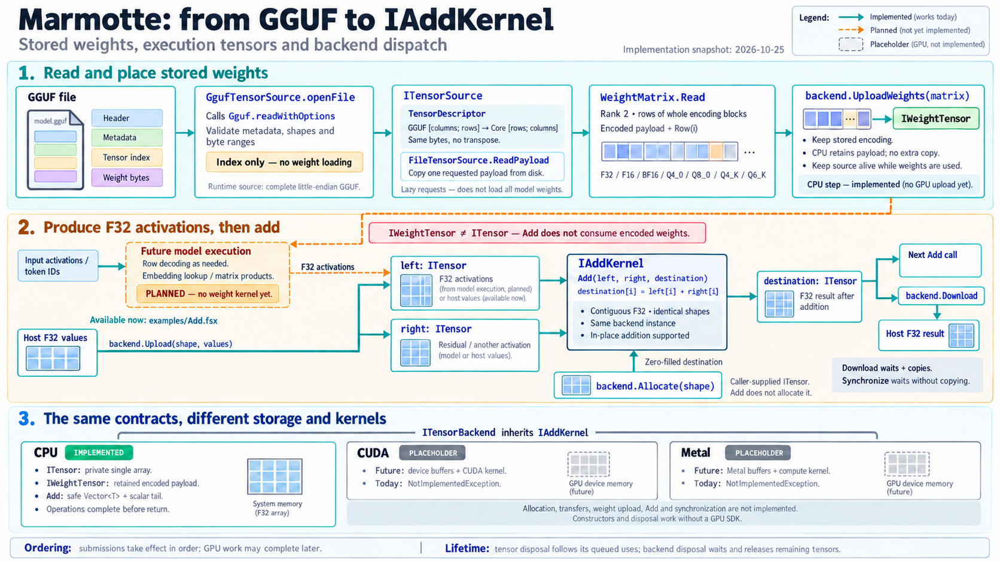

# Execution Tensors and Kernels

`Marmotte.Core` defines the compute contracts. `Marmotte.Cpu`, `Marmotte.Cuda`
and `Marmotte.Metal` each reference Core; Core references none of the backends.
The implemented operations are element-wise F32 addition, the SwiGLU
activation of the feed-forward layer, RMS normalization, embedding lookup from
stored weights, and the matrix-vector product with stored weights.

## From GGUF to Add



[Open the full-size diagram](gguf-to-add-kernel.png).

The diagram predates embedding lookup and `MatVec`, so it still shows both as
planned. Solid teal paths are
implemented, dashed amber paths are planned, and gray panels identify GPU
placeholders. Opening a source reads the index; `WeightMatrix.Read` requests a
payload through that source. CPU `UploadWeights` then retains the encoded
matrix without another payload copy.

Embedding lookup provides the first connection from stored weights to F32
activations, and `MatVec` multiplies stored weights by an F32 activation vector.
`IAddKernel` adds those activations, not encoded weights. `examples/Embedding.fsx`
demonstrates the lookup, while `examples/Add.fsx` supplies F32 host values
directly through `Upload`. Kernel outputs can feed another kernel without a
download; `Download` is the explicit route back to host values. The diagram's
planned embedding and matrix-product labels are now outdated.

The image was generated with the built-in `image_gen` tool and visually reviewed.
Its [generation and correction prompts](gguf-to-add-kernel.prompt.txt) are saved
alongside it. The contracts below remain the authoritative description.

## Stored Weights and Execution Tensors

`ITensorSource` and `WeightMatrix` provide read-only access to encoded model
weights. Their payloads can contain quantization blocks, and they cannot be
passed directly to `Add`. `backend.UploadWeights(matrix)` places a matrix on a
backend as an `IWeightTensor`, keeping its encoding, rows and columns: the
weights are never decoded as a whole. The CPU backend retains the matrix payload
without copying it; a GPU backend is expected to copy it into device memory.
Because a backend may retain the payload, keep the tensor source that produced
the matrix alive while the weight tensor is in use. Embedding lookup consumes
an `IWeightTensor` and token IDs; `MatVec` consumes an `IWeightTensor` and F32
`ITensor` values.

`ITensor` represents an owned, writable, contiguous **F32 execution tensor**.
Its `TensorShape` uses row-major dimensions: `[2; 3]` means two rows of three
values. Shapes copy their dimension arrays and expose a read-only collection.
An empty shape is a scalar with one value; any zero dimension makes an empty
tensor. Negative dimensions and element counts beyond `Array.MaxLength` are
rejected before allocating storage. Allocation still depends on available memory.

The tensor interface exposes shape, encoding and backend family, but no array,
span or native pointer. Each implementation owns its storage. `Upload` accepts
host `ReadOnlyMemory<single>` and copies it into new storage; `Download` copies
into caller-provided `Memory<single>`. Both require an exact element count.
This makes transfers explicit without requiring a GPU allocation to masquerade
as a managed array. Model weights use `UploadWeights` instead; kernels decode
them one row at a time.

## One Contract, Three Implementations

| Concern | CPU today | CUDA placeholder | Metal placeholder |
| --- | --- | --- | --- |
| Factory | `CpuBackend()` | `CudaBackend()` | `MetalBackend()` |
| Owned tensor storage | Private `single array` | Future device allocation | Future Metal buffer |
| `Allocate` | Zero-filled array | `NotImplementedException` | `NotImplementedException` |
| `Upload` / `Download` | Explicit host copies | `NotImplementedException` | `NotImplementedException` |
| `UploadWeights` | Retains the payload without copying | `NotImplementedException` | `NotImplementedException` |
| `Synchronize` | Nothing to wait for | `NotImplementedException` | `NotImplementedException` |
| `IAddKernel.Add` | Safe `Vector<T>` loop with a scalar tail | `NotImplementedException` | `NotImplementedException` |
| `ISwiGluKernel.SwiGlu` | Safe `Vector<T>` loop with `Vector.Exp`, scalar tail with `MathF.Exp` | `NotImplementedException` | `NotImplementedException` |
| `IRmsNormKernel.RmsNorm` | Safe `Vector<T>` loops, sum of squares in double precision | `NotImplementedException` | `NotImplementedException` |
| `IEmbeddingKernel.EmbeddingLookup` | Decodes selected rows with `RowDecoder` directly into F32 output | `NotImplementedException` | `NotImplementedException` |
| `IMatVecKernel.MatVec` | One decoded row at a time, `Vector<T>` dot product in double precision | `NotImplementedException` | `NotImplementedException` |
| SDK/driver required today | None | None | None |

`ITensorBackend` inherits `IAddKernel`, `ISwiGluKernel`, `IRmsNormKernel`,
`IEmbeddingKernel` and `IMatVecKernel`, so orchestration can call each kernel
directly on the backend.
A consumer needing a single operation can accept its kernel interface directly.
No generic operation registry, graph scheduler or native interop is needed for
this example.
GPU factories and disposal work on any host; all other operations fail explicitly,
without a CPU fallback. Concrete GPU tensor types will be introduced with their
storage implementation, rather than exposing unusable device handles now.

## Add and Buffer Reuse

```fsharp
open System
open Marmotte.Core
open Marmotte.Cpu

let addExample () =
    use backend = new CpuBackend() :> ITensorBackend
    let shape = TensorShape.Create [| 2; 3 |]
    use left = backend.Upload(shape, ReadOnlyMemory<single>([| 1.0f; 2.0f; 3.0f; 4.0f; 5.0f; 6.0f |]))
    use right = backend.Upload(shape, ReadOnlyMemory<single>([| 10.0f; 20.0f; 30.0f; 40.0f; 50.0f; 60.0f |]))
    use destination = backend.Allocate(shape)

    backend.Add(left, right, destination)

    let result = Array.zeroCreate<single> shape.ElementCount
    backend.Download(destination, result.AsMemory())
    result // [| 11.0f; 22.0f; 33.0f; 44.0f; 55.0f; 66.0f |]
```

`Add(left, right, destination)` writes `destination[i] = left[i] + right[i]`.
All three tensors must have exactly the same dimensions, not just the same
number of elements. There is no broadcasting, type promotion or strided view.
Empty tensors are valid no-ops; scalars add to scalars. NaN and infinities follow
ordinary F32 addition rather than being rejected as malformed model data.

The CPU backend processes `Vector<single>.Count` values at a time: four with
ARM64 NEON, eight with AVX2. It reinterprets its arrays as vectors with
`MemoryMarshal.Cast`, without unsafe code, and adds the remaining values one by
one. Each lane performs the same single-precision addition as a scalar loop, so
the results are identical. Kernels that reduce values, such as dot products,
will not have that property: vectorizing them changes the summation order, and
their tests will need tolerances.

The destination is explicit so a caller can reuse its buffer. Exact aliasing is
supported: `backend.Add(hidden, residual, hidden)` updates the hidden state in
place, and `backend.Add(hidden, hidden, hidden)` doubles it. Otherwise inputs are
unchanged. All arguments are validated before any destination write.

Every tensor must come from the **same backend instance** executing the kernel.
`BackendKind.Cpu` alone is insufficient: even another `CpuBackend` instance is a
different ownership domain. This leaves room for distinct devices and contexts
without treating their allocations as interchangeable. An explicit download and
upload is currently the only way to move values between instances.

## SwiGLU

The feed-forward layer of LLaMA-family models, including `mistral3`, gates one
projection with another. `SwiGlu(gate, up, destination)` writes
`destination[i] = silu(gate[i]) × up[i]`, with `silu(x) = x / (1 + e^-x)`; see
[GLU Variants Improve Transformer](https://arxiv.org/abs/2002.05202). In the
target model, `gate` and `up` are the 9,216-value outputs of `ffn_gate` and
`ffn_up`, and the result feeds `ffn_down`. The tensor rules are those of `Add`:
identical shapes, the same backend instance, exact aliasing such as
`backend.SwiGlu(gate, up, up)`, and validation before any write.

Unlike addition, the result depends on how the exponential is approximated. The
CPU backend uses `Vector.Exp` in vector lanes and `MathF.Exp` for the remaining
values. Measured on ARM64 for gates from -87 to 90, both stay within 2.2e-7
relative error of a double-precision SiLU, and they differ from each other by
at most four units in the last place. Tests therefore compare with a relative
tolerance of 1e-6. Below about -88.7, `e^-x` overflows in F32 and the result is
a signed zero instead of a value smaller than 1e-36. NaN gates stay NaN, and
`silu(-∞)` is NaN, as the formula gives.

On an Apple M4 Max, single-threaded in Release, the vectorized kernel takes about
0.63 ns per value, against 1.43 ns for a scalar loop with the same formula. One
feed-forward layer of 9,216 values takes about 5.8 µs instead of 13.3 µs.

## RMS Normalization

Each block normalizes the hidden state before attention and before the
feed-forward layer, and the model normalizes it once more before the LM head.
`RmsNorm(input, weight, epsilon, destination)` normalizes every row along the
last dimension, then multiplies each column by its weight:

```text
destination[r, c] = input[r, c] / sqrt(mean(input[r, *]²) + epsilon) × weight[c]
```

See [Root Mean Square Layer Normalization](https://arxiv.org/abs/1910.07467).
For the target model, rows have 3,072 values, `epsilon` is
`attention.layer_norm_rms_epsilon` (1e-5), and `weight` is one of the F32
`attn_norm`, `ffn_norm` or `output_norm` vectors. `input` and `destination` have
the same shape, of rank 1 or more, so one call can normalize every token of a
prompt. `weight` is an F32 `ITensor` of shape `[columns]`, not an
`IWeightTensor`: these vectors are small and already F32, so a caller can read
their payload and upload them once. `epsilon` must be finite and positive, so
that an all-zero row stays finite. Ownership, exact aliasing and validation
follow `Add`; empty tensors are valid no-ops.

The mean of the squares is a reduction, so its result depends on the summation
order. The CPU backend widens each vector to double precision and sums the
squares in two vector accumulators. This keeps rows of thousands of values
accurate, and squares beyond the F32 range, such as that of 1e30, do not
overflow. The scale `1 / sqrt(mean + epsilon)` is computed in double precision
and rounded once, then each value is multiplied by the scale and by its weight
in F32. Over 1,000 random rows of 3,072 values, the largest relative error
against a double-precision reference was 1.6e-7, and tests use a relative
tolerance of 1e-6. NaN or infinite values make their row's results NaN or zero,
as the formula gives; other rows are unaffected.

On an Apple M4 Max, single-threaded in Release, one row of 3,072 values takes
about 0.73 µs, against 3.3 µs for the same algorithm without vectors, which is
limited by its single chain of additions. The 53 normalizations of one token
take about 39 µs.

## Embedding Lookup

`EmbeddingLookup(weights, tokenIds, destination)` selects vocabulary rows:
`destination[i, column] = weights[tokenIds[i], column]`. It applies no scaling,
normalization or special handling for padding tokens. IDs are zero-based signed
integers in `[0, weights.Rows)` and can repeat or arrive in any order. The caller
chooses the matrix; the kernel does not infer architecture or tensor names.

```fsharp
let tokenIds = [| 7; 0; 7 |]
use activations = backend.Allocate(TensorShape.Create [| tokenIds.Length; weights.Columns |])
backend.EmbeddingLookup(weights, ReadOnlyMemory<int>(tokenIds), activations)
```

Destination must have exactly `[tokenIds.Length; weights.Columns]` dimensions,
including `[1; Columns]` for one token. An empty batch requires `[0; Columns]`
and performs no writes. Both tensors must be live and owned by the executing
backend instance. Shape and ownership errors raise `ArgumentException`, null
tensors raise `ArgumentNullException`, and an out-of-range ID raises
`ArgumentOutOfRangeException` identifying its position. Disposal raises
`ObjectDisposedException`. All arguments and every ID are checked before any
output is written, including for an empty batch.

The CPU lookup decodes each selected row with Core's `RowDecoder`, through
`WeightMatrix.DecodeRow`, which supports every current `TensorEncoding`: F32,
F16, BF16, Q4_0, Q8_0, Q4_K and Q6_K. It uses safe spans and explicit
little-endian reads, writing only requested rows directly into the destination,
with no temporary decoded matrix, row or block buffers. Stored weights remain unchanged. `WeightMatrix`
validates the payload length and whole blocks per row before upload; the source
still loads the complete encoded matrix into a managed array. Lookup does not
provide memory mapping or lazy file reads. Floating-point NaN, infinities,
subnormals and signed zeros follow F32 conversion and arithmetic.

The block layouts and reconstruction formulas were checked on 2026-10-25 against
[GGML block definitions](https://github.com/ggml-org/llama.cpp/blob/master/ggml/src/ggml-common.h)
and [GGML reconstruction formulas](https://github.com/ggml-org/llama.cpp/blob/master/ggml/src/ggml-quants.c):

| Encoding | Stored block | Reconstruction |
| --- | --- | --- |
| Q4_0 | 32 values, 18 bytes | `scale × (q − 8)` with an F16 scale and four-bit `q`; low nibbles precede high nibbles |
| Q8_0 | 32 values, 34 bytes | F16 scale times a signed byte |
| Q4_K | 256 values, 144 bytes | Eight groups of 32, each with six-bit scale and minimum factors; `d × scale × q − dmin × minimum` |
| Q6_K | 256 values, 210 bytes | Sixteen groups of 16; signed group scales and six-bit values centered at 32; `d × scale × (q − 32)` |

`RowDecoder` is an original scalar reference implementation, without unsafe
code or a native dependency. Embedding tests specify bytes and expected values
independently of Marmotte's quantizer, exercising packed fields, signed scales, block and row
boundaries, repeated IDs, and validation before writing. GPU lookup remains an
explicit placeholder. Unsupported encodings on a future backend must raise
`NotSupportedException` before submission.

IDs are consumed or copied before the call returns; callers may immediately
reuse the host ID buffer, but must not mutate it during the call. The CPU
operation completes before returning. An asynchronous backend must copy IDs
before returning and follow the same ordering rules as the other kernels.

## Matrix-Vector Product

Every projection of a block and the LM head multiply a stored weight matrix by
one F32 vector. `MatVec(weights, input, destination)` computes

```text
destination[r] = Σ weights[r, c] × input[c]
```

where `weights` is an `IWeightTensor` of `Rows` × `Columns` values, `input` has
shape `[Columns]` and `destination` has shape `[Rows]`. In the target model,
`attn_q` maps 3,072 values to 4,096, and the LM head maps them to the 131,072
logits of the vocabulary. Every tensor must belong to the executing backend.
`destination` must differ from `input`, because each output reads the whole
input. Validation and ordering otherwise follow `Add`.

The weights stay in their stored encoding. Core's `RowDecoder` decodes one row
of any `TensorEncoding` into F32, and `WeightMatrix.DecodeRow` applies it to a
row of a matrix. Block layouts and arithmetic follow `block_q4_0`, `block_q8_0`,
`block_q4_K` and `block_q6_K` in llama.cpp's `ggml-common.h`, and its reference
`dequantize_row_*` functions in `ggml-quants.c`. Tests pack Q4_K and Q6_K blocks
by hand from chosen scales, minimums and quants, and check every decoded value
exactly. Embedding lookup uses the same decoder.

The CPU backend decodes one row at a time into a pooled buffer, so its memory
use is one row, not a decoded matrix. It then computes the dot product with
`Vector<T>`, widening the products to double precision and summing them in two
vector accumulators. Each output is rounded to F32 once. Because outputs are
sums of many products that can cancel, tests compare them with a tolerance
relative to the sum of the absolute products, not to the output itself.

On the local Ministral `Q4_K_M` file, decoded weights have a mean near zero, a
standard deviation of 0.004 to 0.012 and no NaN or infinity. Applying the LM head
to the normalized embedding of 10 sample tokens gives each token the highest
logit. On an Apple M4 Max, single-threaded in Release, a `Q4_K` product takes
about 0.5 ns per weight and a `Q6_K` product about 0.83 ns: 7 ms for `attn_q`,
336 ms for the LM head, and about 2.1 s for all matrix products of one token.
Parallelizing across rows and vectorizing the decoders are the next
optimizations.

## Ordering, Completion and Lifetime

Operations submitted to one backend instance take effect in submission order: a
kernel sees the results of earlier kernels and transfers. A kernel may return
before its result is computed, so a GPU backend can queue a whole forward pass
without waiting for the device after each operation. `Upload` and
`UploadWeights` copy or retain their input before returning, so a host buffer
can be reused at once. `Download` waits for every earlier operation before
copying, and `Synchronize` waits without copying. A device failure in a queued
operation surfaces on a later call to the same backend, at the latest at the
next `Download` or `Synchronize`. The CPU backend completes every operation
before returning, which satisfies these rules; its `Synchronize` has nothing to
wait for.

Callers own the tensors a backend returns and dispose them when they no longer
need them. Disposing a tensor is ordered after the operations already submitted
that use it, so a GPU backend must defer releasing device memory until they
finish. Disposing the backend waits for submitted operations, then releases
every tensor it still owns: device memory is never released after its context,
and a forgotten tensor does not outlive its backend. Those tensors become
disposed, and disposing them again is a no-op. All disposals are idempotent,
and metadata stays readable afterwards. Operations on disposed storage or a
disposed backend raise `ObjectDisposedException`; invalid arguments raise
`ArgumentException` (or `ArgumentNullException`). Concurrent calls on one
backend, including disposal, are outside this initial contract.

## Run the Examples

From the repository root, with no model files or GPU installation:

```sh
dotnet fsi examples/Add.fsx
dotnet fsi examples/Embedding.fsx
```

The Add script loads the library sources, runs the same function with each backend,
prints the CPU result, and reports the GPU placeholders' exceptions at the first
upload. The embedding script uses a tiny in-memory F32 vocabulary and prints
the rows for IDs `[1; 0; 1]`. Tests also call GPU allocation, download and each
kernel directly to verify that all unfinished operations fail explicitly.
