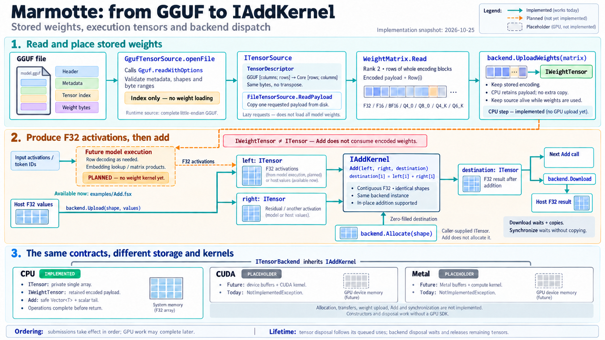

# Execution Tensors and Kernels

`Marmotte.Core` defines the compute contracts. `Marmotte.Cpu`, `Marmotte.Cuda`
and `Marmotte.Metal` each reference Core; Core references none of the backends.
The implemented operations are element-wise F32/F16 addition, the SwiGLU
activation of the feed-forward layer, RMS normalization, embedding lookup from
stored weights, matrix-vector and matrix-matrix products with stored weights,
rotary position embedding, and the attention temperature applied to queries. A
key-value cache keeps the keys and values of past positions in an encoding
chosen separately for each, from F32 down to Q4_0. Grouped-query attention
reads that cache, and row copying selects activations for later computation.

Each operation has a dedicated guide in `docs/kernels/`. Start with Add,
RMSNorm and SwiGLU for basic operations, then follow embedding lookup,
matrix products, RoPE and attention. Shared tensor ownership and ordering
contracts remain on this page.

## Reading the Formulas

A **kernel** is a focused numerical operation on tensors. For these examples,
think of a tensor as an array with a shape: `[3]` holds three values, and
`[2; 3]` holds two rows of three values. F32 means a 32-bit floating-point value.
**Activations** are intermediate values computed for the current input;
**weights** are the model's learned parameters, reused across inputs.

The guides below use small, invented inputs and reuse the existing illustrations.
Read the input shapes first, follow one output value, then repeat the operation
over the remaining positions or rows. Indexes start at zero. Approximate values
in the pictures are rounded to four decimal places for display; calculations
use unrounded intermediates.

| Notation | Meaning |
| --- | --- |
| `x[i]` | Value at position `i` in a vector |
| `X[t, c]` | Feature `c` of token row `t` |
| `W[r, c]` | Weight in output row `r`, input column `c` |
| `X[t, *]` or `X[t, :]` | All columns of row `t` |
| `C`, `R`, `T` | Input feature count, output feature count, token count |
| `Σ_c` | Add the terms for every column `c`, from `0` to `C - 1` |
| `mean(...)` | Sum the values, then divide by their count |
| `sqrt(...)`, `exp(z)` | Square root, and the exponential `e` raised to `z` |
| `Wᵀ` | Transposed matrix in the mathematical expression: rows become columns |

| Kernel or technique | What one output represents | Walkthrough |
| --- | --- | --- |
| Add | Sum of two values at the same position | [Matching positions](kernels/add.md#add-and-buffer-reuse) |
| SwiGLU | One value multiplied by a smooth gate | [Three scalar steps](kernels/swiglu.md) |
| RMSNorm | One value rescaled using its row's magnitude and a learned weight | [Measure, normalize, scale](kernels/rmsnorm.md) |
| EmbeddingLookup | A feature copied or decoded from the vocabulary row selected by an ID | [Select rows](kernels/embedding.md#embedding-lookup) |
| CopyRows | A value copied from a consecutive range of activation rows | [Select token rows](kernels/copy-rows.md) |
| MatVec | Sum of products between one weight row and one input vector | [One dot product](kernels/matvec.md#matrix-vector-product) |
| MatMul | The same dot product for one token in a batch | [Reuse rows across tokens](kernels/matmul.md#matrix-matrix-product) |
| Rope | One value of a pair turned by an angle that grows with the token's position | [Rotate pairs](kernels/rope.md#rotary-position-embedding) |
| YaRN (parameter preparation) | Adjusted RoPE frequencies and an attention magnitude factor | [Extend context](kernels/yarn.md#yarn-context-extension) |
| AttentionTemperature | One query value multiplied by a factor of its position block | [Scale queries](kernels/attention-temperature.md#attention-temperature) |
| StoreKeyValues / ReadKeyValues | One cached key or value of a past position, encoded and decoded back to F32 | [Key-value cache](kernels/key-value-cache.md#key-value-cache) |
| Attention | A weighted combination of the visible cached values for one query head | [Grouped-query attention](kernels/attention.md) |

For scheduling, arithmetic policies and measurements shared by MatVec and
MatMul, continue with [CPU matrix products](kernels/matrix-products.md).

All listed kernels and the key-value cache have CPU implementations. CUDA also
implements Add, SwiGLU, RMS normalization and row copies, all in F32 and F16, F32/F16
device storage/transfers and stored weight uploads in all fourteen runtime
encodings; its remaining kernels and Metal
remain placeholders. See the [CUDA build and implementation guide](cuda.md).
Core implements YaRN parameter preparation. Attention temperature has a worked
example in text. The eight walkthrough images in the dedicated
[kernel guides](#reading-the-formulas) were
generated with the built-in `image_gen` tool, visually reviewed, and their
numerical examples checked independently. The generation prompts for
[RoPE and YaRN](kernels/rope-yarn-illustrations.prompt.txt) are kept alongside those guides.
The older overview below has its own status note.

## From GGUF to Add



[Open the full-size diagram](gguf-to-add-kernel.png).

The diagram predates embedding lookup and `MatVec`, so it still shows both as
planned. Solid teal paths are
implemented, dashed amber paths are planned, and gray panels identify GPU
placeholders at the time the diagram was drawn; CUDA Add is now implemented.
Opening a source reads the index; `WeightMatrix.Read` requests a
payload through that source. CPU `UploadWeights` then retains the encoded
matrix without another payload copy.

Embedding lookup provides the first connection from stored weights to F32
activations, and `MatVec` multiplies stored weights by an F32 activation vector.
`IAddKernel` adds those activations, not encoded weights. `examples/Embedding.fsx`
demonstrates the lookup, while `examples/Add.fsx` supplies F32 and F16 host values
directly through `Upload`. Kernel outputs can feed another kernel without a
download; `Download` is the explicit route back to host values. The diagram's
planned embedding and matrix-product labels are now outdated.

The image was generated with the built-in `image_gen` tool and visually reviewed.
Its [generation and correction prompts](gguf-to-add-kernel.prompt.txt) are saved
alongside it. The contracts below remain the authoritative description.

## Stored Weights and Execution Tensors

`ITensorSource` and `WeightMatrix` provide read-only access to encoded model
weights. Their payloads can contain quantization blocks, and they cannot be
passed directly to `Add`. `backend.UploadWeights(matrix)` places a matrix on a
backend as an `IWeightTensor`, keeping its encoding, rows and columns: the
weights are never decoded as a whole. The CPU backend retains the matrix payload
without copying it; a GPU backend is expected to copy it into device memory.
Because a backend may retain the payload, keep the tensor source that produced
the matrix alive while the weight tensor is in use. Embedding lookup consumes
an `IWeightTensor` and token IDs; `MatVec` consumes an `IWeightTensor` and F32
`ITensor` values.

`ITensor` represents an owned, writable, contiguous **F32 or F16 execution tensor**.
Its `TensorShape` uses row-major dimensions: `[2; 3]` means two rows of three
values. Shapes copy their dimension arrays and expose a read-only collection.
An empty shape is a scalar with one value; any zero dimension makes an empty
tensor. Negative dimensions and element counts beyond `Array.MaxLength` are
rejected before allocating storage. Allocation still depends on available memory.

The tensor interface exposes shape, encoding and backend family, but no array,
span or native pointer. Each implementation owns its storage. `Upload` accepts
host `ReadOnlyMemory<single>` or `ReadOnlyMemory<Half>` and copies it into new
storage of the matching encoding; `Download` copies into caller-provided
`Memory<single>` or `Memory<Half>` of that same encoding. Both require an exact
element count. A mismatched download is rejected before writing; transfers do
not convert precision. `Allocate(shape)` defaults to F32; the overload
`Allocate(shape, encoding)` accepts F32 or F16 and rejects other encodings.
This makes transfers explicit without requiring a GPU allocation to masquerade
as a managed array. Model weights use `UploadWeights` instead; kernels decode
them one row at a time.

## One Contract, Three Implementations

| Concern | CPU today | CUDA today | Metal placeholder |
| --- | --- | --- | --- |
| Factory | `CpuBackend()` | `CudaBackend(deviceIndex = 0)` | `MetalBackend()` |
| Owned tensor storage | Private `single array` or `Half array` | Private F32 or F16 device allocation | Future Metal buffer |
| `Allocate` | Zero-filled array | Device allocation, zeroed on the stream | `NotImplementedException` |
| `Upload` / `Download` | Explicit host copies | Explicit copies through managed staging arrays, complete on return | `NotImplementedException` |
| `UploadWeights` | Retains the payload without copying | Stored-encoding device upload with bounded staging | `NotImplementedException` |
| `Synchronize` | Nothing to wait for | Waits for the instance's stream | `NotImplementedException` |
| `IAddKernel.Add` | F32: safe `Vector<T>` loop with a scalar tail; F16: scalar Half loop | Separate F32/F16 kernels, 256 threads per block | `NotImplementedException` |
| `ISwiGluKernel.SwiGlu` | Safe `Vector<T>` loop with `Vector.Exp`, remainder in one zero-padded vector | F32/F16 kernels with the device `expf`, 256 threads per block; F16 is computed in F32 and rounded once | `NotImplementedException` |
| `IRmsNormKernel.RmsNorm` | Safe `Vector<T>` loops, sum of squares in double precision | F32/F16 kernels, one block per row, double-precision reduction; F16 widens to F32 and rounds once | `NotImplementedException` |
| `IEmbeddingKernel.EmbeddingLookup` | Decodes selected rows with `RowDecoder` directly into F32 output | `NotImplementedException` | `NotImplementedException` |
| `IRowCopyKernel.CopyRows` | Validated contiguous row copy over safe spans | F32/F16: one asynchronous device-to-device copy on the stream, no kernel | `NotImplementedException` |
| `IMatVecKernel.MatVec` | Parallel rows, safe intrinsics and double-precision dot products | `NotImplementedException` | `NotImplementedException` |
| `IMatMulKernel.MatMul` | Each integer or decoded row shared by every token of the batch | `NotImplementedException` | `NotImplementedException` |
| `IRopeKernel.Rope` | Angles in double precision once per token, shared by every head | `NotImplementedException` | `NotImplementedException` |
| `IAttentionTemperatureKernel.ApplyAttentionTemperature` | One F32 factor per token, `Vector<T>` multiplication | `NotImplementedException` | `NotImplementedException` |
| `AllocateKeyValueCache` | Whole capacity up front: one byte array per layer for keys, one for values | `NotImplementedException` | `NotImplementedException` |
| `IKeyValueCacheKernel` | Encodes whole batches with `RowEncoder`, reads them back with `RowDecoder` | `NotImplementedException` | `NotImplementedException` |
| `IAttentionKernel.Attention` | Causal grouped-query attention over cached heads; online and reference modes | `NotImplementedException` | `NotImplementedException` |
| SDK/driver required today | None | Toolkit for native builds, driver/GPU for non-empty tensors | None |

`ITensorBackend` inherits `IAddKernel`, `ISwiGluKernel`, `IRmsNormKernel`,
`IEmbeddingKernel`, `IRowCopyKernel`, `IMatVecKernel`, `IMatMulKernel`, `IRopeKernel`,
`IAttentionTemperatureKernel`, `IKeyValueCacheKernel` and `IAttentionKernel`, so orchestration can
call each kernel directly on the backend.
A consumer needing a single operation can accept its kernel interface directly.
CUDA uses a small native library through P/Invoke. Construction and empty tensors
need no CUDA installation; the first non-empty allocation initializes the device.
GPU tensors expose only Core's interfaces, not native pointers. Metal operations
and unfinished CUDA operations fail explicitly, without a CPU fallback.

## Add and Buffer Reuse

See the [Add and Buffer Reuse guide](kernels/add.md#add-and-buffer-reuse).

## Half Add and memory use

See the [Half Add and memory use guide](kernels/add.md#half-add-and-memory-use).

## SwiGLU

`SwiGlu(gate, up, destination)` computes `silu(gate) × up` element by element.
The [SwiGLU guide](kernels/swiglu.md) contains the illustration, worked example,
tensor contract and CPU numerical and performance notes.

## RMS Normalization

`RmsNorm(input, weight, epsilon, destination)` normalizes each row along the
last dimension, then applies a learned weight per column. The
[RMSNorm guide](kernels/rmsnorm.md) explains the three steps with an
illustration, a runnable F# example, the tensor contract and CPU numerical notes.

## Embedding Lookup

See the [Embedding Lookup guide](kernels/embedding.md#embedding-lookup).
The [R.4 beginner guide](kernels/embedding-cuda.md) explains the planned CUDA
path with two infographics and runnable CPU examples.

## Matrix-Vector Product

See the [Matrix-Vector Product guide](kernels/matvec.md#matrix-vector-product).

## Matrix-Matrix Product

See the [Matrix-Matrix Product guide](kernels/matmul.md#matrix-matrix-product).

## Measure parallel matrix products

See the [Measure parallel matrix products guide](kernels/matrix-products.md#measure-parallel-matrix-products).

### Follow ownership through the workers

See [Follow ownership through the workers](kernels/matrix-products.md#follow-ownership-through-the-workers).

## Quantize activations once for K-quant products

See the [Quantize activations once for K-quant products guide](kernels/matrix-products.md#quantize-activations-once-for-k-quant-products).

### Choose the arithmetic policy

See [Choose the arithmetic policy](kernels/matrix-products.md#choose-the-arithmetic-policy).

### Follow one block through the product

See [Follow one block through the product](kernels/matrix-products.md#follow-one-block-through-the-product).

### Account for error and exceptional values

See [Account for error and exceptional values](kernels/matrix-products.md#account-for-error-and-exceptional-values).

### Recorded kernel timings

See [Recorded kernel timings](kernels/matrix-products.md#recorded-kernel-timings).

### Reference contracts

See [Reference contracts](kernels/matrix-products.md#reference-contracts).

## Rotary Position Embedding

See the [Rotary Position Embedding guide](kernels/rope.md#rotary-position-embedding).

## YaRN Context Extension

See the [YaRN Context Extension guide](kernels/yarn.md#yarn-context-extension).

## Attention Temperature

See the [Attention Temperature guide](kernels/attention-temperature.md#attention-temperature).

## Key-Value Cache

See the [Key-Value Cache guide](kernels/key-value-cache.md#key-value-cache).

## Copy Rows

See the [CopyRows guide](kernels/copy-rows.md) for selecting contiguous token rows
without a host transfer.

## Ordering, Completion and Lifetime

Operations submitted to one backend instance take effect in submission order: a
kernel sees the results of earlier kernels and transfers. A kernel may return
before its result is computed, so a GPU backend can queue a whole forward pass
without waiting for the device after each operation. `Upload` and
`UploadWeights` copy or retain their input before returning, so a host buffer
can be reused at once. `Download` waits for every earlier operation before
copying, and `Synchronize` waits without copying. A device failure in a queued
operation surfaces on a later call to the same backend, at the latest at the
next `Download` or `Synchronize`. The CPU backend completes every operation
before returning, which satisfies these rules; its `Synchronize` has nothing to
wait for.

Callers own the tensors a backend returns and dispose them when they no longer
need them. Disposing a tensor is ordered after the operations already submitted
that use it, so a GPU backend must defer releasing device memory until they
finish. Disposing the backend waits for submitted operations, then releases
every tensor it still owns: device memory is never released after its context,
and a forgotten tensor does not outlive its backend. Those tensors become
disposed, and disposing them again is a no-op. All disposals are idempotent,
and metadata stays readable afterwards. Operations on disposed storage or a
disposed backend raise `ObjectDisposedException`; invalid arguments raise
`ArgumentException` (or `ArgumentNullException`). Concurrent calls on one
backend, including disposal, are outside this initial contract.

## Run the Examples

From the repository root, with no model files or GPU installation:

```sh
dotnet fsi examples/Add.fsx
dotnet fsi examples/Embedding.fsx
dotnet fsi examples/KeyValueCache.fsx
```

The Add script loads the library sources, prints the CPU result, and reports the
Metal placeholder's exception at the first upload. `examples/CudaAdd.fsx` uses
compiled assemblies and a native library to run Add on CUDA; follow the
[CUDA build instructions](cuda.md) first. The embedding script uses a tiny in-memory F32 vocabulary and prints
the rows for IDs `[1; 0; 1]`. The key-value cache script prints the target
model's cache size for each encoding, then stores random keys in a small CPU
cache and prints the root mean square and largest errors after reading them
back. Tests also call GPU allocation, download and each
kernel directly to verify that all unfinished operations fail explicitly.

## Grouped-query attention

See the [Grouped-query attention guide](kernels/attention.md#grouped-query-attention).

### Online attention and H.3 measurements

See the [attention measurements](kernels/attention.md#online-attention-and-h3-measurements).
### 1. Store the keys and values

See [1. Store the keys and values](kernels/attention.md#1-store-the-keys-and-values).

### 2. Share the KV heads

See [2. Share the KV heads](kernels/attention.md#2-share-the-kv-heads).

### 3. Normalize only the visible scores

See [3. Normalize only the visible scores](kernels/attention.md#3-normalize-only-the-visible-scores).

### Validation and references

See [Validation and references](kernels/attention.md#validation-and-references).
