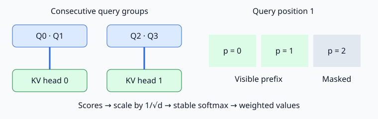

# Grouped-query attention

[Back to execution tensors and kernels](../kernels.md).


Learn how a query selects information from its causal prefix. Prerequisites:
.NET 10 and the [cache concepts](key-value-cache.md). Run the self-contained
example from the repository root without a model file:

```sh
dotnet fsi examples/Attention.fsx
```

## 1. Store the keys and values

The example stores three positions, each with two KV heads of two channels.
In a model, keys have already received RoPE; values have not. Queries have
received RoPE and any position-dependent attention temperature scaling.
Store the whole prompt batch before calling attention: the kernel's causal
mask prevents earlier tokens from seeing later ones.

## 2. Share the KV heads

Allocate queries and destination with shape `[3; 4; 2]`: tokens, query heads,
channels. Four query heads share two KV heads, in consecutive groups:



For query head `h`, the KV head is `h / (queryHeads / KeyValueHeads)` using
integer division. This also covers multi-head attention (one query per KV head)
and multi-query attention (one KV head shared by every query).

```fsharp
backend.Attention(cache, 0, 0, queries, output)
```

The arguments select the cache, layer, first absolute query position, queries
and destination. Both tensors must have identical shapes, either
`[tokens; queryHeads; HeadDimension]` or `[tokens; queryHeads × HeadDimension]`.
The number of query heads must be positive and divisible by the KV head count.
The destination cannot alias queries. All storage belongs to the same backend.

## 3. Normalize only the visible scores

For token `t` at absolute position `p = position + t`, each head computes:

```text
score[j] = sum(Q[c] × K[j,c]) / sqrt(HeadDimension), 0 <= j <= p
weight[j] = exp(score[j] - max(score)) / sum(exp(score - max(score)))
output[c] = sum(weight[j] × V[j,c])
```

The maximum subtraction prevents exponential overflow for large finite scores.
CPU attention defaults to `CpuAttentionMode.Online`: scores use F32 and running
value sums and the denominator use double precision, with O(head dimension)
scratch. `Reference` retains the original F32 reduction and prefix-length score
buffer. Both reuse scratch across tokens and heads. K and V can independently
use any supported cache encoding. Each head slice contains whole encoding
blocks, so no full-cache F32 copy is needed. Future rows are not decoded at all,
including future rows containing NaN. Non-finite visible data or overflowing
scores can produce NaN; finite inputs are not a guarantee against F32 overflow.

The example uses zero queries, hence equal scores and uniform probabilities.
It prints the causal averages (two identical outputs per KV group), shown
rounded below; the reference F32 accumulation can print `60.00000381f` instead of `60.0f`:

```text
Position 0: [|2.0f; 4.0f; 2.0f; 4.0f; 20.0f; 40.0f; 20.0f; 40.0f|]
Position 1: [|4.0f; 6.0f; 4.0f; 6.0f; 40.0f; 60.0f; 40.0f; 60.0f|]
Position 2: [|6.0f; 8.0f; 6.0f; 8.0f; 60.0f; 80.0f; 60.0f; 80.0f|]
```

For generation, store the next K/V row, then pass a single query token and its
absolute position. Batched queries can also start inside an existing prefix.
Every query position must already be stored in that layer; an empty batch is
valid at any position from zero through `StoredPositions(layer)`. Validation
finishes before writing output. A replaced/truncated cache immediately limits
which positions can be attended to. CUDA and Metal expose the contract but
still throw `NotImplementedException`.

## Online attention and H.3 measurements

To compare attention algorithms while keeping matrix arithmetic fixed:

```fsharp
use online = new CpuBackend(CpuMatrixProductMode.QuantizedK, CpuAttentionMode.Online)
use reference = new CpuBackend(CpuMatrixProductMode.QuantizedK, CpuAttentionMode.Reference)
```

The parameterless and one-policy constructors both select online attention.
`examples/InferencePerformance.fsx` runs both algorithms against identical F32
and Q8_0 caches, without a local model:

```sh
dotnet build Marmotte.slnx -c Release
DOTNET_TieredCompilation=0 dotnet fsi --optimize+ examples/InferencePerformance.fsx
```

For each query head, online attention scans visible positions once. It maintains
a maximum `m`, a denominator `l` and a vector of weighted values `a`. For the next
finite score `s`, update:

```text
mNext = max(m, s)
r = exp(m - mNext)
w = exp(s - mNext)
lNext = r * l + w
aNext = r * a + w * value
output = a / l after the final visible position
```

Initially `m = -infinity`, `l = 0`, and `a = 0`. An initial negative-infinity
score has zero mass; a later finite score can still produce valid output. An
all-negative-infinity sequence normalizes to NaN, as does the reference.
Positive-infinity/NaN scores propagate NaN. Masked positions are never decoded.

This fuses score normalization and value accumulation without a prefix-sized
score array. Every K/V head is still decoded once per visible position **per
query head**; this implementation does not yet tile multiple queries or share
those decodes across a query group. It is a CPU online fused attention kernel,
not a GPU-tiled FlashAttention implementation. It does not alter the attention
formula or introduce quantization. The online normalization principle is
explained by [Milakov and Gimelshein (2018)](https://arxiv.org/abs/1805.02867);
[FlashAttention (Dao et al., 2022)](https://arxiv.org/abs/2205.14135) applies
memory-aware fusion and tiling to exact attention on GPUs. Marmotte's loops are
original code, and those papers' GPU speedups are not predictions for this CPU.

Scores and exponentials use F32. Running weighted values and the denominator
use double precision because their unnormalized sums can overflow F32 even
when the final weighted average is finite. Safe `Vector<T>` operations widen
values and accumulate the sums, followed by one final F32 rounding per channel.
The scalar fallback uses the same precision. The order of arithmetic differs
from `Reference`, so compare with tolerances rather than bit equality.

Recorded on 2026-11-08, ARM64, .NET 10.0.12, 14 logical processors; head width
128, eight query heads, two KV heads. Three warmup calls precede seven groups
of three timed calls; fixture/cache setup and transfers are excluded.

| K/V encoding | Prefix | Query tokens | Reference | Online |
| --- | ---: | ---: | ---: | ---: |
| F32 | 128 | 8 | 2.180 ms | 1.826 ms |
| F32 | 2,048 | 1 | 4.504 ms | 3.799 ms |
| F32 | 2,048 | 8 | 35.906 ms | 30.734 ms |
| Q8_0 | 128 | 8 | 1.796 ms | 1.482 ms |
| Q8_0 | 2,048 | 1 | 3.742 ms | 3.114 ms |
| Q8_0 | 2,048 | 8 | 30.102 ms | 24.780 ms |

Maximum absolute differences in these cases are below 4.6e-6. Managed allocations
per call are 1,584 bytes online, independent of prefix length, versus 1,072 bytes
for the 128-position reference and 8,752 bytes for 2,048 positions. Online scratch
can therefore be larger for short prefixes because it stores a double value
vector. Neither algorithm reduces the allocated KV cache. These are attention
kernel measurements, not full-generation throughput; see [selected-logit
measurements](../forward-pass.md#request-only-the-logits-you-need) for the other
part of H.3.

An optional real-model check on Ministral-3-3B-Instruct-2512-Q4_K_M used
`La capitale de la France est`. The selected/full final logit rows were exactly
equal within each attention mode. Comparing attention modes with `DecodedFloat`
matrix products gave a maximum final-logit difference of 1.91e-6. With H.2's
`QuantizedK` policy, that difference reached 0.361 and the top token changed:
intermediate rounding can cross later activation-quantization thresholds.
The default CLI still completed its eight-token budget, producing
` Paris. C'est une ville très connue`. This single prompt is not a model-quality
evaluation. To retain the previous H.2 arithmetic, construct
`CpuBackend(CpuMatrixProductMode.QuantizedK, CpuAttentionMode.Reference)`.

## Validation and references

`AttentionTests` compares against an independent dense, double-precision
reference, covers multi-query, grouped and multi-head layouts, and checks
batch/single-token equivalence, nonzero batch offsets, causal masking, large
scores, all 81 K/V encoding combinations, validation and lifetime failures.
Quantized attention is compared with the actual decoded cached values; this
does not establish model-quality tolerances for cache quantization. There is
no end-to-end accuracy or throughput guarantee from these kernel checks.

The grouping follows [Ainslie et al., GQA (2023)](https://arxiv.org/abs/2305.13245).
Scaled dot-product attention is defined in
[Vaswani et al., Attention Is All You Need, section 3.2.1](https://arxiv.org/abs/1706.03762).
The implementation is original; neither reference code nor a native library is
required by the kernel or its tests.
