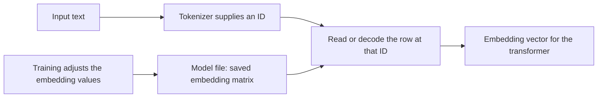
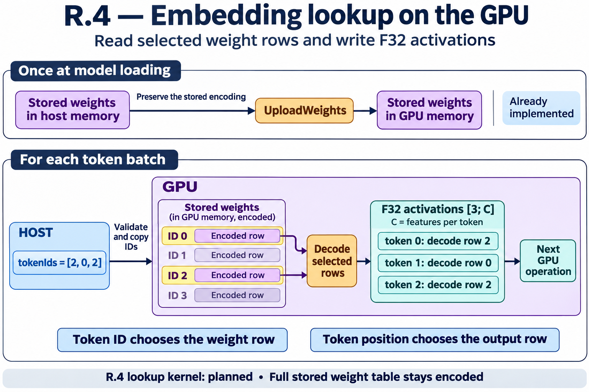
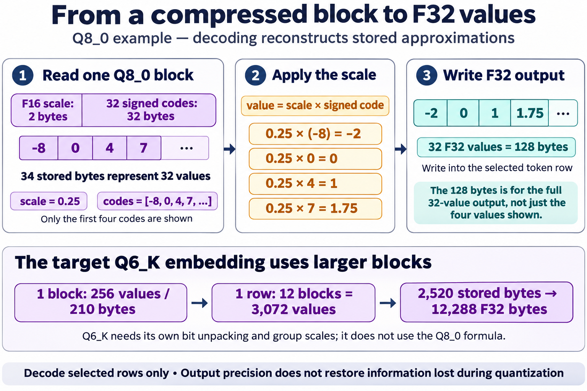

# R.4: understand embedding lookup on the GPU

[Back to embedding lookup](embedding.md) · [Kernel index](../kernels.md) ·
[Roadmap](../../ROADMAP.md#r-cuda-element-wise-normalization-and-lookup-kernels)

By the end of this guide, you should be able to follow a token ID from a host
array to a row of F32 values on the GPU, explain what decoding compressed
weights means, and understand the work planned in R.4. You need arrays and
basic multiplication. The runnable examples use .NET 10 and require neither
a model download nor a GPU.

**Status: F32, F16, Q4_0 and Q8_0 are implemented on the GPU** in
`kernels/Embedding.cu`; every other stored encoding raises
`NotSupportedException` before submission. The CPU implements embedding
lookup for every encoding, and CUDA already uploads weights in their stored
encoding. This guide explains the operation and its implementation, not a
measured speedup.

## 1. An embedding is a row selected by a token ID

A tokenizer turns text into integer IDs. An **embedding matrix** is a learned
table with one row per vocabulary ID. A row contains numerical features used
by the following transformer layers; it is not a definition of a word or a
list of output probabilities. A token can represent a word fragment, punctuation
or another tokenizer-defined piece.

### Where do the stored numbers come from?

The token ID is an **address in a table**. It does not contain the embedding
values or provide a formula for calculating them. Two different objects are
prepared before Marmotte runs:

- The **tokenizer vocabulary** associates text pieces with integer IDs.
- The **model's embedding matrix** holds a learned vector at each of those IDs.

For a language model trained from scratch, the embedding values are initialized,
often randomly. Training then repeatedly asks the model to predict the next
token in example text. A prediction error is computed, and the training
algorithm adjusts the embedding values along with the other trainable weights
to reduce that error. The resulting numbers are saved as part of the model.
The [embedding API reference](https://docs.pytorch.org/docs/2.15/generated/torch.nn.Embedding.html)
shows this distinction between a table of learnable weights and the indexes
used to retrieve them.

Marmotte performs **inference**: it loads those saved weights and reads them.
For the GGUF model layout used here, the embedding matrix is named
`token_embd.weight`. Its values are in the file's tensor payload, possibly
quantized. The tokenizer and model must agree on the vocabulary IDs.



Each row's values are coordinates in a learned feature space. Its columns do
not come with fixed human labels such as "animal", "color" or "plural". The
following layers learn to use combinations of these coordinates. At inference,
the initial lookup gives the same vector for the same ID; later transformer
operations combine it with position and context.

### A small table to follow the lookup

**The values below are chosen by hand for this explanation.** In particular,
`[1; 0; 2]` is neither calculated from ID `0` nor extracted from a real model.
Simple integers make the row selection visible. Imagine that this is the
table already saved in a tiny F32 model, with four vocabulary entries and
three features per entry:

| Token ID (row index) | Stored feature values (invented) |
| --- | --- |
| 0 | `[1; 0; 2]` |
| 1 | `[-1; 3; 0]` |
| 2 | `[2; 2; 2]` |
| 3 | `[0; 1; -1]` |

Read the first line as: **"row 0 already contains the three numbers 1, 0 and
2; when ID 0 arrives, return those numbers."** This is ordinary table access,
`embeddingTable[0]`. The three returned numbers are feature values, not three
more token IDs. A real row usually contains many more floating-point values;
the target model in R.4 has 3,072 per token.

For IDs `[2; 0; 2]`, the output contains these three rows, in this order:

```text
token position 0 -> vocabulary row 2 -> [2; 2; 2]
token position 1 -> vocabulary row 0 -> [1; 0; 2]
token position 2 -> vocabulary row 2 -> [2; 2; 2]
```

The **ID** selects a weight row; the **position in the input batch** selects
the output row. Repeated IDs repeat their embeddings. Nothing is summed across
rows. With `T` input tokens, `V` vocabulary entries and `C` features:

```text
weights shape     = [V; C]
destination shape = [T; C]
destination[t, c] = decodedWeights[tokenIds[t], c]
```

`decodedWeights` describes the values mathematically. R.4 should reconstruct
only the requested rows, without allocating that entire decoded table.
The three-column example uses F32: real quantized rows must contain whole
blocks of their encoding.

## 2. Follow the data from the CPU to the GPU

In CUDA terminology, the CPU and its memory are the **host**; the GPU is the
**device**, with its own device memory, often called VRAM. A **kernel** is a
function launched on the GPU. These terms describe where the data and work
live, independently of their numerical encoding.



[Open the data-flow infographic](embedding-cuda-flow.png).

There are two different moments:

1. **At model loading**, `UploadWeights` transfers the table into GPU memory
   with its original encoding. This already exists. Quantized weights stay
   quantized; uploading is not decoding. The current upload reuses at most
   4 MiB of managed staging space, while the whole stored payload occupies VRAM.
2. **For a token batch**, the lookup validates the IDs, copies them into
   context-owned device memory before returning, reads the selected stored
   rows and writes their F32 values straight into the destination. The
   destination can feed subsequent GPU operations without a download. Those
   later kernels have their own roadmap work.

F32 storage already contains F32 values; F16 and BF16 need conversion to F32.
Quantized encodings require decoding. The resulting activation tensor is F32
in every case. R.4 does not change the learned weights or run training.

The full stored weight table remains allocated on the GPU even when only one
row is requested. This saves a full F32 expansion, not the stored table itself.
Model loading, host sources, other weights and caches have their own memory
costs. See [stored CUDA weight uploads](../cuda.md#upload-stored-weights-and-release-vram).

## 3. Decode one compressed block

Quantization stores approximations to floating-point weights using compact
codes and scaling information. A **quantization block** is a group of values
whose encoding shares that information. It is a data format, distinct from
a CUDA **thread block**, which groups parallel workers.

Start with Q8_0: one block represents 32 values with an F16 scale and 32 signed
8-bit codes. The stored block occupies `2 + 32 = 34` bytes. Each value is
reconstructed as `scale × signedCode`.



[Open the block-decoding infographic](embedding-cuda-block.png).

For the first four codes `[-8; 0; 4; 7]` and scale `0.25`, the decoded values
are `[-2; 0; 1; 1.75]`. All 32 values are written as F32, occupying 128 bytes.
An F32 output makes these approximations usable by the following kernels; it
does not recover information already lost when the weights were quantized.

Other formats require different decoding rules. Q4_0 stores two four-bit codes
per byte and reconstructs `scale × (code - 8)`. Q6_K combines packed low and
high bits with group scales and a block scale. Applying Q8_0's formula to a
Q6_K payload would produce incorrect values. The [encoding reference](embedding.md)
lists the formats; Core's [RowDecoder](../../src/Marmotte.Core/RowDecoder.fs)
provides the existing CPU behavior to check against.

## 4. Put the target model's sizes into perspective

R.4 names an embedding matrix with **131,072 rows and 3,072 features**, stored
as **Q6_K**. These are the roadmap's target-model values, not assumptions the
kernel may make about every file.

A Q6_K block represents 256 values in 210 bytes, including its scales.
Therefore:

```text
blocks per row    = 3,072 / 256 = 12
stored row bytes  = 12 × 210 = 2,520
stored table      = 131,072 × 2,520 = 330,301,440 bytes = 315 MiB
full F32 table    = 131,072 × 3,072 × 4 = 1,536 MiB = 1.5 GiB
one F32 output row = 3,072 × 4 = 12,288 bytes = 12 KiB
```

For three input tokens, the output is `3 × 12 KiB = 36 KiB`. The stored table
still takes 315 MiB; a separate 1.5 GiB F32 table is unnecessary. These are
payload sizes, with `1 KiB = 1,024 bytes` and `1 MiB = 1,048,576 bytes`;
allocation overhead and temporary ID buffers are additional. They are not
measurements of total model memory or runtime performance.

This explains why the first F32/F16/Q4_0/Q8_0 milestone will not yet cover the
target model: its embedding specifically needs Q6_K decoding.

## 5. Give each GPU worker a piece of the row

CUDA launches many **threads**, grouped into **thread blocks** and a **grid**.
Threads can use their indexes to choose the output values they own. The
implemented lookup uses this design:

```text
for each token position t, in parallel:
    rowId = tokenIds[t]
    for each assigned column c:
        decode the value at column c of stored row rowId
        write destination[t, c]
```

One thread block handles one requested row, with 256 threads working across
its columns. For 3,072 columns, thread `k` handles columns `k`, `k + 256`,
... up to `k + 11 × 256`. Each output value has one writer, and adjacent
threads write adjacent F32 columns. A block-oriented decoder could instead
assign work by quantization block to reuse scale information; that choice
still needs measurements, especially for a one-token batch.

The encoding determines how to locate a value. For a validated row width `C`:

```text
rowBytes       = (C / encoding.BlockElements) × encoding.BlockBytes
rowByteOffset  = rowId × rowBytes
blockIndex     = c / encoding.BlockElements
indexInBlock   = c % encoding.BlockElements
blockByteOffset = rowByteOffset + blockIndex × encoding.BlockBytes
outputIndex    = t × C + c
```

Divisions here are integer divisions. `blockByteOffset` is a byte offset;
`outputIndex` counts F32 elements. Within a compressed block, bits can be
rearranged rather than stored as one byte per column. Bounds and overflow must
be checked before using offsets, with sufficiently wide integer arithmetic.
The existing `WeightMatrix` validation already requires whole blocks per row.

Unlike a matrix product, embedding lookup has no dot product or reduction.
Duplicate IDs can be processed independently into different output rows.
Neither thread cooperation nor reuse of duplicate rows should be assumed to
provide a speedup before measuring it.

## 6. Keep the existing contract while adding CUDA

R.4 implements the existing
[`IEmbeddingKernel`](../../src/Marmotte.Core/Compute.fs) contract:

| Requirement | What the CUDA implementation must preserve |
| --- | --- |
| Output layout | Exactly `[tokenIds.Length; weights.Columns]`, F32, in input-token order |
| Valid IDs | Every ID is in `[0; weights.Rows)`; validate the entire batch before submission or output writes |
| Ownership | Weights and destination are live and belong to the executing backend instance |
| Empty input | Shape `[0; C]`; validate arguments and submit no lookup work |
| Numerical behavior | Decode the stored representation, with no extra normalization, embedding scale or padding-token policy |
| Host ID lifetime | Consume or copy IDs before the call returns; the caller may then reuse its array |
| Completion | Preserve stream submission order; `Download` and `Synchronize` wait for completed work |

The host-lifetime rule is easy to miss. An asynchronous device copy must not
continue reading an array after the caller is allowed to change it. The
implementation copies the IDs into context-owned device staging and waits for
that transfer before returning, so the caller may reuse its array immediately;
the staged IDs stay alive until the lookup finishes. The destination and
weights also remain alive for their submitted work.

The existing exception categories still apply: invalid IDs use
`ArgumentOutOfRangeException`, incompatible tensors use `ArgumentException`,
null tensors use `ArgumentNullException`, and disposal uses
`ObjectDisposedException`. An encoding not supported by the implemented CUDA
lookup is rejected with `NotSupportedException` before submission; silently
choosing another decoding rule would corrupt the embeddings.

## 7. Build R.4 in small, checkable steps

The table below is the progression. Steps 1 and 2 are implemented in
`kernels/Embedding.cu` and covered by opt-in CUDA tests; steps 3–5 remain
planned. Stored CUDA uploads already support all fourteen encodings.

| Step | Encodings or concern | Status |
| --- | --- | --- |
| 1 | F32 and F16: row addressing, ID order and F32 output; F16 is converted, not copied as F32 bits | Implemented |
| 2 | Q4_0 and Q8_0: scale reading, signed/packed codes and complete 32-value blocks | Implemented |
| 3 | BF16, Q4_1, Q5_0, Q5_1, IQ4_NL: remaining scalar formats, minimums, extra bits and nonlinear level lookup | Planned; raises `NotSupportedException` |
| 4 | Q2_K through Q6_K: 256-value blocks and their distinct scale/bit layouts; Q6_K covers the target embedding | Planned; raises `NotSupportedException` |
| 5 | Integration and measurements: stream ordering, buffer lifetimes, validation, prefill and decode workloads | Partly covered by tests; measurements pending |

BF16 is part of Core's fourteen runtime encodings and must be included in the
eventual coverage. Implement each device decoder from its format rules, using
original code; consult the cited references to verify layouts and formulas.

Small independent fixtures should check first/last/repeated IDs, reordered
batches, block and thread-boundary widths, each format, and invalid arguments
without partial output. Compare with hand-specified decoded values and the CPU
decoder, allowing only justified floating-point differences. Include lifetime
and queued-operation cases, not only numerical tests. GPU checks remain opt-in
with `MARMOTTE_TEST_CUDA=1`; normal development must not require a GPU.

Measure weight upload separately from lookup. **Prefill** handles a batch of
prompt tokens; **decode** commonly requests one next-token embedding. Report
both, with batch size, row width, encoding, ID reuse and temporary memory.
Time ID transfer plus lookup separately from kernel-only work, and wait for
GPU completion: timing only a launch measures submission, not execution.

## 8. Try the two ideas today, on the CPU

First, run the existing lookup example from the repository root:

```sh
dotnet fsi examples/Embedding.fsx
```

It uses a different tiny F32 table, with IDs `[1; 0; 1]`, and prints:

```text
Token 1: [|4.0f; 5.0f; 6.0f|]
Token 0: [|1.0f; 2.0f; 3.0f|]
Token 1: [|4.0f; 5.0f; 6.0f|]
```

Next, run `dotnet fsi` from the repository root and paste this block, including
`;;`. It decodes the infographic's Q8_0 example through Core. The remaining
28 signed codes are zero, so this is a complete 32-value block.

```fsharp
#load "src/Marmotte.Core/Tensors.fs"
#load "src/Marmotte.Core/RowDecoder.fs"

open System
open Marmotte.Core

let block = Array.zeroCreate<byte> 34
// F16 scale 0.25 is 0x3400, stored in little-endian order.
block[0] <- 0x00uy
block[1] <- 0x34uy
// Signed codes: -8, 0, 4, 7, followed by 28 zeros.
block[2] <- 0xF8uy
block[3] <- 0x00uy
block[4] <- 0x04uy
block[5] <- 0x07uy

let decoded = Array.zeroCreate<single> 32
RowDecoder.decode(TensorEncoding.Q8_0, ReadOnlySpan<byte>(block), decoded.AsSpan())
printfn "First four values: %A" decoded[..3]
printfn "Remaining values are zero: %b" (decoded[4..] |> Array.forall ((=) 0.0f))
;;
```

Expected output:

```text
First four values: [|-2.0f; 0.0f; 1.0f; 1.75f|]
Remaining values are zero: true
```

These examples demonstrate row selection and decoding separately. R.4 brings
them together on the GPU under the same format-neutral contract, currently
for F32, F16, Q4_0 and Q8_0 weights (see `examples/CudaEmbedding.fsx`).

## References and illustration notes

- [NVIDIA CUDA programming model](https://docs.nvidia.com/cuda/cuda-programming-guide/01-introduction/programming-model.html): host/device terminology and thread, block and grid concepts.
- [GGML block definitions](https://github.com/ggml-org/ggml/blob/master/src/ggml-common.h): Q8_0 and Q6_K layouts, cross-checked against Core's `TensorEncoding` and `RowDecoder` on 2026-11-22. The offsets and memory examples above are derived from those layouts.
- [Core tensor encodings](../../src/Marmotte.Core/Tensors.fs), [row decoding](../../src/Marmotte.Core/RowDecoder.fs) and [weight matrix validation](../../src/Marmotte.Core/WeightMatrix.fs): current format-neutral behavior.
- [CUDA backend](../../src/Marmotte.Cuda/CudaBackend.fs): stored uploads and the embedding lookup entry point; [Embedding.cu](../../src/Marmotte.Cuda/native/kernels/Embedding.cu) holds the device decoder.

The two new infographics were generated with the built-in `image_gen` tool
and visually reviewed; the examples and memory arithmetic were checked separately.
Their [prompts](embedding-cuda.prompt.txt) are saved alongside them. The diagrams
illustrate the R.4 flow; the contract and explicit status above take
precedence over a simplified drawing.
