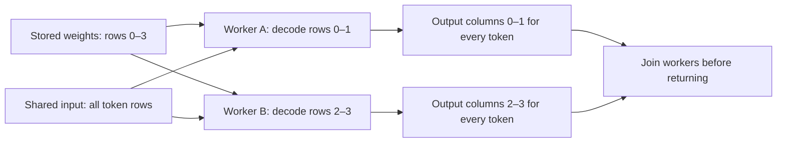
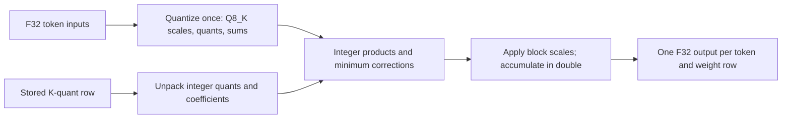

# CPU Matrix Products: Arithmetic and Measurements

[Back to execution tensors and kernels](../kernels.md).

This reference explains the CPU implementation shared by [MatVec](matvec.md)
and [MatMul](matmul.md): row scheduling, arithmetic policies, error bounds and
recorded measurements. Read their illustrated examples first. Commands below
run from the repository root with the .NET 10 SDK; timings are historical
measurements of the stated workloads, not guarantees for other machines.

## Measure parallel matrix products

To measure H.1 independently of model loading, select `DecodedFloat`, build
.NET 10 in Release and run the synthetic benchmark. No model download is needed:

```sh
dotnet build src/Marmotte.Cpu -c Release
DOTNET_TieredCompilation=0 dotnet fsi --optimize+ examples/MatrixProducts.fsx -- --decoded
DOTNET_PROCESSOR_COUNT=1 DOTNET_TieredCompilation=0 dotnet fsi --optimize+ examples/MatrixProducts.fsx -- --decoded
```

The second run constrains scheduling to one worker, separating the intrinsics
change from row parallelism. Disabling tiered compilation keeps short workloads
from being measured partly before JIT optimization. Each case warms up ten calls,
then reports the median and range of seven groups of ten calls. Timings include
row decoding, dot products, pooled row buffers and scheduling; they exclude
fixture creation, uploads and downloads. One-token `MatMul` uses the same kernel
as `MatVec`. Checksums help spot differences but do not replace the scalar-reference
tests. Before/after runs use the same script; the baseline is commit `0cea0b3`.

Recorded on 2026-11-08, ARM64, .NET 10.0.12, 14 logical processors,
`Vector128.IsHardwareAccelerated = true`, `Vector256.IsHardwareAccelerated = false`:

| Stored encoding, 1,024 × 3,072 | Tokens | Before (ms) | Intrinsics, one worker (ms) | Intrinsics, parallel (ms) | Total speedup |
| --- | ---: | ---: | ---: | ---: | ---: |
| F32 | 1 | 1.991 | 1.915 | 0.387 | 5.1× |
| F32 | 8 | 5.467 | 4.694 | 0.741 | 7.4× |
| Q4_K | 1 | 1.388 | 1.243 | 0.283 | 4.9× |
| Q4_K | 8 | 4.800 | 3.994 | 0.681 | 7.0× |
| Q6_K | 1 | 2.798 | 2.673 | 0.485 | 5.8× |
| Q6_K | 8 | 6.297 | 5.433 | 0.827 | 7.6× |

Small 16 × 64 F32 matrices remain serial (about 0.001 ms for one token,
0.002 ms for eight). At 64 × 256, eight-token products use two partitions:
F32 improves from 0.024 to 0.015 ms, Q4_K from 0.022 to 0.012 ms, and Q6_K
from 0.029 to 0.016 ms. These measurements motivate a minimum of 65,536
multiply terms per scheduled partition. They are local kernel timings, not a
claim about full-model throughput or a universal optimum for other CPUs.

### Follow ownership through the workers

For `Rows * Columns * Tokens` work, the number of partitions is bounded by
`Environment.ProcessorCount`, `Rows`, and `floor(work / 65536)`. Zero or one
partition runs serially. Contiguous row ranges are computed with 64-bit arithmetic,
including uneven division; each row belongs to exactly one partition. Each active
worker rents one row buffer and returns it in `finally`. The pool may round its
capacity up; scratch storage is O(workers × columns), independent of tokens.



The diagram shows a two-partition example. Only memory values cross task
boundaries; spans are created inside the worker. Weights and inputs are read-only
throughout the call. The backend retains ownership and rejects aliasing before
execution, and the parallel loop joins before the call returns, including on
failure. A batch still decodes each weight row exactly once. There is no native
pointer, pinning, global mutable scratch buffer or new package dependency.

SIMD may change addition order relative to the former `Vector<T>` implementation,
so cross-version results are compared with numerical tolerances. Scheduling never
splits an individual dot product: repeated calls and batch/single-token execution
remain identical on the same runtime and hardware. Tests cover all fourteen
encodings, uneven partitions, SIMD boundaries and tails, large cancelling
products, repeated writes, empty batches, and existing ownership/shape validation.
The matrix tests also pass with `DOTNET_EnableHWIntrinsic=0`; the 256-bit path
compiles but still needs execution on an accelerated x64 host.

The intrinsic operations and feature guards follow the contracts in Microsoft's
[SIMD and hardware intrinsics documentation](https://learn.microsoft.com/en-us/dotnet/standard/simd).
The arithmetic and partitioning are original Marmotte code. H.2 adds the
quantized-input policy below. H.3 adds selected-logit execution and online
attention; their measurements are separate from these matrix-product results.

## Quantize activations once for K-quant products

H.2 adds a CPU arithmetic policy that avoids reconstructing every K-quant weight
as F32. Build with .NET 10, then compare both policies on the same synthetic rows:

```sh
dotnet build src/Marmotte.Cpu -c Release
DOTNET_TieredCompilation=0 dotnet fsi --optimize+ examples/MatrixProducts.fsx -- --decoded
DOTNET_TieredCompilation=0 dotnet fsi --optimize+ examples/MatrixProducts.fsx
```

The script prints its policy, timings and checksums. Different checksums are
expected because activations are rounded. Add `--large` for 4,096 × 3,072 and
3,072 × 9,216 matrices. Upload and download are excluded; activation quantization,
integer unpacking, dot products, scheduling and temporary allocations are timed.

### Choose the arithmetic policy

```fsharp
// Default, also used by the generate CLI:
use fast = new CpuBackend()
// Same H.1 parallelism, but without additional activation rounding:
use reference = new CpuBackend(CpuMatrixProductMode.DecodedFloat)
// Explicit equivalent of the default:
use quantized = new CpuBackend(CpuMatrixProductMode.QuantizedK)
```

`QuantizedK` handles Q2_K, Q3_K, Q4_K, Q5_K and Q6_K. The other nine stored
encodings retain the H.1 F32-input path. Input/output tensors remain F32 and the
caller's input is never modified. Q8_K is a transient activation representation,
not a newly supported weight-file or cache encoding: `TensorEncoding`, GGUF
quantization, embedding lookup and cache storage are unchanged.

### Follow one block through the product

Each token is split into blocks of 256 activations. The first value with largest
absolute magnitude determines a signed reciprocal `r = -127 / extreme`, computed
in F32. The stored scale is `d = 1 / r`; quants are nearest-even rounded `r*x`,
clamped to [-127,127]. Zero blocks have zero quants, sums and scale. Sixteen
integer sums, each covering 16 quants, are prepared alongside them.

For example, a block starting with `127, -127, 0.5, 1.5, 2.5, -1.5` and otherwise
zero has scale -1 and starts with quants `-127, 127, 0, -2, -2, 2`. Its first
16-value sum is -2. This signed scale and tie rule are tested explicitly.



The quantized batch is shared read-only by all row workers. A worker unpacks each
weight row once and reuses it for all tokens, just as H.1 shared a decoded row.
Weight group scales remain integers. For each 256-value block, compute
`P = sum(groupScale * weightQuant * inputQuant)` and
`M = sum(groupMinimum * inputGroupSum)`. Its contribution is
`inputScale * (weightScale * P - weightMinimumScale * M)`.
Q3_K and Q6_K have no minimum correction. Only these block-level operations are
floating point; the dot products and group coefficients accumulate in Int32.

Quants are promoted to Int16 in memory to use safe `Vector128` multiplication.
The products fit Int16. The largest absolute scaled Q6_K block sum is bounded by
`256 * 32 * 127 * 128 = 133169152`, within Int32; other K formats are smaller.
Tests include this extreme case. Packed extraction uses bounds-checked spans and
portable vectors; dot products have a scalar fallback when SIMD is disabled.
There are no pointers, native dependencies or copied upstream kernels.

Scratch is O(tokens × columns + workers × columns), not O(weights). Shared
activation arrays cost approximately 2.266 bytes per input element plus one
validity flag per token. Worker scratch uses one pooled Int16 row and per-group/
per-block coefficient arrays (approximately 2.531 bytes per column, before pool
rounding and array headers). Arrays are private to the call; the row buffer is
returned in `finally`, and all workers join before return.

### Account for error and exceptional values

This is an approximation, so it is not bit-identical to `DecodedFloat`. With
reconstructed activations `xHat`, the additional dot-product error is bounded by
`sum(abs(weight) * abs(x - xHat))`, plus floating-point rounding. Away from scale
underflow, each activation's rounding error is approximately at most half a
block scale; reciprocal/scale rounding contributes as well. Cancellation can
make relative error against a small output arbitrarily large, so a blanket
percentage tolerance against the result is inappropriate.

Tests compare integer products with a separate scalar calculation over decoded
weights and reconstructed activations, then independently check the above bound
against the original F32 input. The existing strict product tests still exercise
`DecodedFloat`. Additional tests cover every K encoding, multiple blocks/tokens,
uneven row partitions, zero blocks, ties, signed scales, integer extremes,
non-K encodings, repeated calls and exact batch/individual-token agreement.

A token containing NaN/infinity or an unrepresentable reciprocal/scale uses the
F32 reference arithmetic. This includes tiny subnormals whose reciprocal would
overflow. The fallback is per token, so other tokens in the batch behave exactly
as they would alone. A weight row containing non-finite super-block scales also
uses the reference path. No invalid values are silently turned into finite zeros.
Small matrices can be slower because input preparation and scheduling costs are
not fully amortized. Select `DecodedFloat` when extra activation error is unwanted.

### Recorded kernel timings

On 2026-11-08, ARM64, .NET 10.0.12, 14 logical processors, using the same warmup
and seven-by-ten median protocol as H.1, for matrices of 1,024 × 3,072:

| Encoding | One token: F32 input → Q8_K (ms) | Eight tokens: F32 input → Q8_K (ms) |
| --- | ---: | ---: |
| Q2_K | 0.535 → 0.250 | 0.894 → 0.605 |
| Q3_K | 1.919 → 0.302 | 2.499 → 0.637 |
| Q4_K | 0.307 → 0.308 | 0.675 → 0.628 |
| Q5_K | 0.334 → 0.308 | 0.743 → 0.647 |
| Q6_K | 0.530 → 0.276 | 0.870 → 0.624 |

Q6_K improves by about 1.9× for one token; Q4_K is effectively unchanged there
and improves modestly for eight tokens. Small 64 × 256 Q4_K products regress
from 0.006 to 0.008 ms (one token) and 0.012 to 0.015 ms (eight tokens). These are
kernel measurements, not full-generation throughput or proof of model quality.
Both the SIMD and software paths pass the focused tests; accelerated x64 still
needs hardware validation.

An optional local check with Ministral-3-3B-Instruct-2512-Q4_K_M and the prompt
`La capitale de la France est` completed its eight-token budget. The Q8_K policy
produced ` **Paris**. La capitale de la Belgique`; the H.1 path had produced
` **Paris**. La ville est située dans`. The first answer remains correct, but
the continuation changed. This illustrates token sensitivity to approximation;
it is not a general quality evaluation or comparison with a native runtime.

### Reference contracts

The block sizes, signed quants, scale/minimum packing and 16-value sums were
checked against [ggml's block declarations](https://github.com/ggml-org/ggml/blob/master/src/ggml-common.h).
The signed 127 reciprocal and nearest-even convention follow the Q8_K reference
quantizer inspected on 2026-11-08 in
[ggml-quants.c](https://github.com/ggml-org/ggml/blob/master/src/ggml-quants.c).
Marmotte uses its own grouped integer representation and portable arithmetic;
it does not serialize Q8_K blocks or claim bit-identical accumulation with a
native backend. The fallback behavior for non-finite or unrepresentable input
is Marmotte's explicit extension.
