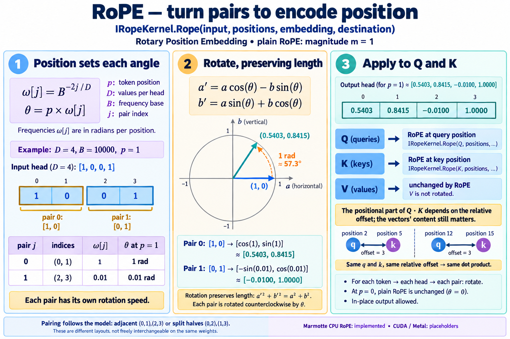

# Rotary Position Embedding

[Back to execution tensors and kernels](../kernels.md).

Learn how rotating pairs of features encodes token positions in queries and
keys. Prerequisites: vectors, angles in radians, sine and cosine. Run
`dotnet fsi examples/Yarn.fsx` from the repository root with .NET 10 to compare
plain and adjusted frequencies and inspect CPU rotations without a model file.



[Open the RoPE illustration](rope.png).

Think of each pair `[a; b]` as an arrow in a two-dimensional plane. The token's
position determines how far that arrow turns, and the pair's frequency
determines its rotation speed. Plain RoPE changes its direction while keeping
its length. The illustrated angle of one radian is about 57.3 degrees.

Attention needs to know where each token is. Rotary position embedding (RoPE)
encodes positions by rotating the queries and keys of every head, two values at
a time. For a head of `D` values, pair `j` of a token at position `p` turns by
the angle `θ = p × ω[j]`, with `ω[j] = base^(-2j / D)`:

```text
a' = m × (a × cos θ - b × sin θ)
b' = m × (a × sin θ + b × cos θ)
```

`m` is a magnitude factor, 1 for plain RoPE. Rotating a query and a key by their
own positions makes the positional part of their dot product depend on their
relative offset. The vectors' content still matters: holding the unrotated
query and key fixed, positions `(2, 5)` and `(12, 15)` give the same dot product.
See [RoFormer](https://arxiv.org/abs/2104.09864).

Take a head of four values `[1; 0; 0; 1]` at position 1, with base 10,000. Pair 0
turns by 1 radian and becomes `[cos 1; sin 1] ≈ [0.5403; 0.8415]`. Pair 1 turns
by 0.01 radian and becomes `[-sin 0.01; cos 0.01] ≈ [-0.0100; 1.0000]`. At
position 0, every value stays unchanged.

`Rope(input, positions, embedding, destination)` rotates every head of every
token. `input` has rank 2 or more, `[tokens; heads × D]` as `MatMul` produces it,
or `[tokens; heads; D]`, and `positions` holds one absolute position per token.
A `RotaryEmbedding` describes the model's frequencies, magnitude and pairing:
`RotaryEmbedding.Standard(128, 1000000.0, RopePairing.AdjacentPairs)` gives plain
RoPE at the target model's base frequency. Use `RotaryEmbedding.Yarn` for its
context extension, or `RotaryEmbedding.Create` for custom frequencies.
`RopePairing.AdjacentPairs` rotates values `2j` and `2j + 1`, llama.cpp's
"normal" type, which it uses for `mistral3`. `RopePairing.SplitHalves` rotates
values `j` and `j + D / 2`, llama.cpp's NeoX type and the convention of Hugging
Face checkpoints. Pairings and formulas follow `rotate_pairs` in llama.cpp's
`ggml-cpu/ops.cpp`. `destination` may be `input`. Ownership, validation and
ordering follow `Add`, and a negative position raises
`ArgumentOutOfRangeException` before any write.

The CPU backend computes the cosine and sine of each pair once per token, in
double precision, multiplies them by `m`, rounds them once to F32, and uses them
for every head. Frequencies are kept in double precision, while llama.cpp
accumulates them in F32, so angles at long positions can differ slightly. Tests
compare results with a double-precision reference up to position 262,143, and
check that rotations preserve lengths and that query-key products depend only
on the distance between positions. The rotation loop is scalar: RoPE touches
5,120 values per token for the target model's queries and keys, little next to
the matrix products.

The target model uses [YaRN preparation](yarn.md) to adjust its frequencies
and magnitude before rotation. The [original illustration prompts](rope-yarn-illustrations.prompt.txt)
are kept with these guides.
