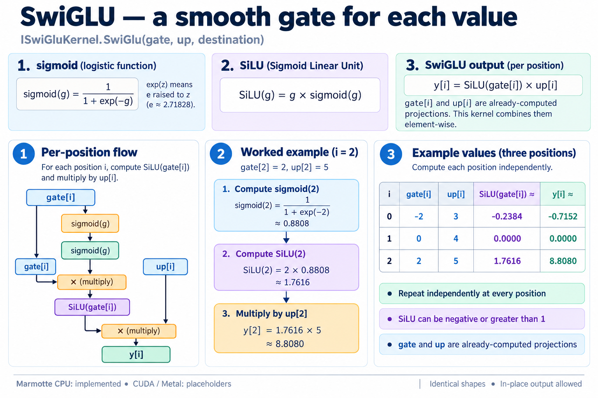

# SwiGLU

[Back to execution tensors and kernels](../kernels.md).

[Open the SwiGLU illustration](swiglu.png).
Its [original generation prompt](../kernel-illustrations.prompt.txt) is kept
with the other kernel prompts. The illustration's backend footer predates
CUDA SwiGLU support; see [On CUDA](#on-cuda) below.

For each position, first compute `sigmoid(g) = 1 / (1 + exp(-g))`. Multiply
that by `g` to get `silu(g)`, then multiply by the corresponding `up` value.
For `gate = [-2; 0; 2]` and `up = [3; 4; 5]`, the output is approximately
`[-0.7152; 0; 8.8080]`. This smooth multiplier can be negative or greater than
one. The caller has already computed the `gate` and `up` projections before
invoking this kernel.

The feed-forward layer of LLaMA-family models, including `mistral3`, gates one
projection with another. `SwiGlu(gate, up, destination)` writes
`destination[i] = silu(gate[i]) × up[i]`, with `silu(x) = x / (1 + e^-x)`; see
[GLU Variants Improve Transformer](https://arxiv.org/abs/2002.05202). In the
target model, `gate` and `up` are the 9,216-value outputs of `ffn_gate` and
`ffn_up`, and the result feeds `ffn_down`. The tensor rules are those of
[Add](../kernels.md#add-and-buffer-reuse):
identical shapes, the same backend instance, exact aliasing such as
`backend.SwiGlu(gate, up, up)`, and validation before any write.

Unlike addition, the result depends on how the exponential is approximated. The
CPU backend uses `Vector.Exp` in vector lanes and `MathF.Exp` for the remaining
values. Measured on ARM64 for gates from -87 to 90, both stay within 2.2e-7
relative error of a double-precision SiLU, and they differ from each other by
at most four units in the last place. Tests therefore compare with a relative
tolerance of 1e-6. Below about -88.7, `e^-x` overflows in F32 and the result is
a signed zero instead of a value smaller than 1e-36. NaN gates stay NaN, and
`silu(-∞)` is NaN, as the formula gives.

On an Apple M4 Max, single-threaded in Release, the vectorized kernel takes about
0.63 ns per value, against 1.43 ns for a scalar loop with the same formula. One
feed-forward layer of 9,216 values takes about 5.8 µs instead of 13.3 µs.

## On CUDA

The CUDA backend implements SwiGLU for F32 and F16 tensors; the CPU backend
accepts F32 only and rejects F16 with `NotSupportedException`. All three tensors
must share one format: mixing F32 and F16 raises `ArgumentException`, as for Add.
Each GPU thread computes one position with the device `expf`, so F32 results may
differ from the CPU's by a few units in the last place.

The F16 kernel does not compute in half precision. It widens `gate[i]` and
`up[i]` exactly to F32, evaluates the F32 formula, and rounds the product once
to the nearest F16 value, ties to even. Two reasons motivate this:

- Half arithmetic would round after each of the four operations (negation,
  exponential, division, product) instead of once.
- With only five exponent bits, `e^-x` exceeds the largest finite F16 value,
  65,504, as soon as `x` is below about -11.1, even though `silu(x)` itself is
  then a small, representable number.

For `gate = 2` and `up = 5`, the F32 result 8.80797 rounds to the F16 value
8.8046875, the closest of its neighbours spaced 1/128 apart. A product larger
than 65,504 becomes infinity; subnormal inputs and results are kept. Because
the F32 value carries the exponential's small error, a result that falls within
that error of a midpoint between two F16 values may round to either one: tests
accept one unit in the last place against a double-precision reference, and
check exact bits only for fixtures far from a midpoint. The kernel files and
their contract are described in the [CUDA guide](../cuda.md#kernel-formats-and-file-layout).
