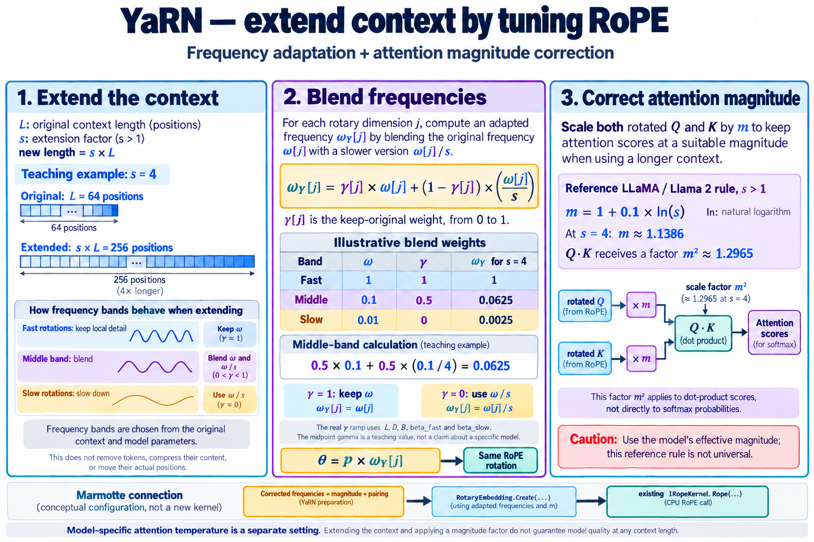

# YaRN Context Extension

[Back to execution tensors and kernels](../kernels.md).

Learn how a model prepares RoPE frequencies for a longer context. Read the
[RoPE walkthrough](rope.md) first. YaRN is parameter preparation in Core;
the prepared frequencies and magnitude are consumed by the RoPE kernel.
Run `dotnet fsi examples/Yarn.fsx` from the repository root with .NET 10
to inspect the frequencies and rotations without a model file.



[Open the YaRN illustration](yarn.png).

`RotaryEmbedding.Yarn` prepares frequencies and a magnitude in Core for the
same `IRopeKernel.Rope` operation. The CPU kernel consumes these prepared
parameters; CUDA implements F32/F16 rotation using host-prepared cos/sin tables,
while Metal remains a placeholder. Preparation depends only on
the configuration and can be shared across heads, layers and backends.

Let `L` be the original context length and `s` the extension factor. The picture
uses the teaching example `L = 64`, `s = 4`, giving `256` positions. These are
not the target model's parameters. Keep fast rotations, slow the lowest
frequencies by dividing by `s`, and blend the middle band:

```text
omegaY[j] = gamma[j] × omega[j] + (1 - gamma[j]) × (omega[j] / s)
angle[p, j] = p × omegaY[j]
```

`gamma[j]` is the fraction of the original frequency to keep. The positions
themselves remain unchanged. The [reference implementation](https://github.com/jquesnelle/yarn/blob/master/scaled_rope/LlamaYaRNScaledRotaryEmbedding.py)
derives transition boundaries from how many rotations a pair makes within `L`,
using `beta_fast` and `beta_slow`, then applies a clamped ramp across pair
indices. The illustration's blend weights demonstrate the arithmetic; they
are not a substitute for deriving that ramp from model parameters.

For a full head of `D` values and frequency base `B`, Marmotte uses the
following equations, verified against ggml's
[`ggml_rope_yarn_corr_dims`](https://github.com/ggml-org/llama.cpp/blob/2280f0fd163b03d4331d49e08460f66502e35854/ggml/src/ggml.c#L4520-L4533)
and [`rope_yarn`](https://github.com/ggml-org/llama.cpp/blob/2280f0fd163b03d4331d49e08460f66502e35854/ggml/src/ggml-cpu/ops.cpp#L6268-L6288):

```text
pairAtRotations(beta) = D × ln(L / (2π × beta)) / (2 × ln(B))
low  = max(0, floor(pairAtRotations(beta_fast)))
high = min(D - 1, ceil(pairAtRotations(beta_slow)))
gamma[j] = 1 - clamp((j - low) / max(0.001, high - low), 0, 1)
```

`floor` rounds down, `ceil` rounds up, and `clamp` limits a value to the given
interval. The first equation finds the pair that completes `beta` full turns
within the original context. The ramp keeps fast pairs unchanged and gradually
increases interpolation toward the slow pairs. The `0.001` denominator guard
also covers coincident boundaries. The upper cutoff follows ggml's `D - 1`
bound even though only `D / 2` pairs are sampled; a transition can extend past
the last pair. This API uses the full blend, equivalent to `ext_factor = 1`.

| Illustrative band | Original frequency | Keep-original weight `gamma` | Corrected frequency for `s = 4` |
| --- | --- | --- | --- |
| Fast | `1` | `1` | `1` |
| Middle | `0.1` | `0.5` | `0.5 × 0.1 + 0.5 × 0.025 = 0.0625` |
| Slow | `0.01` | `0` | `0.01 / 4 = 0.0025` |

YaRN also adjusts attention magnitude. The [YaRN paper's LLaMA/Llama 2 reference rule](https://arxiv.org/html/2309.00071v2#S3.SS4)
for extension factors greater than one is:

```text
m = 1 + 0.1 × ln(s)
qY = m × rotatedQuery
kY = m × rotatedKey
dot(qY, kY) = m² × dot(rotatedQuery, rotatedKey)
```

`ln` is the natural logarithm. For `s = 4`, `m ≈ 1.1386` and `m² ≈ 1.2965`.
The factor acts on attention scores before softmax, not on the resulting
probabilities. Use the model's effective magnitude: this reference fit is not
universal. Marmotte combines the general `mscale = 1` rule in
[`llama-context.cpp`](https://github.com/ggml-org/llama.cpp/blob/2280f0fd163b03d4331d49e08460f66502e35854/src/llama-context.cpp#L269-L306)
with the compensation inside ggml's kernel, so it applies the final magnitude
exactly once:

```text
m = AttentionFactor × (1 + 0.1 × ln(s)) / (1 + 0.1 × LogMultiplier × ln(s))
```

`LogMultiplier` corresponds to `rope.scaling.yarn_log_multiplier`; use zero
when absent to get the reference rule above. `AttentionFactor` corresponds to
`rope.scaling.attn_factor`, with a default of one when absent. Model-specific
policies such as DeepSeek's alternative numerator are not inferred. The
position-dependent `attention.temperature_scale` is applied separately; see
[Attention Temperature](attention-temperature.md#attention-temperature).

For the target model, `D = 128`, `B = 1,000,000`, `L = 16,384`, `s = 16`,
`beta_fast = 32` and `beta_slow = 1`. The unrounded cutoff indices are about
20.385 and 36.440, giving `low = 20` and `high = 37`. Pair 27 therefore keeps
`10/17` of its original frequency and takes `7/17` of its divided frequency:
`0.00294272718` becomes `0.00180674794` radians per position. With
`LogMultiplier = 1` and `AttentionFactor = 1`, the magnitude is exactly one;
applying the paper's reference amplification again would incorrectly enlarge
the attention scores.

```fsharp
let parameters =
    { ScalingFactor = 16.0
      OriginalContextLength = 16384
      BetaFast = 32.0
      BetaSlow = 1.0
      LogMultiplier = 1.0
      AttentionFactor = 1.0 }

let embedding =
    RotaryEmbedding.Yarn(128, 1000000.0, RopePairing.AdjacentPairs, parameters)

backend.Rope(queries, positions, embedding, queries)
backend.Rope(keys, positions, embedding, keys)
```

The factory requires a positive even head dimension, a finite base greater
than one, `s >= 1`, a positive original context, finite thresholds with
`BetaFast >= BetaSlow > 0`, a finite non-negative logarithmic multiplier and a
finite positive attention factor. Invalid configuration raises an argument
exception before allocating the frequency array; the final magnitude must
also fit a finite positive F32 value. A scale of one leaves frequencies
unchanged. Both pairings use the same frequencies and magnitude. Model loading
prepares these parameters before execution; see the
[forward-pass walkthrough](../forward-pass.md).

Tests check the transition, magnitude cancellation and non-default magnitude
parameters, invalid inputs, collapsed or out-of-range cutoffs, and CPU
rotations of 32 query heads and 8 key heads through position 262,143 with both
pairings. A separate check ran the unmodified ggml CPU kernel at revision
`2280f0fd163b03d4331d49e08460f66502e35854` at positions 0, 1, 16,384 and
262,143. It called `ggml_rope_ext` in NORMAL mode on an F32 `[128; 1; 4]` tensor
whose every adjacent pair is `(1, 0)`, with the target configuration:
`n_dims = 128`, `n_ctx_orig = 16384`, `freq_base = 1e6`, `freq_scale = 1/16`,
`ext_factor = 1`, `beta_fast = 32`, `beta_slow = 1` and ggml's compensated
`attn_factor = 1 / (1 + 0.1 × ln(16))`. The recorded outputs, not values
computed by Marmotte or by a port of that kernel, are retained in
[`YarnTests.fs`](../../tests/Marmotte.Backends.Tests/YarnTests.fs); running the tests
does not require ggml or GPU hardware. They account for ggml's F32 angle
accumulation, while a separate double-precision reference checks Marmotte with
a tighter tolerance. Neither check measures language-model accuracy at long
context lengths.

Run [`examples/Yarn.fsx`](../../examples/Yarn.fsx) to inspect the frequencies and
CPU rotations without a model file.

The [original illustration prompts](rope-yarn-illustrations.prompt.txt) record
the image generation and its status-label correction.
