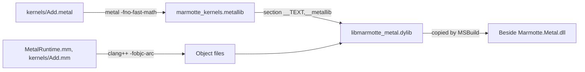
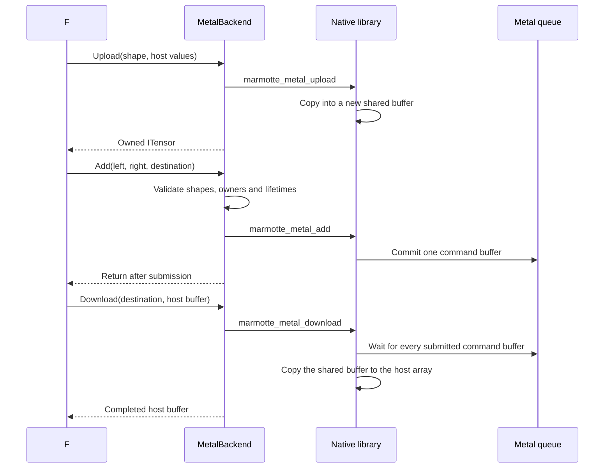

# Metal: from the first build to an Add on the GPU

By the end of this guide you will have compiled Marmotte's Metal kernels, run an
addition on your Mac's GPU, and be able to follow that call from F# to the
compute function.

The Metal backend implements contiguous F32 and F16 tensors, zero-initialized
allocation, uploads, downloads, synchronization, element-wise Add, the mixed
`AddF32F16`, SwiGLU and RMS normalization in F32 and F16, and the mixed
`RmsNormF32ToF16`. It uses native
Objective-C++ and Metal Shading Language (MSL) through P/Invoke, with no
additional NuGet dependency. Other kernels, weight upload and the key-value cache
still throw `NotImplementedException`.

This guide assumes familiarity with building the .NET solution, but no Metal
experience. Commands run from the repository root. The native build is optional:
with GPU tests disabled, `dotnet build Marmotte.slnx` and the default tests work
without it, on any operating system.

## What the different tools do

| Component | Purpose |
| --- | --- |
| Mac with a Metal GPU | Executes the parallel arithmetic. On Apple silicon, the GPU and CPU share the same memory. |
| Xcode | Provides the macOS SDK, the Metal framework headers and the Objective-C++ compiler. |
| Metal Toolchain | Provides the `metal` command that compiles `.metal` files. Recent versions of Xcode install it separately. |
| CMake 3.24 or later | Compiles the shaders and the host code into one library. |
| .NET SDK | Compiles the F# backend. With `MarmotteBuildMetal=true`, MSBuild also invokes CMake. |

## Step 1: install the prerequisites

Install Xcode from the App Store and open it once to finish its setup. The Command
Line Tools alone are not enough, because they do not include the Metal compiler.
Then install the two remaining tools:

```bash
xcodebuild -downloadComponent MetalToolchain
```

```bash
brew install cmake
```

`xcrun -sdk macosx metal --version` must print a version. If it reports a missing
Metal Toolchain, run the first command above.

## Step 2: build the native library

```bash
dotnet build Marmotte.slnx -p:MarmotteBuildMetal=true
```

MSBuild runs CMake, which runs this pipeline:



Embedding the compiled shaders in a section of the library means there is one
file to deploy, and no path to find at run time.

| MSBuild property | Default and purpose |
| --- | --- |
| `MarmotteBuildMetal` | Defaults to `true` on macOS when `MARMOTTE_TEST_METAL=1` and no prebuilt library is configured; otherwise `false`. Set explicitly to `true` or `1` to build the native library, or `false` to disable that build. Both environment variables and `-p:` properties accept these values. |
| `MarmotteMetalBuildDirectory` | `artifacts/metal/msbuild/<Configuration>` under the repository. |
| `MarmotteMetalNativePath` | Empty. Set it to deploy a prebuilt `libmarmotte_metal.dylib` instead of building one. |

## Step 3: run an Add on the GPU

```bash
dotnet fsi examples/MetalAdd.fsx
```

Expected output:

```text
Metal Add, then in-place Add: [|12.0f; 24.0f; 36.0f; 48.0f; 60.0f; 72.0f|]
Metal Half Add, then in-place Add: [|12; 24; 36; 48; 60; 72|]
Metal AddF32F16 in place: [|24.0f; 48.0f; 72.0f; 96.0f; 120.0f; 144.0f|]
```

The script adds two `[2; 3]` tensors, then adds the left tensor again in place.
For example, the first value is 1 + 10 + 1 = 12. It repeats this in F16, then adds
the F16 result into the F32 result: 12 + 12 = 24.

## Run the tests

Two settings control the build and the test process:

| Setting | Read by | Purpose |
| --- | --- | --- |
| `MarmotteBuildMetal=true` or `1` | MSBuild, during the build | Compiles the native library and copies it beside the test assemblies. |
| `MARMOTTE_TEST_METAL=1` | MSBuild and the test process | Enables the optional GPU tests and, on macOS, defaults `MarmotteBuildMetal` to `true` unless a prebuilt library is configured. Once enabled, a missing library or device fails the tests. |

Build and run the backend tests in one command:

```bash
MARMOTTE_TEST_METAL=1 dotnet test tests/Marmotte.Backends.Tests/Marmotte.Backends.Tests.fsproj
```

With `MARMOTTE_TEST_METAL=1` exported in your shell or inherited by your IDE,
ordinary build and test commands also compile and copy the native library. An
explicit `MarmotteBuildMetal=false` still disables compilation, and
`MarmotteMetalNativePath` deploys a prebuilt library without invoking native tools.

To build separately and then run without rebuilding, use the same configuration
for both commands:

```bash
dotnet build tests/Marmotte.Backends.Tests/Marmotte.Backends.Tests.fsproj -p:MarmotteBuildMetal=true
```

```bash
MARMOTTE_TEST_METAL=1 dotnet test tests/Marmotte.Backends.Tests/Marmotte.Backends.Tests.fsproj --no-build --filter "FullyQualifiedName~MetalTests"
```

Without `MARMOTTE_TEST_METAL=1`, tests that need a GPU are skipped. Tests of empty
tensors and argument validation always run, because those paths load no native code.

If a GPU test raises `DllNotFoundException`, check that `libmarmotte_metal.dylib`
is beside `Marmotte.Backends.Tests.dll` in the selected configuration's output
directory. `dotnet test --no-build` cannot compile or copy a missing library;
run the build above first. Enabling the variable only inside an IDE's test runner
does not pass it to MSBuild: enable it for the IDE's build process as well, or set
`MarmotteBuildMetal=true` for that build.

In Rider, an explicit build setting can be added under **Settings > Build,
Execution, Deployment > Toolset and Build > MSBuild global properties**:
`MarmotteBuildMetal=true`. Keep `MARMOTTE_TEST_METAL=1` enabled for the test
process, then rebuild the solution before rerunning the tests. See Rider's
[Toolset and Build reference](https://www.jetbrains.com/help/rider/Settings_Toolset_and_Build.html).

## Follow one call through the code

| File | Responsibility |
| --- | --- |
| [`MetalBackend.fs`](../src/Marmotte.Metal/MetalBackend.fs) | Tensor shapes, instance ownership, disposal and the public Core interfaces. |
| [`MetalNative.fs`](../src/Marmotte.Metal/MetalNative.fs) | P/Invoke declarations, native error translation and the context `SafeHandle`. |
| [`native/MetalContext.h`](../src/Marmotte.Metal/native/MetalContext.h) | Private shared state: device, command queue, pipelines, buffers and in-flight work. |
| [`native/MetalRuntime.mm`](../src/Marmotte.Metal/native/MetalRuntime.mm) | Device initialization, shader loading, allocation, copies, synchronization and cleanup. |
| [`native/kernels/Add.metal`](../src/Marmotte.Metal/native/kernels/Add.metal) | The F32, F16 and mixed compute functions that run on the GPU. |
| [`native/kernels/Add.mm`](../src/Marmotte.Metal/native/kernels/Add.mm) | `marmotte_metal_add` and `marmotte_metal_add_f32_f16`: native validation, format dispatch, encoding and submission. |
| [`native/kernels/SwiGlu.metal`](../src/Marmotte.Metal/native/kernels/SwiGlu.metal) | The F32 and F16 SwiGLU compute functions: `silu(gate[i]) * up[i]`. |
| [`native/kernels/SwiGlu.mm`](../src/Marmotte.Metal/native/kernels/SwiGlu.mm) | `marmotte_metal_swi_glu`: native validation, encoding and submission. |
| [`native/kernels/RmsNorm.metal`](../src/Marmotte.Metal/native/kernels/RmsNorm.metal) | The F32, F16 and F32-to-F16 RMS normalization compute functions, sharing one row function, one thread per row. |
| [`native/kernels/RmsNorm.mm`](../src/Marmotte.Metal/native/kernels/RmsNorm.mm) | `marmotte_metal_rms_norm` and `marmotte_metal_rms_norm_f32_to_f16`: native validation, row and column arguments, encoding and submission. |
| [`native/CMakeLists.txt`](../src/Marmotte.Metal/native/CMakeLists.txt) | Native sources, compiler settings and output location. |



For `[2; 3]`, storage is six consecutive values in row-major order: 24 bytes in
F32 or 12 bytes in F16. Shape
validation stays in F#; the native addition only needs the element count.

`marmotte_metal_add` runs on the CPU. It selects `addValuesF32` or `addValuesF16`
from the encodings in its allocation registry, and rejects mixed formats before
encoding anything. Then it encodes a dispatch of exactly `count`
threads, with
[`dispatchThreads`](https://developer.apple.com/documentation/metal/mtlcomputecommandencoder/dispatchthreads(_:threadsperthreadgroup:)).
Each thread receives its element index as `[[thread_position_in_grid]]`. The
last threadgroup may be smaller than the others. This requires non-uniform
threadgroup support, which the backend checks against the GPU families listed in
Apple's [feature set tables](https://developer.apple.com/metal/Metal-Feature-Set-Tables.pdf).
No threads communicate, and each output reads only the same index of each input,
which makes exact in-place Add valid.

## Memory, ordering and lifetime

`new MetalBackend()` uses
[the system's default device](https://developer.apple.com/documentation/metal/mtlcreatesystemdefaultdevice()).
Construction does not load the library. The first non-empty allocation creates
one native context with one command queue. An unused `Synchronize`, and operations
using only empty tensors, work without Metal.

Tensors are `MTLBuffer` objects in shared storage, created with
[`newBufferWithLength`](https://developer.apple.com/documentation/metal/mtldevice/makebuffer(length:options:)),
which zero-fills them. Each `Add` commits its own command buffer and returns.
These rules follow from Metal's behavior:

- **Order.** One queue plus tracked buffers means that a kernel waits for the
  earlier writes it depends on.
- **Backpressure.** A queue accepts a limited number of uncompleted command
  buffers. Beyond that limit, `Add` blocks until the GPU catches up.
- **Disposal.** Command buffers
  [retain the resources they use](https://developer.apple.com/documentation/metal/mtlcommandbuffer/retainedreferences),
  so disposing a tensor does not wait, even when submitted work still uses it.
- **Errors.** A command buffer can fail after `Add` has returned. The backend
  records the first failure and raises it at the next `Download` or `Synchronize`,
  as `InvalidOperationException` or `OutOfMemoryException`. This path has no
  automated test, because a GPU failure cannot be provoked on demand.

`Upload` and `Download` copy through a temporary managed array to avoid unsafe
code, so a transfer briefly uses twice the tensor's size on the host. F16 transfers
copy raw bits through a `uint16[]` array, so they stay at two bytes per element and
preserve all 65,536 bit patterns, without any F32 buffer. Shared storage leaves
room for avoiding these copies later.

## Floating-point behavior

The shaders are compiled with `-fno-fast-math`, because
[Metal enables fast math by default](https://developer.apple.com/documentation/metal/mtlcompileoptions/fastmathenabled).
NaN, infinities and signed zero then follow IEEE 754, and tests cover them.

**F32 subnormal values are the exception.** An Apple M4 Max flushes them to zero,
for both inputs and results:

| Addition | CPU result | Metal on M4 Max |
| --- | --- | --- |
| `1e-45f + 1e-45f` | `0x00000002` | `0x00000000` |
| Largest subnormal + `1e-45f` | `0x00800000` | `0x00000000` |

Compiling with `-std=metal3.2 -fmetal-math-mode=safe` gave the same results. So
when comparing with the CPU reference, use an absolute tolerance of about
`1.2e-38`, the smallest normal F32 value. Transfers are unaffected: they copy
bytes and preserve every bit.

**F16 subnormal values are kept.** The same GPU computes them exactly, and rounds
to nearest, ties to even: F16 Add matches the CPU bit for bit on the fixtures of
[`HalfTests.fs`](../tests/Marmotte.Backends.Tests/HalfTests.fs), including
`0x0001 + 0x0001 = 0x0002`.

`AddF32F16` follows from both rules. Every F16 value, subnormal or not, is a normal
F32 value after widening, so the right operand is exact. The left operand and the
sum are F32, so subnormals there are flushed. That is why a mixed sum is not simply
an F16 sum: `(1 + 3 × 2⁻²³) + 1` rounds in F32 to `2 + 2⁻²¹`, where F16 arithmetic
would give `2`.

## Measurements

Total time per Add, for repeated Adds followed by one `Synchronize`, averaged over
at least 20 Adds. Release builds on an Apple M4 Max (32-core GPU). These numbers
are indicative, not a benchmark suite.

| Elements | CPU backend | Metal backend |
| ---: | ---: | ---: |
| 1 | 0.3 µs | 13.1 µs |
| 1,024 | 1.0 µs | 10.5 µs |
| 1,048,576 | 116 µs | 50 µs |
| 67,108,864 | 7,272 µs | 2,718 µs |

F16 and mixed additions, with the same method:

| Elements | CPU F16 `Add` | Metal F16 `Add` | CPU `AddF32F16` | Metal `AddF32F16` |
| ---: | ---: | ---: | ---: | ---: |
| 1,024 | 10.0 µs | 11.7 µs | 7.2 µs | 8.7 µs |
| 1,048,576 | 2,451 µs | 90 µs | 889 µs | 49 µs |
| 67,108,864 | 156,897 µs | 2,817 µs | 57,160 µs | 2,623 µs |

The CPU loops for these two operations are scalar, while F32 Add is vectorized, so
the gap on large tensors is wider here.

Small additions are dominated by the cost of one command buffer per `Add`, so the
CPU is faster for them. Batching several kernels into one command buffer is the
obvious next step once the forward pass runs on Metal.

## SwiGLU

`SwiGlu(gate, up, destination)` computes `destination[i] = silu(gate[i]) × up[i]`
with `silu(x) = x / (1 + e^-x)`. Metal accepts F32 and F16, with all three tensors
in the same encoding; mixed encodings raise `ArgumentException` before any
submission. (The CPU requires F32 and raises `NotSupportedException` for F16.)
The destination may be `gate` or `up`, because each thread reads and writes only
its own index.

Metal's `exp` is a different approximation from the CPU's, so results may differ
by a few units in the last place: compare F32 with a relative tolerance of about
`1e-6`, and F16 with about `1e-2`, as `MetalTests.fs` does. The F16 function
widens its operands, computes in F32 and rounds once to F16: in binary16, `e^-x`
would overflow below -11.1 and turn representable results such as `silu(-12)`
into zero. The special values follow the formula: `silu(-∞)` is NaN, `silu(+∞)`
is `+∞`, and where `e^-x` overflows in F32 (gate below about -88.7) the result
is a signed zero. The F32 subnormal
flush described above also applies to F32 SwiGLU results, so the tests add an
absolute floor of `1e-30`; F16 subnormals are kept exactly.

## RMS normalization

`RmsNorm(input, weight, epsilon, destination)` computes, for each row `r` of the
last dimension,
`destination[r, c] = input[r, c] / sqrt(mean(input[r, *]²) + epsilon) × weight[c]`.
Metal accepts F32 or F16, with `input`, `weight` and `destination` in the same
encoding; mixed encodings raise `ArgumentException`. The one mixed combination,
F32 `input` and `weight` with an F16 `destination`, is requested by name with
`RmsNormF32ToF16`. Shapes, ownership and `epsilon` are validated as on the CPU (see
[the RMS normalization guide](kernels/rmsnorm.md)), before any submission.

| Call | Input and weight | Destination | Compute function |
| --- | --- | --- | --- |
| `RmsNorm` | F32 | F32 | `rmsNormF32` |
| `RmsNorm` | F16 | F16 | `rmsNormF16` |
| `RmsNormF32ToF16` | F32 | F16 | `rmsNormF32ToF16` |

The three compute functions call one templated row function and differ only by
their storage types. It is deliberately the simplest kernel: each GPU thread
normalizes one whole row, reading it once to sum the squares and once to write
the results, with an extra reduction for tiny `epsilon` as described below. The
column count and `epsilon` reach the GPU through `setBytes`, while the row count
sets the dispatch size. Parallelism comes only from rows, so a prompt of
many tokens keeps the GPU busy, whereas the single row of a decoding step runs on
one thread. Splitting each row across a SIMD group is the obvious next step once
it is measured.

The squares, their sum and the scale are always F32, then each result is
converted once to the destination type. For F16 storage this matters: the square
of an F16 value above 256 overflows binary16, and 65504 normalizes to exactly 1
only because the sum is wider. For F32 storage it is a limitation: the CPU sums in
double precision, but Metal has no double type, so a row whose sum of squares
exceeds the F32 range (values of about 1e19 or more) behaves like a row holding an
infinity, and its finite values become signed zeros. Real activations stay far
below that range.

Positive subnormal `epsilon` values remain valid. For example, normalizing
`[0; -0]` with unit weights and `epsilon = 1e-38f` must return `[0; -0]`, and
normalizing `[1e-20f; -1e-20f]` must give approximately `[0.0995037; -0.0995037]`.
A direct F32 calculation can lose both `epsilon` and the squared inputs to the
[subnormal flush](#floating-point-behavior). When `epsilon < 2^-64` and the first
sum of squares is below 1, the kernel recomputes the sum with inputs multiplied
by `2^32`, scales epsilon by `2^64`, and computes
`scale = 2^32 / sqrt(mean(scaledInput²) + scaledEpsilon)`.
For a subnormal epsilon, it reconstructs `scaledEpsilon` from the stored fraction
bits times `2^-85`, so even the smallest positive F32 epsilon becomes normal.
The row bound keeps the scaled sum below overflow; above it, such a tiny epsilon
cannot affect the F32 mean, even at the largest supported column count. NaN and
infinite sums retain their ordinary behavior. Subnormal F32 tensor inputs and
results still have the general flush limitation described above.

The [Metal Shading Language specification](https://developer.apple.com/metal/Metal-Shading-Language-Specification.pdf),
sections "Type Conversions and Reinterpreting Data" and "INF, NaN, and Denormalized
Numbers", specifies bit-preserving `as_type` and permits flushing subnormals in
arithmetic. The regression test covers the smallest and largest subnormal
epsilon, the normal boundary, signed zeros, and small nonzero rows in all three
storage combinations.

`MetalTests.fs` compares every variant with a double-precision reference. In F32,
the summation order makes the largest relative error 1.4e-6 over 1,000 random rows
of 3,072 values (the CPU reaches 1.6e-7), so the tests use a relative tolerance of
`1e-5`, plus an absolute floor of `1e-30` for flushed subnormals. With an F16
destination, one F16 rounding (at most `2^-11`) dominates: the tolerance is `1e-3`
relative, with an absolute floor of `6e-8` for subnormal results. `RmsNormF32ToF16`
results beyond the F16 range become infinities.

Because a row is read in full before it is written, `RmsNorm`'s `destination` may
be `input`, or `weight` for a single row; `RmsNormF32ToF16` cannot alias, since its
storage types differ. An all-zero row stays zero with its signs, a row whose sum is
infinite gives NaN for infinite values and signed zeros elsewhere, and a NaN makes
its whole row NaN; other rows are unaffected.

## Known limitations

- Only Add, `AddF32F16`, SwiGLU and RMS normalization (F32 and F16) and `RmsNormF32ToF16` run on Metal; every other kernel is a placeholder.
- The default device only: there is no device selection for Macs with several GPUs.
- Tested on Apple silicon only (M4 Max, macOS 27).
- The [kernel development guide](../src/Marmotte.Metal/native/kernels/README.md)
  explains how to add the next operation.
