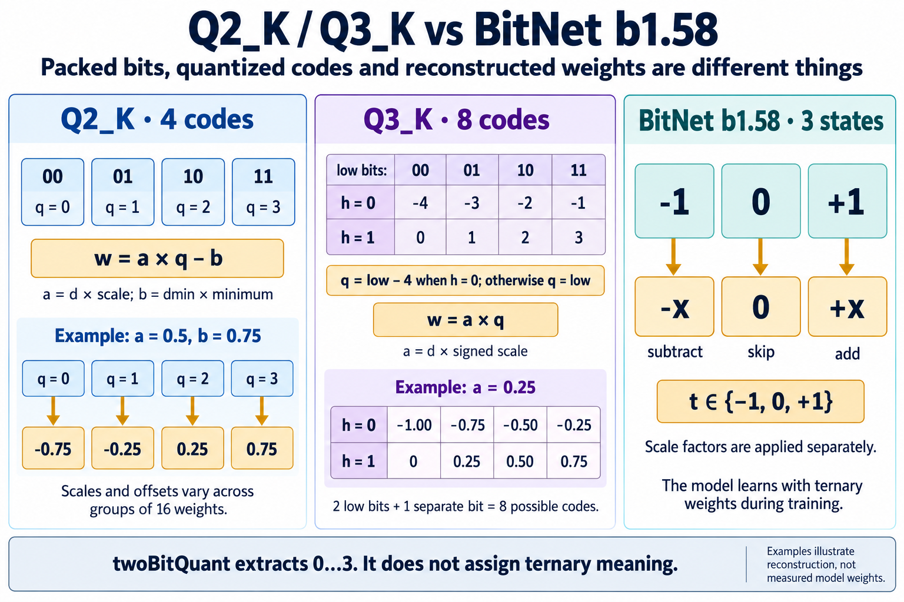
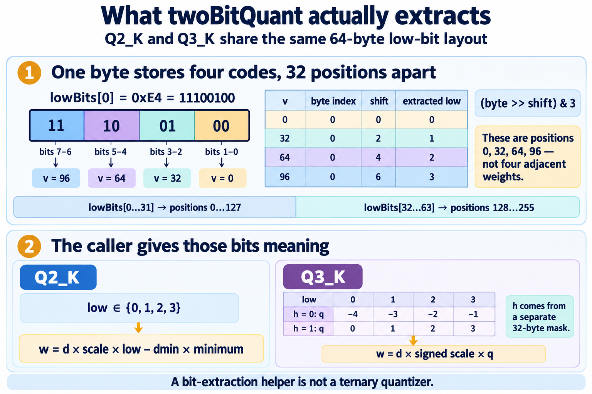
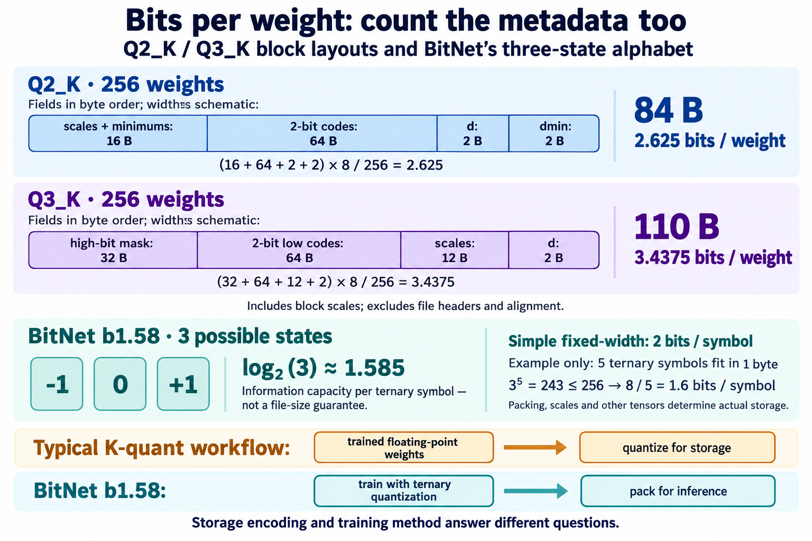

# Q2_K, Q3_K and BitNet b1.58

`twoBitQuant` in [Core's row decoder](../src/Marmotte.Core/RowDecoder.fs)
extracts an unsigned integer in `0..3` from packed bytes. The caller supplies
its meaning: Q2_K reconstructs one of four levels in a group; Q3_K combines
those bits with a separate bit to reconstruct one of eight levels. BitNet
b1.58 instead uses the ternary alphabet `{-1, 0, +1}` in its quantized linear
layers, with scale factors applied separately.

The illustrations use small teaching examples, not weights measured from a
model. Their [generation prompts](quantization-illustrations.prompt.txt) are
included for future revisions.

## Codes and reconstructed weights



A **code** is the small integer recovered from storage. A **reconstructed
weight** is the floating-point value obtained by applying the format's scales
and, for Q2_K, its offset. Each K-quant block here represents 256 weights in
sixteen groups of 16. Each group has its own quantized parameters.

| Scheme | Codes | Reconstruction or interpretation |
| --- | --- | --- |
| Q2_K | `q = 0, 1, 2, 3` | `w = (d × s) × q − dmin × m`; `s` and `m` are four-bit factors in `0..15` |
| Q3_K | `q = -4, -3, -2, -1, 0, 1, 2, 3` | `w = (d × s) × q`; `s` is a signed six-bit factor in `-32..31` |
| BitNet b1.58 | `t = -1, 0, +1` | The weight contribution is subtraction, zero, or addition of an activation, with scaling handled separately |

For Q2_K, choose `d = 0.25`, `s = 2`, `dmin = 0.25`, and `m = 3`.
Then `a = d × s = 0.5` and `b = dmin × m = 0.75`:

| Two-bit code | `00` | `01` | `10` | `11` |
| --- | --- | --- | --- | --- |
| `q` | 0 | 1 | 2 | 3 |
| `a × q − b` | -0.75 | -0.25 | 0.25 | 0.75 |

Unsigned codes can therefore reconstruct negative weights, and a zero code
need not reconstruct zero. Different group parameters move and resize this
four-level grid. If the scale is zero, levels can coincide.

For Q3_K, `d = 0.25` and `s = 1` give `a = 0.25`. Multiplying the eight
signed codes by `a` gives `[-1; -0.75; -0.5; -0.25; 0; 0.25; 0.5; 0.75]`.
The factor `s` can also be negative. These are eight possible codes per
group, not three values for the entire tensor.

The layouts and reconstruction rules follow the
[upstream block definitions](https://github.com/ggml-org/llama.cpp/blob/master/ggml/src/ggml-common.h)
and [dequantization formulas](https://github.com/ggml-org/llama.cpp/blob/master/ggml/src/ggml-quants.c).

## Following twoBitQuant through one byte



Both encodings contain 64 bytes of low bits. Their layout interleaves codes
from positions 32 apart. For a zero-based weight position `v` in `0..255`,
all division below is integer division:

```text
half       = v / 128
withinHalf = v % 128
lane       = withinHalf % 32
byteIndex  = 32 × half + lane
shift      = 2 × (withinHalf / 32)
low        = (lowBits[byteIndex] >> shift) & 3
```

`& 3` retains the two least significant bits after the shift. In
`lowBits[0] = 0xE4 = 11100100`, reading from the least significant pair
upwards gives `00`, `01`, `10`, `11`. These describe positions 0, 32, 64,
and 96. Adjacent positions 0 and 1 instead use different bytes at the same
shift. The second half begins with position 128 in `lowBits[32]`.

`lowBits` names a slice within the block: it starts at block byte 16 in Q2_K
and block byte 32 in Q3_K. It is not an absolute file offset.

Q3_K also reads a separate 32-byte high-bit mask:

```text
h = (highBits[v % 32] >> (v / 32)) & 1
q = low − 4 when h = 0; otherwise q = low
```

| Mask bit | `low = 0` | `low = 1` | `low = 2` | `low = 3` |
| --- | --- | --- | --- | --- |
| `h = 0` | -4 | -3 | -2 | -1 |
| `h = 1` | 0 | 1 | 2 | 3 |

Here a **clear** bit selects the negative range. This is the high bit of
the biased code `q + 4`, not a conventional sign bit where 1 means negative.
For example, position 64 with `low = 2` reconstructs `q = -2` if its mask
bit is clear, or `q = 2` if set. `twoBitQuant` alone cannot distinguish them.
The mapping is implemented in `decodeQ2KBlock` and `decodeQ3KBlock`, with
[independently packed fixtures](../tests/Marmotte.Core.Tests/RowDecoderTests.fs).

## Storage cost and training method



These byte ranges are relative to the beginning of one block and use exclusive
end offsets. F16 fields occupy two bytes each.

| Encoding | Fields in storage order | Bytes per 256 weights | Bits per weight |
| --- | --- | --- | --- |
| Q2_K | `[0,16)` scale/minimum factors; `[16,80)` two-bit codes; `[80,82)` F16 `d`; `[82,84)` F16 `dmin` | 84 | `84 × 8 / 256 = 2.625` |
| Q3_K | `[0,32)` high-bit mask; `[32,96)` low bits; `[96,108)` packed six-bit scales; `[108,110)` F16 `d` | 110 | `110 × 8 / 256 = 3.4375` |

The totals include block parameters but exclude container headers, tensor
alignment and other tensors. File profiles such as `Q3_K_M` may mix tensor
encodings; they do not establish one uniform cost for every weight. See
[GGUF tensor encodings and file profiles](gguf.md).

For an alphabet with three states, `log2(3) ≈ 1.585` expresses its information
capacity per symbol. It does not specify a physical fractional-bit field or
a complete model's memory usage. A simple fixed-width representation uses two
bits per symbol with one unused pattern. As a packing example, five ternary
symbols have `3^5 = 243` combinations, so they fit in one byte: 1.6 bits per
symbol, before scales or other overhead. This is a counting example, not a
claim about any particular BitNet serialization.

The original [BitNet b1.58 paper, section 2](https://arxiv.org/html/2402.17764v1#S2)
describes training with ternary weight quantization and eight-bit activations.
Its weight rule normalizes by `gamma = mean(abs(W))`, rounds, and clips to
`{-1, 0, +1}`, using a small epsilon in the denominator. The learned latent
weights can remain floating point during training; the forward pass uses their
quantized form. This lets learning adapt to the three-state constraint.

K-quant storage formats are typically used to compress already trained
floating-point weights. A storage layout alone does not prescribe training.
Saving a conventional model as Q2_K or Q3_K does not turn it into BitNet b1.58.

For ternary codes `[-1; 0; +1]` and activation values `[2; 5; 3]`, the
unscaled dot product is `-2 + 0 + 3 = 1`. A specialized kernel can implement
these contributions as subtract, skip, and add. Weight and activation scales
still matter; this does not make every operation in the network multiplication
free. [BitNet's implementation discussion, Appendix D](https://jmlr.org/papers/volume26/24-2050/24-2050.pdf#page=23)
describes floating-point latent weights, quantization during training, and
applying scaling factors after the low-bit product during inference.

## Connection to Marmotte

Marmotte currently decodes Q2_K and Q3_K into F32 through `RowDecoder`.
The CPU matrix kernels then multiply those F32 rows by F32 activations;
they do not execute a specialized ternary product. `RowEncoder` rejects
K-quants, and the GGUF quantizer writes Q4_0 or Q8_0. BitNet ternary execution
and its storage encodings are not implemented.

See [the kernel contracts](kernels.md#embedding-lookup),
[tensor encoding sizes](../src/Marmotte.Core/Tensors.fs), and
[CPU arithmetic](../src/Marmotte.Cpu/CpuKernels.fs). Binary layouts and the
primary references linked above were checked on 2026-10-25. The illustrations
are original teaching diagrams, not copies of upstream figures or code.
