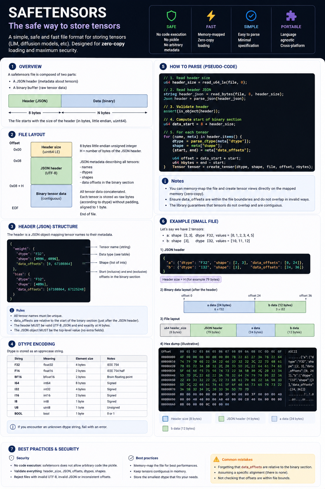

# Safetensors Format

Safetensors is an open tensor serialization format maintained by Hugging Face.
It is designed to be simple, fast, and safe to parse: unlike pickle-based
formats, loading a Safetensors file does not execute code.

Hugging Face documents the format in its Safetensors documentation, including a
format overview and usage examples:

- [Hugging Face Safetensors documentation](https://huggingface.co/docs/safetensors/index)



The editable source for the infographic is
[`safetensors-format.svg`](safetensors-format.svg).

## File Layout

A `.safetensors` file has three consecutive regions:

1. Header length
2. JSON header
3. Tensor data buffer

```text
+----------------+-------------+--------------------+
| header_length  | JSON header | tensor data buffer |
+----------------+-------------+--------------------+
```

## Header Length

The first 8 bytes are an unsigned 64-bit little-endian integer:

```text
N: uint64 little-endian
```

`N` is the number of bytes in the JSON header that immediately follows.

A parser must validate `N` before allocating memory. DotDiffusion should enforce
a configurable maximum header size.

## JSON Header

The next `N` bytes are UTF-8 JSON.

The JSON object maps tensor names to tensor descriptors. The special
`__metadata__` key is optional and contains string-to-string metadata.

Example:

```json
{
  "tensor": {
    "dtype": "F16",
    "shape": [2, 3],
    "data_offsets": [0, 12]
  },
  "__metadata__": {
    "format": "pt"
  }
}
```

The JSON header may be padded with spaces. Tensor names are object keys.

## Tensor Descriptor

Each tensor descriptor contains:

```text
dtype:        string
shape:        uint64[]
data_offsets: [BEGIN, END]
```

`BEGIN` is inclusive and `END` is exclusive. Offsets are relative to the start of
the tensor data buffer, not to the start of the file:

```text
data_start = 8 + N
absolute_position = data_start + BEGIN
byte_count = END - BEGIN
```

## Tensor Data Buffer

The final region contains raw packed tensor bytes.

Important properties:

- Numeric values are little-endian.
- Tensor data is stored in row-major / C order.
- The format stores no strides.
- Tensor data can be exposed lazily as slices of the original file.

## Safe Parsing Order

1. Read exactly 8 bytes.
2. Decode `N` as `uint64` little-endian.
3. Validate `N` against configured limits and file length.
4. Read `N` bytes.
5. Decode strict UTF-8 JSON.
6. Reject duplicate JSON keys.
7. Validate every tensor descriptor.
8. Compute `data_start = 8 + N`.
9. Validate `data_offsets`.
10. Ensure tensor ranges do not overlap.
11. Ensure there are no holes in the tensor data buffer.
12. Expose lazy tensor slices.

## Security Requirements

Safetensors files must be treated as untrusted input.

- Use checked arithmetic for all offset and size calculations.
- Validate header size before allocation.
- Validate UTF-8 and JSON structure.
- Reject duplicate keys.
- Validate `dtype`, `shape`, and `data_offsets`.
- Reject negative, reversed, overlapping, or out-of-file ranges.
- Confirm tensor byte size matches `dtype * shape`.
- Never trust offsets merely because the JSON parses successfully.

## DotDiffusion Implementation Plan

The recommended implementation order is:

1. Add `DotDiffusion.Safetensors` models:
   - `SafetensorsFile`
   - `SafetensorsHeader`
   - `SafetensorsTensorInfo`
   - `SafetensorsDType`
2. Implement a bounded header reader.
3. Parse JSON using `System.Text.Json`.
4. Reject duplicate keys with a custom JSON reader pass.
5. Validate tensor ranges and byte sizes.
6. Expose lazy tensor byte slices.
7. Add a small `Safetensors.Cli` or extend `Gguf.Cli` into a general model
   inspection CLI later.

## References

- [Hugging Face Safetensors documentation](https://huggingface.co/docs/safetensors/index)
- [Safetensors GitHub repository](https://github.com/huggingface/safetensors)
