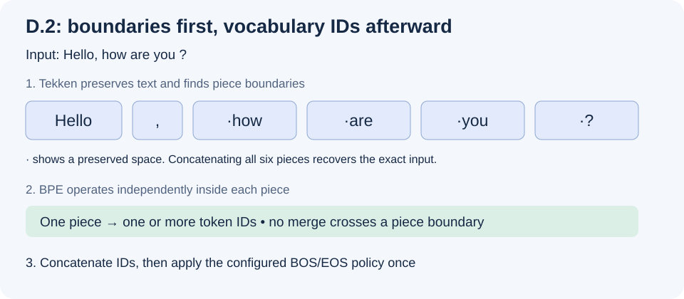

# D.2: split text before BPE with Tekken

The goal of this tutorial is to turn an ordinary sentence into the pieces
accepted by [the BPE engine from D.1](tokenizer.md). You need the .NET 10 SDK
and this repository. No downloaded model is required for the runnable example.

**Implemented:** `TekkenPreTokenizer.split` in Core and `GgufTokenizer.EncodeText`
for GGUF files declaring `tokenizer.ggml.pre = "tekken"`.
[Streaming UTF-8 decoding (D.3)](token-decoding.md) is also implemented. Chat
templates (D.4) and other automatic pre-tokenizer profiles remain unimplemented.
Pre-tokenization returns text pieces, not vocabulary IDs.

## 1. Start with the sentence

```fsharp
open Marmotte.Core

let pieces = TekkenPreTokenizer.split "Hello, how are you ?"
// [| "Hello"; ","; " how"; " are"; " you"; " ?" |]
```

Notice the spaces at the beginnings of four pieces. Concatenating all pieces
must reproduce the exact input, including the space before the question mark.
Nothing is trimmed, lowercased or normalized. A piece is only a boundary inside
which BPE can merge; it may become one token or several tokens.



Run the complete independent example from the repository root:

```sh
dotnet fsi examples/Tokenizer.fsx
```

The script now finds the boundaries automatically. It still uses the D.1
tutorial's invented vocabulary and checks the expected result:

```text
Pieces: [|"Hello"; ","; " how"; " are"; " you"; " ?"|]
IDs with BOS: [|0; 20; 21; 22; 23; 24; 25; 22; 26|]
```

Here ` how` becomes two tokens; a real model can store that whole piece as one
vocabulary entry. The splitting rules do not depend on which vocabulary is used.

## 2. Understand the ordered rules

The profile tries alternatives in order, taking a greedy match within the first
successful alternative. Define **U** as uppercase/titlecase/modifier/other letters
and combining marks; **L** as lowercase/modifier/other letters and combining
marks. These groups overlap. A word prefix is one character other than a letter,
number, CR or LF.

| Priority | Match |
| --- | --- |
| 1 | Optional word prefix, zero or more U, then one or more L |
| 2 | Optional word prefix, one or more U, then zero or more L |
| 3 | One Unicode number, including non-decimal number categories |
| 4 | Optional ASCII space, punctuation/symbol run (neither whitespace, letter nor number), then any CR/LF/slash suffix |
| 5 | Whitespace through its last CR or LF |
| 6 | Whitespace ending at input end, or leaving one whitespace before non-whitespace |
| 7 | Remaining whitespace |

These semantics follow the original Tekken category pattern recorded in the
[profile reference](https://github.com/ggml-org/llama.cpp/blob/master/src/llama-vocab.cpp).
Mistral's [tokenizer configuration contract](https://github.com/mistralai/mistral-common/blob/main/src/mistral_common/tokens/tokenizers/tekken.py)
provides the pattern separately from its vocabulary and handles special tokens
separately. Sources were consulted on 2026-11-08; these links track moving branches.

## 3. Try the surprising cases

In this table `␠` displays an ordinary space; `\t`, `\r` and `\n` display control
characters. They are explanatory notation, not replacements applied by the code.

| Input | Pieces | What to observe |
| --- | --- | --- |
| `helloWorld` | `hello` · `World` | A case transition can create a boundary |
| `HTTPServer` | `HTTPServer` | Not every uppercase letter creates a boundary |
| `123` | `1` · `2` · `3` | Numbers are split individually |
| `a␠␠b` | `a` · `␠` · `␠b` | A space is reserved for the next word |
| `a␠␠` | `a` · `␠␠` | Trailing spaces stay together |
| `!\r\n/abc` | `!\r\n/` · `abc` | The punctuation suffix can include slashes |
| `I'm` | `I` · `'m` | The apostrophe acts as a word prefix |
| `中文ABC` | `中文` · `ABC` | Overlapping categories affect greedy matching |
| `😀Hello` | `😀Hello` | An optional prefix can be a supplementary symbol |

Try composed `é` and decomposed `e` plus U+0301 as well. Their original spellings
are preserved; the scanner does not promise equal token IDs for visually similar
strings. UTF-8 byte mapping happens later inside BPE.

## 4. Encode through the GGUF adapter

After reading a model index, use the adapter to select the declared profile:

```fsharp
open Marmotte.Gguf

let model = Gguf.readFile "model.gguf"
let loaded = GgufTokenizer.read model.Metadata
let ids = loaded.EncodeText("Hello, how are you ?", true)
```

`true` applies the model's configured BOS/EOS insertion once to the complete
sequence; `false` omits automatic boundaries. The pre-tokenizer never inserts
markers. `EncodeText` treats special-token spellings as ordinary text. To supply
actual control IDs, split the ordinary text yourself and combine `TextPiece`
segments with explicit `SpecialToken` segments for `loaded.Tokenizer.Encode`.

For the locally configured Ministral 3 3B Instruct 2512 Q4_K_M GGUF, a manual
smoke check on 2026-11-08 produced:

```text
[|1; 22177; 1044; 2606; 1584; 1636; 3082|]
```

The first ID is BOS. This result uses the file's 131,072-entry vocabulary and
reads no weights. It is an observed Marmotte result, not an independently
verified reference fixture; automated tests do not require this file.

## 5. Know the contract and validation boundary

`split` returns a fresh array of non-empty contiguous substrings; empty input
returns an empty array. It rejects null with `ArgumentNullException` and malformed
UTF-16 with `EncoderFallbackException` before returning a result. It uses
`System.Text.Rune` categories, including supplementary-plane letters and numbers,
and O(input length) working storage. There is no regex runtime or recursive
backtracking in the implementation and no new package dependency.

`EncodeText` raises `NotSupportedException` if the profile is missing or is not
exactly `tekken`, including the other profiles accepted by the D.1 metadata
loader. Those vocabularies can still be used with caller-supplied pieces.
`tekken-num3` is a different profile and is not accepted. BPE's existing vocabulary
errors and boundary policy remain unchanged.

Core tests check exact pieces, concatenation, Unicode case/number/mark categories,
CRLF, whitespace, supplementary scalars, malformed input and long runs. A seeded
2,000-input test compares BMP results with an independently evaluated category
grammar; supplementary cases use explicit expected pieces. GGUF tests show that
whole-piece vocabulary lookup cannot merge across a pre-tokenization boundary,
and that boundary tokens are inserted once.

Unicode classifications come from the installed .NET runtime. A reference engine
using different Unicode tables or an adapted pattern can disagree on edge cases.
The implementation follows the original category grammar, not ASCII approximations
of non-ASCII case. Complete target-model parity still needs an independent corpus
comparison; the local smoke check alone does not establish it.
