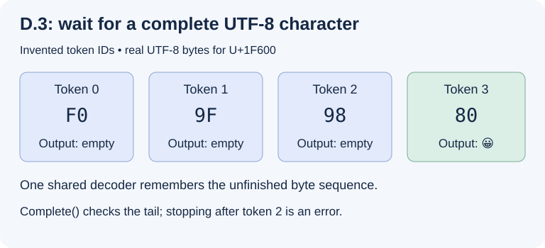

# D.3: turn token IDs back into UTF-8 text

This tutorial starts with the token IDs produced by [D.1](tokenizer.md) and
[D.2](tekken.md). The goal is to display complete characters while tokens arrive
one at a time, even when one character spans several tokens. The .NET 10 SDK
and this repository are enough to run the example; no model download is needed.

**Implemented:** `BpeTokenizer.Decode`, `BpeTokenizer.CreateDecoder` and
`TokenTextDecoder.Append`, `Complete`, and `Reset`. Chat templates and generation
remain separate roadmap items. Decoding does not run the model or stop on EOS.

## 1. Decode the complete sentence

After encoding with the tokenizer used in `examples/Tokenizer.fsx`:

```fsharp
let text = tokenizer.Decode(ids, SpecialTokenDecoding.Skip)
// "Hello, how are you ?"
```

`Skip` hides Control, UserDefined and Unknown entries. `Include` renders their
stored spellings literally, so the example's BOS becomes `<bos>` before the
sentence. The caller chooses this policy explicitly. Unused entries are rejected
in either mode. Skipping depends on the category, not on recognizing a spelling
or guessing that a particular ID must be special.

Normal and Byte entries contain spellings in the reversible byte alphabet,
not directly displayable text: `Ġ` stands for byte `20`, an ordinary space.
The decoder reverses that mapping, then interprets the resulting bytes as UTF-8.
It preserves whitespace, NUL, combining marks and an encoded U+FEFF exactly.
It does not trim, normalize or remove a byte-order mark.

## 2. Watch a character arrive across tokens

A vocabulary entry may represent only part of a UTF-8 character. In this
independent fixture, four entries represent the bytes of `😀` (U+1F600):

| Token ID | Stored spelling | Recovered byte (hex) | Text returned by `Append` |
| --- | --- | --- | --- |
| 0 | `ð` | F0 | `""` |
| 1 | `Ł` | 9F | `""` |
| 2 | `ĺ` | 98 | `""` |
| 3 | `Ģ` | 80 | `"😀"` |



The IDs above are invented for this fixture. Run it, along with the sentence
round trip, from the repository root:

```sh
dotnet fsi examples/Tokenizer.fsx
```

The final output includes three empty strings, then the emoji, then an empty
string from `Complete`. Empty output means that no complete character is ready;
it does not mean that the token was lost.

## 3. Keep one decoder for each generated response

```fsharp
let stream = tokenizer.CreateDecoder SpecialTokenDecoding.Skip
for tokenId in generatedIds do
    let chunk = stream.Append tokenId
    printf "%s" chunk
printf "%s" (stream.Complete())
```

Here `generatedIds` is supplied by the caller; this example does not introduce
an inference pipeline. Keep the same decoder for the whole response. Creating a
new decoder for each ID loses the pending prefix of a multi-byte character.
Each returned chunk is valid Unicode text, including complete UTF-16 surrogate
pairs for supplementary characters.

Call `Complete` when the response ends, including when the generation loop stops
on EOS. An ignored EOS does not flush the decoder. If only `F0 9F 98` arrived,
completion raises `DecoderFallbackException`: the final character was truncated.
This implementation is strict and never substitutes replacement characters for
malformed UTF-8.

The implementation uses the state retained by
[.NET Decoder.Convert](https://learn.microsoft.com/en-us/dotnet/api/system.text.decoder.convert?view=net-10.0)
and the throwing fallback of
[UTF8Encoding](https://learn.microsoft.com/en-us/dotnet/api/system.text.utf8encoding.-ctor?view=net-10.0).
`Append` converts without flushing; `Complete` flushes to validate the tail.
These contracts were checked on 2026-11-08. The byte alphabet is the inverse of
[the mapping documented for D.1](tokenizer.md#supported-contract-and-limits).

## 4. Handle completion and errors deliberately

| Event | Result | Next action |
| --- | --- | --- |
| Valid token with incomplete UTF-8 tail | Return complete prefix, retain pending bytes | Append the next token |
| Skipped special token | Return no text; preserve pending bytes | Continue the stream |
| Successful `Complete` | Close the stream | `Reset` before reuse |
| Invalid UTF-8, or truncated tail at `Complete` | Throw `DecoderFallbackException`; fault the stream | `Reset` before reuse |
| Invalid ID | Throw `ArgumentException`; state unchanged | Correct the ID or reset |
| Invalid byte-alphabet spelling or Unused entry | Throw `InvalidDataException`; state unchanged | Correct the vocabulary/ID or reset |
| Malformed UTF-16 in an included special spelling | Throw `EncoderFallbackException`; state unchanged | Correct the vocabulary or reset |

Calls to `Append` or `Complete` on a closed or faulted stream raise
`InvalidOperationException`. `Reset` discards pending bytes and reopens it,
keeping the vocabulary and special-token policy. It is also allowed on an
active stream when intentionally abandoning a response.

A failed append returns no text from that call, even if it consumed a valid
prefix before finding the bad byte. Text returned by earlier successful calls
cannot be retracted. `Decode` uses a fresh stream internally and returns no
partial string on failure; null ID arrays raise `ArgumentNullException`.

With `Include`, a special spelling is encoded literally as UTF-8, bypassing the
byte alphabet. Inserting its text into the middle of an unfinished UTF-8
character can therefore fault the stream. With `Skip`, that marker contributes
no bytes and the next ordinary token can finish the character. This is an
explicit rendering policy, not a promise that arbitrary special-token placement
forms valid text.

## 5. Understand memory and verification

A decoder keeps a 1,024-character conversion buffer and at most three pending
UTF-8 bytes. Each append allocates bytes and returned text proportional to that
token, without retaining the previous response. Whole-sequence `Decode` also
builds the complete output string. Streams retain access to their tokenizer's
vocabulary, require no disposal, and are not thread-safe; create independent
streams for independent responses.

Tests use independently specified byte spellings. They cover two-, three- and
four-byte scalars, every token partition of a mixed ASCII/Unicode sequence,
large tokens crossing the conversion buffer, special categories, invalid IDs,
invalid alphabet characters, overlong encodings, surrogates, out-of-range scalars,
truncation, completion, reset and independent streams. The GGUF fixture also
checks the sentence round trip with BOS hidden and visible. No installed model
is required by the automated suite.

An optional local check on 2026-11-08 loaded only the Ministral 3 3B Instruct
2512 Q4_K_M index and verified five batch and streaming round trips: the tutorial
sentence, accents and combining marks, supplementary characters with Arabic
digits and emoji, CRLF/spaces, and NUL/newline. This checks internal round trips,
not independent parity with another tokenizer.
