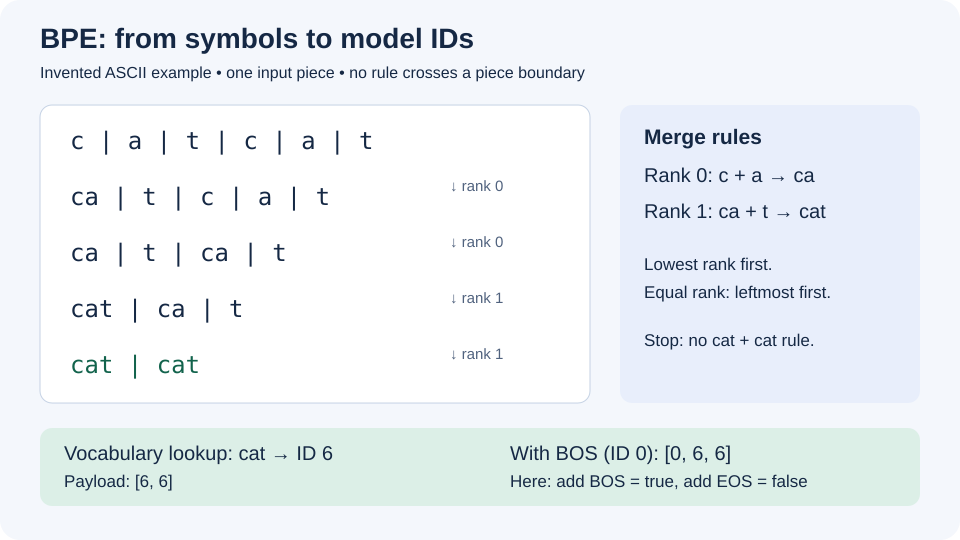

# D.1: turn vocabulary metadata into BPE token IDs

This tutorial explains the planned tokenizer in [roadmap item D.1](../ROADMAP.md#d-tokenizer).
By the end, you should be able to trace a small input through ranked merges,
map the result to vocabulary IDs, and explain where BOS/EOS markers belong.
No model download is needed for the worked example.

**Status:** Marmotte reads tokenizer metadata through `Gguf.read`, but has no
BPE tokenizer API yet. The steps below describe the intended design and a
hand-worked example, not an executable Marmotte tokenization feature. D.1
remains unchecked. The existing `info` command can inspect a real file today.

## 1. Find the tokenizer's ingredients

If you have a GGUF file and the .NET 10 SDK, run this from the repository root,
replacing the path with your file:

```sh
dotnet run --project src/Marmotte.Cli -- info "/path/to/model.gguf" --metadata --tensor-limit 0
```

Look for `tokenizer.ggml.*`. The output previews arrays rather than printing
the whole vocabulary; the complete values remain available in `model.Metadata`
after `Gguf.readFile`. Inspection reads the index, without loading weights.

| Metadata suffix after `tokenizer.ggml.` | Type | Meaning |
| --- | --- | --- |
| `model` | string | Tokenizer family; `gpt2` denotes a BPE family |
| `tokens` | string array | Array position is the model's token ID |
| `token_type` | int32 array | Parallel token categories, when present |
| `merges` | string array | Ordered pair-merge rules |
| `bos_token_id`, `eos_token_id` | uint32 | Beginning/end markers |
| `unknown_token_id`, `separator_token_id`, `padding_token_id` | uint32 | Other special roles, when supplied |
| `pre` | string | Pre-tokenizer profile, such as `tekken` |
| `add_bos_token`, `add_eos_token` | bool | Automatic marker insertion policy |

Token types distinguish normal (1), unknown (2), control (3), user-defined (4),
unused (5), and byte (6) entries. A present type array must align with the
vocabulary. Token scores, when supplied, are separate from merge ranks.
Vocabulary and special-ID fields are described in the
[GGUF tokenizer specification](https://github.com/ggml-org/ggml/blob/master/docs/gguf.md#tokenizer);
profile and insertion keys are listed in the
[metadata constants](https://github.com/ggml-org/llama.cpp/blob/master/gguf-py/gguf/constants.py).

For Marmotte's planned loader, keep missing values distinguishable from explicit
values. Reject an unsupported profile instead of silently selecting another.
Validate array types and lengths, special-ID bounds, and ambiguous duplicate
entries before constructing lookup tables. Any profile defaults must be
explicitly documented as defaults, rather than reported as file metadata.

## 2. Follow one small example

Imagine one already separated input piece, `catcat`. Our invented vocabulary is:

| ID | Stored spelling | Role in this example |
| --- | --- | --- |
| 0 | `<bos>` | Control marker |
| 1 | `<eos>` | Control marker |
| 2 | `c` | Ordinary token |
| 3 | `a` | Ordinary token |
| 4 | `t` | Ordinary token |
| 5 | `ca` | Ordinary token |
| 6 | `cat` | Ordinary token |

Its entire merge list is `c a`, then `ca t`: their ranks are 0 and 1.
These are illustrative IDs and rules, not values from Ministral.



Start with `c | a | t | c | a | t`. Select the available adjacent pair with the
lowest rank, breaking ties from left to right, and repeat after each merge:

| Step | Symbols | Reason |
| --- | --- | --- |
| 0 | `c · a · t · c · a · t` | Initial symbols |
| 1 | `ca · t · c · a · t` | Leftmost rank-0 pair |
| 2 | `ca · t · ca · t` | Remaining rank-0 pair beats rank 1 |
| 3 | `cat · ca · t` | Leftmost rank-1 pair |
| 4 | `cat · cat` | Remaining rank-1 pair |

There is no `cat cat` rule, so merging stops. Vocabulary lookup gives `[6; 6]`.
A merge rank chooses an operation; a token ID selects a vocabulary entry.
They are different numbers with different purposes. The ranked-pair ordering
and tie rule follow the
[reference BPE implementation](https://github.com/ggml-org/llama.cpp/blob/master/src/llama-vocab.cpp).

This example uses ASCII to keep the symbols readable. A byte-level tokenizer
must handle UTF-8 bytes and its profile's reversible byte-to-symbol mapping;
splitting a .NET string into UTF-16 `char` values is not an equivalent algorithm.
Do not add normalization, trimming, or whitespace splitting as a convenience:
those choices can change the IDs presented to the model.

### Try a sentence: `Hello, how are you ?`

Use a **second, invented tokenizer** for this walkthrough. Its vocabulary and
merge rules are independent of the `catcat` example. These are not measured
Ministral or Tekken results; real token IDs require the model's exact tokenizer.

Assume this teaching pre-tokenizer produces the following pieces. Here `␠`
is a visible notation for one ordinary space, not a literal character inserted
into the input or a prescribed byte-to-symbol encoding:

```text
Hello, how are you ?
          ↓ assumed piece boundaries
[Hello] [,] [␠how] [␠are] [␠you] [␠?]
```

For this example, the complete ordered merge list is:

| Rank | Pair → merged symbol | Rank | Pair → merged symbol |
| --- | --- | --- | --- |
| 0 | `H + e → He` | 6 | `a + r → ar` |
| 1 | `He + l → Hel` | 7 | `ar + e → are` |
| 2 | `Hel + l → Hell` | 8 | `␠ + are → ␠are` |
| 3 | `Hell + o → Hello` | 9 | `y + o → yo` |
| 4 | `h + o → ho` | 10 | `yo + u → you` |
| 5 | `ho + w → how` | 11 | `␠ + you → ␠you` |

The vocabulary contains every initial and merged symbol. Its final entries
have the illustrative IDs below; intermediate entries have other distinct IDs.
Apply the rules within each piece, then concatenate the resulting ID sequences:

| Piece | Merge progression | Final IDs |
| --- | --- | --- |
| `Hello` | `H · e · l · l · o → He · l · l · o → Hel · l · o → Hell · o → Hello` | `[20]` |
| `,` | No applicable rule | `[21]` |
| `␠how` | `␠ · h · o · w → ␠ · ho · w → ␠ · how` | `[22; 23]` |
| `␠are` | `␠ · a · r · e → ␠ · ar · e → ␠ · are → ␠are` | `[24]` |
| `␠you` | `␠ · y · o · u → ␠ · yo · u → ␠ · you → ␠you` | `[25]` |
| `␠?` | No applicable rule | `[22; 26]` |

Notice that one piece can produce several tokens: `␠how` stays as a space
(ID 22) followed by `how` (ID 23), because there is no merge for that pair.
Conversely, `␠are` and `␠you` each include their leading space in one token.

```text
Tokens:  [Hello] [,] [␠] [how] [␠are] [␠you] [␠] [?]
IDs:     [ 20;    21; 22;  23;    24;     25;   22; 26 ]
```

Joining those token spellings, with `␠` restored to a space, gives exactly
`Hello, how are you ?`, including the space before `?`. With an invented BOS
ID of 0, BOS insertion enabled and EOS insertion disabled, the model input
would be `[0; 20; 21; 22; 23; 24; 25; 22; 26]`.

## 3. Apply the sequence policy

For the invented vocabulary, explicitly choose `add_bos_token = true` and
`add_eos_token = false`. Wrapping the payload once gives `[0; 6; 6]`.
With both flags enabled it would give `[0; 6; 6; 1]`. A defined EOS ID alone
does not imply that every prompt ends with EOS.

The planned API should distinguish automatic boundary insertion from recognition
of special-token spellings inside input text. Test these decisions separately,
including empty input and text containing `<bos>`. Keep markers out of ordinary
pair merging, and make ownership of wrapping explicit so callers do not insert
BOS twice. Chat rendering belongs to D.4.

The resulting IDs will select rows in `token_embd.weight` through
[`EmbeddingLookup`](kernels.md). In our invented example, rows 0, 6 and 6 would
be selected in that order; tokenization itself does not read those weight rows.

## 4. Keep D.1's boundary visible

D.1 covers vocabulary loading, BPE merging and special-token policy. D.2 supplies
Tekken pre-tokenization; merges must stay within its pieces. D.3 reconstructs
UTF-8 text, including sequences split between tokens. D.4 formats conversations.
Implementing the worked merge loop alone will not make the target model usable.

There is another compatibility detail to check with D.2: the reference Tekken
profile enables a whole-piece vocabulary shortcut before ordinary merging
(`ignore_merges`). A generic merge-only example does not capture that behavior.
The profile also supplies defaults which explicit metadata may override. See
[the profile selection and BPE session logic](https://github.com/ggml-org/llama.cpp/blob/master/src/llama-vocab.cpp).

For the future implementation, keep the format-neutral tokenizer data and
algorithm in Core, with GGUF metadata interpretation in `Marmotte.Gguf`.
Construction should use metadata only and retain the reader's allocation limits.
The exact public API and exception contract remain to be designed.

## 5. Turn the example into acceptance cases

When implementing D.1, use small independently specified fixtures:

- Expect `[6; 6]` for the toy piece and `[0; 6; 6]` with the stated wrapping policy.
- Exercise competing ranks, repeated pairs, ties, and a piece with no applicable merge.
- Reject invalid IDs, mismatched arrays and malformed merge entries; explicitly
  define how absent optional fields and unsupported token categories are handled.
- Check whitespace, non-ASCII bytes, empty input and literal special-token text.
- Once D.2 exists, compare exact token IDs for a fixed corpus against the target
  tokenizer, including pieces already present in the vocabulary. A text round
  trip alone cannot prove that the segmentation matches.

The upstream sources linked above were consulted on 2026-11-08. They are moving
branches; pin the revision used for compatibility fixtures when D.1 is implemented.
