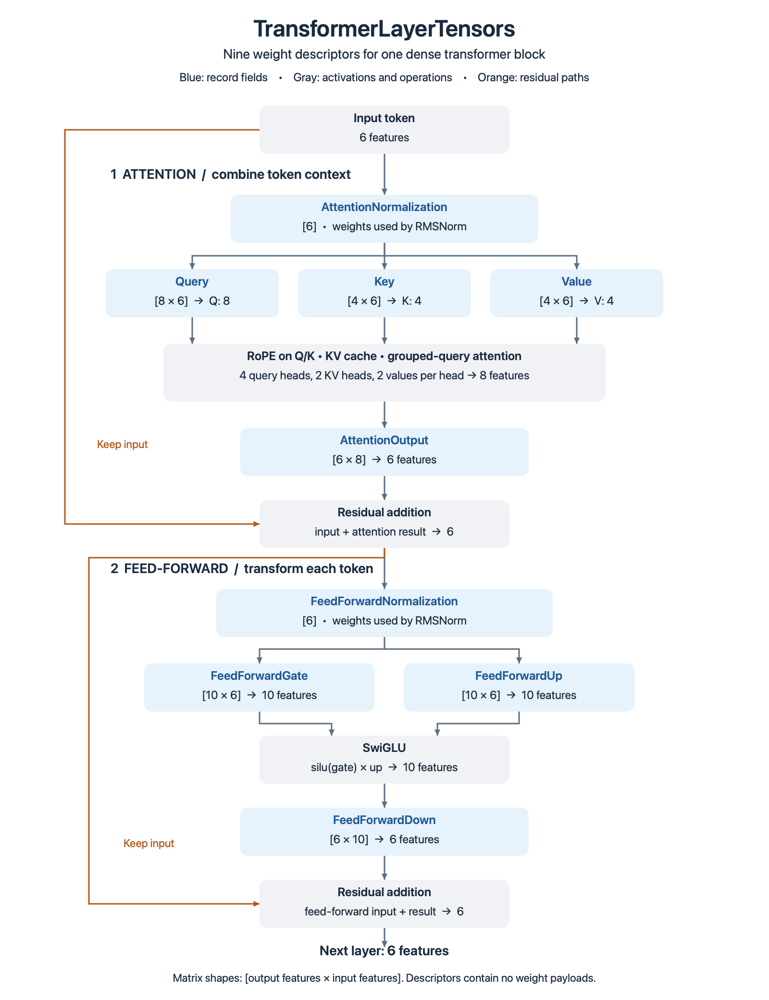

# Understanding TransformerLayerTensors

`TransformerLayerTensors` groups the **nine weight descriptors of one dense
transformer block**. Each descriptor identifies a tensor by its name, row-major
shape and stored encoding. It contains no weight payload and performs no
computation. The diagram shows where these weights will be used during a forward
pass; it does not imply that the inference pipeline is already implemented.



## Read the shapes

The illustration uses the same small dimensions as the layout tests: an embedding
width of 6, four query heads and two key-value heads of two values each, and a
feed-forward width of 10. These are illustrative dimensions, not the real target
model's dimensions.

Matrix shapes are **[output features; input features]** in Core's row-major order.
For example, `Query` with shape `[8; 6]` transforms a token's six input values
into eight query values. GGUF stores this matrix's dimensions as `[6; 8]`;
`GgufTensorSource.descriptor` reverses the dimension list without moving any bytes.
Normalization weights are vectors with one learned scale per embedding feature.

## Follow one token through the block

1. **Normalize for attention.** `AttentionNormalization` supplies the six learned
   scales used by RMS normalization. The normalized activation still has six values.
2. **Project Q, K and V.** `Query`, `Key` and `Value` are three separate matrices
   applied to that activation. Q describes what the token searches for, K how a
   token is matched, and V the information attention can retrieve. Four query heads
   share two key-value heads, so Q has eight values while K and V each have four.
3. **Combine context.** RoPE rotates Q and K; K and V enter the cache. Causal
   grouped-query attention uses the current token and earlier tokens to produce
   eight values. `AttentionOutput` projects them back to six, then a residual
   addition adds the original block input.
4. **Normalize for the feed-forward network.** `FeedForwardNormalization` supplies
   another six learned scales. It is a distinct weight vector from the first norm.
5. **Expand and gate.** `FeedForwardGate` and `FeedForwardUp` each project the same
   normalized activation to ten values. SwiGLU combines them element by element:
   `silu(gate) * up`, where `silu(x) = x / (1 + exp(-x))`.
6. **Return to the embedding width.** `FeedForwardDown` projects ten values back
   to six. A second residual addition adds the input of the feed-forward stage.
   The next transformer block therefore receives six values per token again.

RoPE, cache access, attention, SwiGLU and residual addition are operations, not
fields in `TransformerLayerTensors`. Q/K/V activations are also different from
the `Query`, `Key` and `Value` weight descriptors. The weights are shared across
all tokens; the activations depend on each input token and its context.

## What C.2 validates

`GgufModelTensorLayout.read index` reads the model configuration, resolves GGUF
names such as `blk.0.attn_q.weight`, checks their shapes, and puts each descriptor
in its corresponding field. Layers are returned in block-index order, even when
the file lists its tensors in a different order. No weights are loaded.

The mapping currently supports dense, bias-free `mistral3` with separate Q/K/V
matrices. Missing, duplicate, unexpected and incorrectly shaped tensors are
rejected. Unknown encodings remain unknown; successful shape validation does not
establish that a backend can execute the weights.

Token embeddings, final output normalization and the vocabulary output matrix
belong to `ModelTensorLayout`, outside this per-layer record. If `output.weight`
is absent, the model layout reuses the token embedding descriptor for output.

```fsharp
open Marmotte.Gguf

let index = Gguf.readFile "model.gguf"
let layout = GgufModelTensorLayout.read index
let firstLayer = layout.Layers[0]
printfn "%s: %A" firstLayer.Query.Name firstLayer.Query.Shape
```

## Related contracts

- [Model configuration and tensor shape mapping](model-configuration.md#tensor-roles-and-shape-validation)
- [Execution tensors and kernels](kernels.md)
- [Core record definitions](../src/Marmotte.Core/ModelTensorLayout.fs)
- [GGUF layout mapping](../src/Marmotte.Gguf/GgufModelTensorLayout.fs)
- [Independent layout fixtures](../tests/Marmotte.Gguf.Tests/ModelTensorLayoutTests.fs)

The architecture reference and verification date are recorded in the
[model configuration documentation](model-configuration.md#tensor-roles-and-shape-validation).
